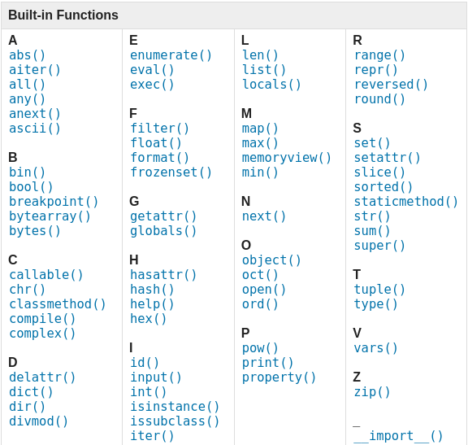
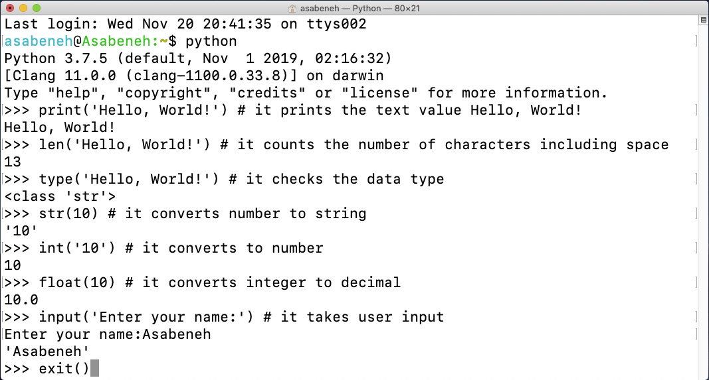
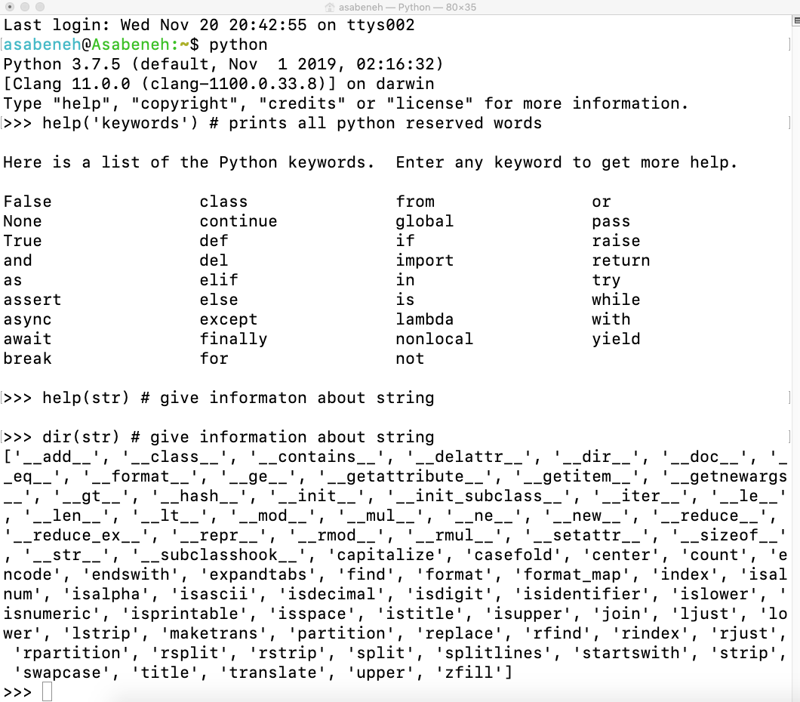
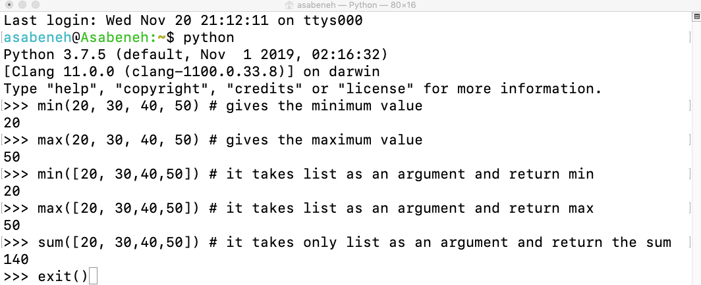

<div align="center">
  <h1> 30 дней Python: День 2 - Переменные, встроенные функции</h1>
  <a class="header-badge" target="_blank" href="https://www.linkedin.com/in/asabeneh/">
  
  </a>
  <a class="header-badge" target="_blank" href="https://twitter.com/Asabeneh">
  
  </a>

<sub>Автор:
<a href="https://www.linkedin.com/in/asabeneh/" target="_blank">Асабенех Йетаех</a><br>
<small> Второе издание: июль 2021</small>
</sub>

</div>

[<< День 1](../readme.md) | [День 3 >>](../03_Day_Operators/03_operators.md)


- [📘 День 2](#-день-2)
  - [Встроенные функции](#встроенные-функции)
  - [Переменные](#переменные)
    - [Объявление нескольких переменных в одной строке](#объявление-нескольких-переменных-в-одной-строке)
  - [Типы данных](#типы-данных)
  - [Проверка типов данных и приведение](#проверка-типов-данных-и-приведение)
  - [Числа](#числа)
  - [💻 Упражнения - День 2](#-упражнения---день-2)
    - [Упражнения: Уровень 1](#упражнения-уровень-1)
    - [Упражнения: Уровень 2](#упражнения-уровень-2)

# 📘 День 2

## Встроенные функции

В Python много встроенных функций. Встроенные функции доступны вам глобально, то есть вы можете использовать их без импорта или настройки. Некоторые из наиболее часто используемых встроенных функций Python: _print()_, _len()_, _type()_, _int()_, _float()_, _str()_, _input()_, _list()_, _dict()_, _min()_, _max()_, _sum()_, _sorted()_, _open()_, _file()_, _help()_ и _dir()_. В следующей таблице вы увидите исчерпывающий список встроенных функций Python, взятый из [документации Python](https://docs.python.org/3/library/functions.html).



Давайте откроем оболочку Python и начнём использовать некоторые из наиболее распространённых встроенных функций.



Давайте потренируемся больше, используя разные встроенные функции.



Как вы можете видеть из терминала выше, в Python есть зарезервированные слова. Мы не используем зарезервированные слова для объявления переменных или функций. Мы рассмотрим переменные в следующем разделе.

Я полагаю, к настоящему моменту вы знакомы со встроенными функциями. Давайте выполним ещё одну практику встроенных функций и перейдём к следующему разделу.



## Переменные

Переменные хранят данные в памяти компьютера. Во многих языках программирования рекомендуется использовать мнемонические переменные. Мнемоническая переменная - это имя переменной, которое легко запомнить, и которое легко ассоциируется с чем-то. Переменная ссылается на адрес памяти, в котором хранятся данные.
Цифра в начале, специальный символ, дефис не допускаются при именовании переменной. Переменная может иметь короткое имя (например, x, y, z), но более описательное имя (firstname, lastname, age, country) настоятельно рекомендуется.

Правила именования переменных в Python

- Имя переменной должно начинаться с буквы или символа подчёркивания
- Имя переменной не может начинаться с цифры
- Имя переменной может содержать только буквенно-цифровые символы и подчёркивания (A-z, 0-9 и \_ )
- Имена переменных чувствительны к регистру (firstname, Firstname, FirstName и FIRSTNAME - это разные переменные)

Вот несколько примеров допустимых имён переменных:

```shell
firstname
lastname
age
country
city
first_name
last_name
capital_city
_if # если мы хотим использовать зарезервированное слово как переменную
year_2021
year2021
current_year_2021
birth_year
num1
num2
```

Недопустимые имена переменных

```shell
first-name
first@name
first$name
num-1
1num
```

Мы будем использовать стандартный стиль именования переменных Python, который был принят многими разработчиками Python. Разработчики Python используют соглашение об именовании переменных snake case (snake_case). Мы используем символ подчёркивания после каждого слова для переменной, содержащей более одного слова (например, first_name, last_name, engine_rotation_speed). Пример ниже - это пример стандартного именования переменных, подчёркивание требуется, когда имя переменной состоит более чем из одного слова.

Когда мы присваиваем переменной определённый тип данных, это называется объявлением переменной. Например, в примере ниже моё имя (first name) присваивается переменной first_name. Знак равенства - это оператор присваивания. Присваивание означает сохранение данных в переменной. Знак равенства в Python - это не равенство, как в математике.

_Пример:_

```py
# Переменные в Python
first_name = 'Asabeneh'
last_name = 'Yetayeh'
country = 'Finland'
city = 'Helsinki'
age = 250
is_married = True
skills = ['HTML', 'CSS', 'JS', 'React', 'Python']
person_info = {
   'firstname':'Asabeneh',
   'lastname':'Yetayeh',
   'country':'Finland',
   'city':'Helsinki'
   }
```

Давайте используем встроенные функции _print()_ и _len()_. Функция print принимает неограниченное количество аргументов. Аргумент - это значение, которое можно передать или поместить внутрь скобок функции, см. пример ниже.

**Пример:**

```py
print('Hello, World!') # Текст Hello, World! - это аргумент
print('Hello',',', 'World','!') # она может принимать несколько аргументов, передано четыре аргумента
print(len('Hello, World!')) # она принимает только один аргумент
```

Давайте выведем на печать и найдём длину переменных, объявленных выше:

**Пример:**

```py
# Вывод значений, хранящихся в переменных

print('First name:', first_name)
print('First name length:', len(first_name))
print('Last name: ', last_name)
print('Last name length: ', len(last_name))
print('Country: ', country)
print('City: ', city)
print('Age: ', age)
print('Married: ', is_married)
print('Skills: ', skills)
print('Person information: ', person_info)
```

### Объявление нескольких переменных в одной строке

Несколько переменных также могут быть объявлены в одной строке:

**Пример:**

```py
first_name, last_name, country, age, is_married = 'Asabeneh', 'Yetayeh', 'Helsink', 250, True

print(first_name, last_name, country, age, is_married)
print('First name:', first_name)
print('Last name: ', last_name)
print('Country: ', country)
print('Age: ', age)
print('Married: ', is_married)
```

Получение пользовательского ввода с помощью встроенной функции _input()_. Давайте присвоим данные, которые мы получаем от пользователя, переменным first_name и age.
**Пример:**

```py
first_name = input('What is your name: ')
age = input('How old are you? ')

print(first_name)
print(age)
```

## Типы данных

В Python существует несколько типов данных. Для определения типа данных мы используем встроенную функцию _type_. Я хотел бы попросить вас сосредоточиться на хорошем понимании различных типов данных. Когда дело доходит до программирования, всё связано с типами данных. Я представил типы данных в самом начале, и они снова появляются, потому что каждая тема связана с типами данных. Мы рассмотрим типы данных более подробно в соответствующих разделах.

## Проверка типов данных и преобразование типов

- Проверка типов данных: чтобы проверить тип данных определённых данных/переменной, мы используем _type_
  **Примеры:**

```py
# Различные типы данных Python
# Давайте объявим переменные с различными типами данных

first_name = 'Asabeneh'     # str
last_name = 'Yetayeh'       # str
country = 'Finland'         # str
city= 'Helsinki'            # str
age = 250                   # int, это не мой настоящий возраст, не беспокойтесь об этом

# Вывод типов
print(type('Asabeneh'))          # str
print(type(first_name))          # str
print(type(10))                  # int
print(type(3.14))                # float
print(type(1 + 1j))              # complex
print(type(True))                # bool
print(type([1, 2, 3, 4]))        # list
print(type({'name':'Asabeneh'})) # dict
print(type((1,2)))               # tuple
print(type(zip([1,2],[3,4])))    # zip
```

- Преобразование типов (casting): преобразование одного типа данных в другой тип данных. Мы используем _int()_, _float()_, _str()_, _list_, _set_
  Когда мы выполняем арифметические операции, строковые числа должны быть сначала преобразованы в int или float, иначе будет возвращена ошибка. Если мы объединяем число со строкой, число должно быть сначала преобразовано в строку. Мы поговорим о конкатенации в разделе о строках.

  **Примеры:**

```py
# int в float
num_int = 10
print('num_int',num_int)         # 10
num_float = float(num_int)
print('num_float:', num_float)   # 10.0

# float в int
gravity = 9.81
print(int(gravity))             # 9

# int в str
num_int = 10
print(num_int)                  # 10
num_str = str(num_int)
print(num_str)                  # '10'

# str в int или float
num_str = '10.6'
num_float = float(num_str)  # Сначала преобразуем строку в число с плавающей точкой
num_int = int(num_float)    # Затем преобразуем число с плавающей точкой в целое число
print('num_int', int(num_str))      # 10
print('num_float', float(num_str))  # 10.6
num_int = int(num_float)
print('num_int', int(num_int))      # 10

# str в list
first_name = 'Asabeneh'
print(first_name)               # 'Asabeneh'
first_name_to_list = list(first_name)
print(first_name_to_list)            # ['A', 's', 'a', 'b', 'e', 'n', 'e', 'h']
```

## Числа

Числовые типы данных в Python:

1. Целые числа: Целые (отрицательные, нулевые и положительные) числа
   Пример:
   ... -3, -2, -1, 0, 1, 2, 3 ...

2. Числа с плавающей точкой (десятичные числа)
   Пример:
   ... -3.5, -2.25, -1.0, 0.0, 1.1, 2.2, 3.5 ...

3. Комплексные числа
   Пример:
   1 + j, 2 + 4j, 1 - 1j

🌕 Ты великолепен. Ты только что завершил испытания второго дня, и ты на два шага впереди на пути к величию. Теперь выполни несколько упражнений для своего мозга и мышц.

## 💻 Упражнения - День 2

### Упражнения: Уровень 1

1. Внутри 30DaysOfPython создай папку с именем day_2. Внутри этой папки создай файл с именем variables.py
2. Напиши комментарий на Python: «Day 2: 30 Days of python programming»
3. Объяви переменную с именем first_name (имя) и присвой ей значение
4. Объяви переменную с именем last_name (фамилия) и присвой ей значение
5. Объяви переменную с именем full_name (полное имя) и присвой ей значение
6. Объяви переменную с именем country и присвой ей значение
7. Объяви переменную с именем city и присвой ей значение
8. Объяви переменную с именем age и присвой ей значение
9. Объяви переменную с именем year и присвой ей значение
10. Объяви переменную is_married и присвой ей значение
11. Объяви переменную is_true и присвой ей значение
12. Объяви переменную is_light_on и присвой ей значение
13. Объяви несколько переменных в одной строке

### Упражнения: Уровень 2

1. Проверь тип данных всех своих переменных с помощью встроенной функции type()
2. Используя встроенную функцию _len()_, найди длину своего имени
3. Сравни длину своего имени и своей фамилии
4. Объяви 5 как num_one и 4 как num_two
5. Сложи num_one и num_two и присвой значение переменной total (итог)
6. Вычти num_two из num_one и присвой значение переменной diff
7. Умножь num_two на num_one и присвой значение переменной product
8. Раздели num_one на num_two и присвой значение переменной division
9. Используй деление по модулю, чтобы найти остаток от деления num_two на num_one (num_two % num_one), и присвой значение переменной remainder
10. Вычисли num_one в степени num_two и присвой значение переменной exp
11. Найди целочисленное деление num_one на num_two и присвой значение переменной floor_division
12. Радиус круга равен 30 метрам.
    1. Вычисли площадь круга и присвой значение переменной с именем _area_of_circle_
    2. Вычисли длину окружности и присвой значение переменной с именем _circum_of_circle_
    3. Прими радиус как пользовательский ввод и вычисли площадь.
13. Используй встроенную функцию input, чтобы получить имя, фамилию, страну и возраст от пользователя, и сохрани значения в соответствующие переменные
14. Запусти help('keywords') в оболочке Python или в своём файле, чтобы проверить зарезервированные слова или ключевые слова Python

🎉 ПОЗДРАВЛЯЕМ! 🎉

[<< День 1](../readme.md) | [День 3 >>](../03_Day_Operators/03_operators.md)
