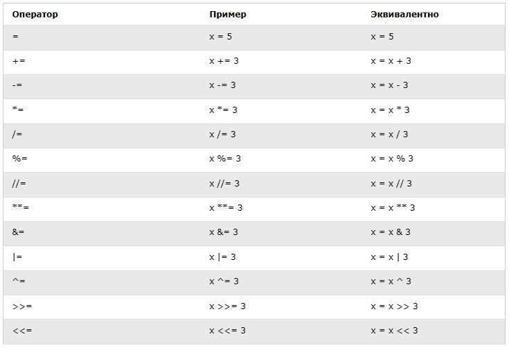
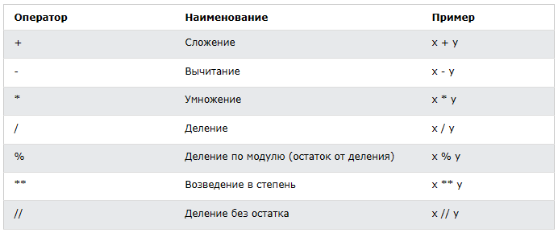
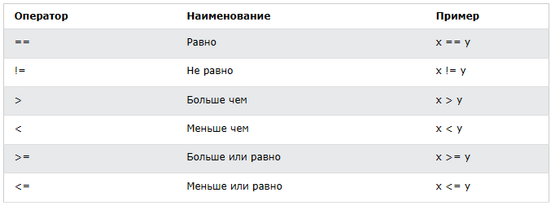
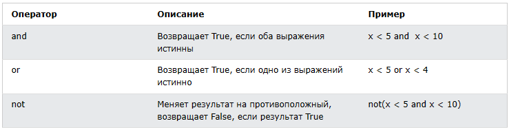

<div align="center">
  <h1> 30 дней Python: День 3 - Операторы</h1>
  <a class="header-badge" target="_blank" href="https://www.linkedin.com/in/asabeneh/">
  
  </a>
  <a class="header-badge" target="_blank" href="https://twitter.com/Asabeneh">
  
  </a>

<sub>Автор:
<a href="https://www.linkedin.com/in/asabeneh/" target="_blank">Асабенех Йетаех</a><br>
<small> Второе издание: июль 2021</small>
</sub>
</div>

[<< День 2](../02_Day_Variables_builtin_functions/02_variables_builtin_functions.md) | [День 4 >>](../04_Day_Strings/04_strings.md)


- [📘 День 3](#-день-3)
  - [Логический тип](#логический-тип)
  - [Операторы](#операторы)
    - [Операторы присваивания](#операторы-присваивания)
    - [Арифметические операторы](#арифметические-операторы)
    - [Операторы сравнения](#операторы-сравнения)
    - [Логические операторы](#логические-операторы)
  - [💻 Упражнения - День 3](#-упражнения---день-3)

# 📘 День 3

## Логический тип

Логический тип данных (boolean) представляет одно из двух значений: _True_ или _False_. Использование этих типов данных станет понятным, когда мы начнём использовать оператор сравнения. Первая буква **T** для True и **F** для False должна быть заглавной, в отличие от JavaScript.
**Пример: логические значения**

```py
print(True)
print(False)
```

## Операторы

Язык Python поддерживает несколько типов операторов. В этом разделе мы сосредоточимся на нескольких из них.

### Операторы присваивания

Операторы присваивания используются для присвоения значений переменным. Возьмём в качестве примера знак =. Знак равенства в математике показывает, что два значения равны, однако в Python он означает, что мы сохраняем значение в определённой переменной, и это называется присваиванием или присвоением значения переменной. В таблице ниже показаны различные типы операторов присваивания Python, взятые из [w3school](https://www.w3schools.com/python/python_operators.asp).



### Арифметические операторы

- Сложение(+): a + b
- Вычитание(-): a - b
- Умножение(*): a * b
- Деление(/): a / b
- Остаток от деления (%): a % b
- Целочисленное деление(//): a // b
- Возведение в степень(**): a ** b



**Пример: целые числа**

```py
# Арифметические операции в Python
# Целые числа

print('Addition: ', 1 + 2)        # 3
print('Subtraction: ', 2 - 1)     # 1
print('Multiplication: ', 2 * 3)  # 6
print ('Division: ', 4 / 2)       # 2.0  Деление в Python даёт число с плавающей точкой
print('Division: ', 6 / 2)        # 3.0         
print('Division: ', 7 / 2)        # 3.5
print('Division without the remainder: ', 7 // 2)   # 3, даёт без плавающей точки или без остатка
print ('Division without the remainder: ',7 // 3)   # 2
print('Modulus: ', 3 % 2)         # 1, даёт остаток
print('Exponentiation: ', 2 ** 3) # 8, это означает 2 * 2 * 2
```

**Пример: числа с плавающей точкой**

```py
# Числа с плавающей точкой
print('Floating Point Number, PI', 3.14)
print('Floating Point Number, gravity', 9.81)
```

**Пример: комплексные числа**

```py
# Комплексные числа
print('Complex number: ', 1 + 1j)
print('Multiplying complex numbers: ',(1 + 1j) * (1 - 1j))
```

Давайте объявим переменную и присвоим ей числовой тип данных. Я собираюсь использовать односимвольную переменную, но помните, не вырабатывайте привычку объявлять переменные такого типа. Имена переменных должны быть всегда мнемоническими.

**Пример:**

```python
# Объявление переменной в самом начале

a = 3 # a - имя переменной, а 3 - целое число
b = 2 # b - имя переменной, а 2 - целое число

# Арифметические операции и присваивание результата переменной
total = a + b
diff = a - b
product = a * b
division = a / b
remainder = a % b
floor_division = a // b
exponential = a ** b

# Мне следовало бы использовать sum вместо total, но sum - встроенная функция - старайтесь избегать переопределения встроенных функций
print(total) # если не подписать вывод строкой, никогда не узнаешь, откуда берётся результат
print('a + b = ', total)
print('a - b = ', diff)
print('a * b = ', product)
print('a / b = ', division)
print('a % b = ', remainder)
print('a // b = ', floor_division)
print('a ** b = ', exponential)
```

**Пример:**

```py
print('== Addition, Subtraction, Multiplication, Division, Modulus ==')

# Объявление значений и их группировка вместе
num_one = 3
num_two = 4

# Арифметические операции
total = num_one + num_two
diff = num_two - num_one
product = num_one * num_two
div = num_two / num_one
remainder = num_two % num_one

# Вывод значений с подписью
print('total: ', total)
print('difference: ', diff)
print('product: ', product)
print('division: ', div)
print('remainder: ', remainder)
```

Давайте начнём связывать всё воедино и использовать то, что мы уже знаем, для расчётов (площадь, объём, плотность, вес, периметр, расстояние, сила).

**Пример:**

```py
# Вычисление площади круга
radius = 10                                 # радиус круга
area_of_circle = 3.14 * radius ** 2         # два знака * означают степень или возведение в степень
print('Area of a circle:', area_of_circle)

# Вычисление площади прямоугольника
length = 10
width = 20
area_of_rectangle = length * width
print('Area of rectangle:', area_of_rectangle)

# Вычисление веса объекта
mass = 75
gravity = 9.81
weight = mass * gravity
print(weight, 'N')                         # Добавление единицы измерения к весу

# Вычисление плотности жидкости
mass = 75 # в кг
volume = 0.075 # в кубических метрах
density = mass / volume # 1000 Kg/m^3
print(density, 'Kg/m^3') # Добавление единицы измерения к плотности

```

### Операторы сравнения

В программировании мы сравниваем значения, используя операторы сравнения для сравнения двух значений. Мы проверяем, больше ли значение, меньше или равно другому значению. В следующей таблице показаны операторы сравнения Python, взятые из [w3school](https://www.w3schools.com/python/python_operators.asp).


**Пример: операторы сравнения**

```py
print(3 > 2)     # True, потому что 3 больше 2
print(3 >= 2)    # True, потому что 3 больше 2
print(3 < 2)     # False, потому что 3 больше 2
print(2 < 3)     # True, потому что 2 меньше 3
print(2 <= 3)    # True, потому что 2 меньше 3
print(3 == 2)    # False, потому что 3 не равно 2
print(3 != 2)    # True, потому что 3 не равно 2
print(len('mango') == len('avocado'))  # False
print(len('mango') != len('avocado'))  # True
print(len('mango') < len('avocado'))   # True
print(len('milk') != len('meat'))      # False
print(len('milk') == len('meat'))      # True
print(len('tomato') == len('potato'))  # True
print(len('python') > len('dragon'))   # False


# Сравнение чего-либо даёт либо True, либо False

print('True == True: ', True == True)
print('True == False: ', True == False)
print('False == False:', False == False)
```

В дополнение к приведённым выше операторам сравнения Python использует:

- _is_: Возвращает true, если обе переменные являются одним и тем же объектом (x is y)
- _is not_: Возвращает true, если обе переменные не являются одним и тем же объектом (x is not y)
- _in_: Возвращает True, если проверяемый список содержит определённый элемент (x in y)
- _not in_: Возвращает True, если проверяемый список не содержит определённый элемент (x not in y)

```py
print('1 is 1', 1 is 1)                   # True - потому что значения данных одинаковые
print('1 is not 2', 1 is not 2)           # True - потому что 1 не равно 2
print('A in Asabeneh', 'A' in 'Asabeneh') # True - A найдена в строке
print('B not in Asabeneh', 'B' in 'Asabeneh') # False - нет заглавной B
print('coding' in 'coding for all') # True - потому что coding for all содержит слово coding
print('a in an:', 'a' in 'an')      # True
print('4 is 2 ** 2:', 4 is 2 ** 2)   # True
```

### Логические операторы

В отличие от других языков программирования Python использует ключевые слова _and_, _or_ и _not_ для логических операторов. Логические операторы используются для объединения условных операторов:



```py
print(3 > 2 and 4 > 3) # True - потому что оба утверждения истинны
print(3 > 16 and 4 > 31) # False - потому что одно утверждение ложно
print(3 > 2 and 4 < 3) # False - потому что второе утверждение ложно
print(3 < 2 and 4 < 3) # False - потому что оба утверждения ложны
print('True and True: ', True and True)
print(3 > 2 or 4 > 3)  # True - потому что оба утверждения истинны
print(3 > 2 or 4 < 3)  # True - потому что одно из утверждений истинно
print(3 < 2 or 4 < 3)  # False - потому что оба утверждения ложны
print('True or False:', True or False)
print(not 3 > 2)     # False - потому что 3 > 2 истинно, затем not True даёт False
print(not True)      # False - Отрицание, оператор not превращает true в false
print(not False)     # True
print(not not True)  # True
print(not not False) # False

```

🌕 У тебя безграничная энергия. Ты только что завершил испытания третьего дня, и ты на три шага впереди на пути к величию. Теперь выполни несколько упражнений для своего мозга и мышц.

## 💻 Упражнения - День 3

Важно: после того как вы выполните каждое задание, отобразите или распечатайте результат. После каждого задания выведите результат в консоль. Используйте ввод данных через `input()` там, где это требуется в формулировке задания.

1. Объяви свой возраст как переменную целочисленного типа
2. Объяви свой рост как переменную с плавающей точкой
3. Объяви переменную, которая хранит комплексное число
4. Напиши скрипт, который запрашивает у пользователя основание и высоту треугольника и вычисляет площадь этого треугольника (area = 0.5 x b x h).

```py
Enter base: 20
Enter height: 10
The area of the triangle is 100
```

5. Напиши скрипт, который запрашивает у пользователя стороны a, b и c треугольника. Вычисли периметр треугольника (perimeter = a + b + c).

```py
Enter side a: 5
Enter side b: 4
Enter side c: 3
The perimeter of the triangle is 12
```

6. Получи длину и ширину прямоугольника с помощью prompt. Вычисли его площадь (area = length x width) и периметр (perimeter = 2 x (length + width))
7. Получи радиус круга с помощью prompt. Вычисли площадь (area = pi x r x r) и окружность (c = 2 x pi x r), где pi = 3.14.
8. Вычисли наклон (slope), точку пересечения с осью x (x-intercept) и точку пересечения с осью y (y-intercept) для y = 2x -2
9. Наклон равен (m = y2-y1/x2-x1). Найди наклон и [евклидово расстояние](https://en.wikipedia.org/wiki/Euclidean_distance#:~:text=In%20mathematics%2C%20the%20Euclidean%20distance,being%20called%20the%20Pythagorean%20distance.) между точкой (2, 2) и точкой (6,10) 
10. Сравни наклоны в задачах 8 и 9.
11. Вычисли значение y (y = x^2 + 6x + 9). Попробуй использовать разные значения x и выясни, при каком значении x y будет равно 0.
12. Найди длину 'python' и 'dragon' и составь ложное утверждение сравнения.
13. Используй оператор _and_, чтобы проверить, находится ли 'on' в обоих 'python' и 'dragon'
14. _I hope this course is not full of jargon_. Используй оператор _in_, чтобы проверить, есть ли _jargon_ в этом предложении.
15. 'on' отсутствует и в dragon, и в python
16. Найди длину текста _python_ и преобразуй значение в float, а затем в строку
17. Чётные числа делятся на 2, и остаток равен нулю. Как проверить, является ли число чётным, используя Python?
18. Проверь, равно ли целочисленное деление 7 на 3 преобразованному в int значению 2.7.
19. Проверь, равен ли тип '10' типу 10
20. Проверь, равно ли int('9.8') числу 10
21. Напиши скрипт, который запрашивает у пользователя количество часов и ставку за час. Вычисли заработную плату человека?

```py
Enter hours: 40
Enter rate per hour: 28
Your weekly earning is 1120
```

22. Напиши скрипт, который запрашивает у пользователя количество лет. Вычисли количество секунд, которые человек может прожить. Предположим, что человек может прожить сто лет

```py
Enter number of years you have lived: 100
You have lived for 3153600000 seconds.
```

23. Напиши скрипт на Python, который выводит следующую таблицу

```py
1 1 1 1 1
2 1 2 4 8
3 1 3 9 27
4 1 4 16 64
5 1 5 25 125
```

🎉 ПОЗДРАВЛЯЕМ! 🎉

[<< День 2](../02_Day_Variables_builtin_functions/02_variables_builtin_functions.md) | [День 4 >>](../04_Day_Strings/04_strings.md)
