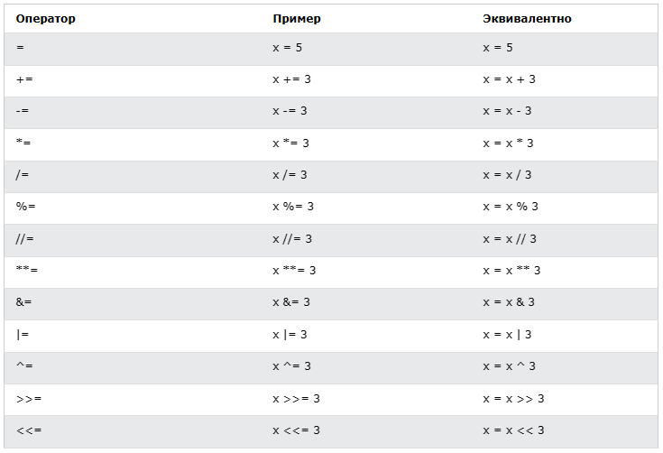
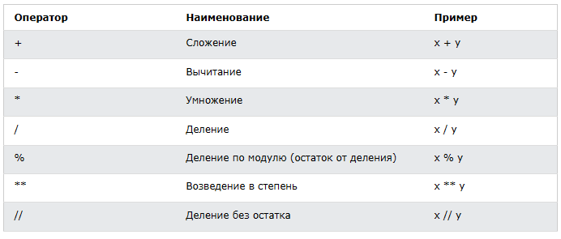
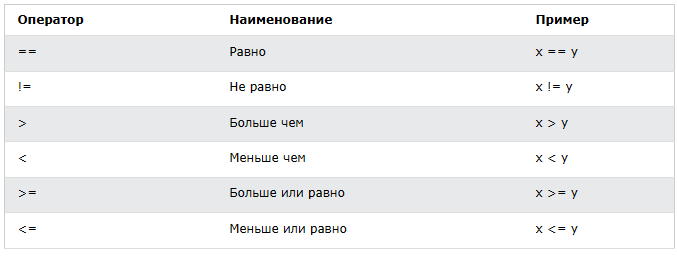
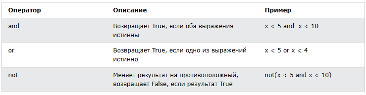

<div align="center">
  <h1> 30 Days Of Python: День 3 - Операторы</h1>
  <a class="header-badge" target="_blank" href="https://www.linkedin.com/in/asabeneh/">
  
  </a>
  <a class="header-badge" target="_blank" href="https://twitter.com/Asabeneh">
  
  </a>

<sub>Автор:
<a href="https://www.linkedin.com/in/asabeneh/" target="_blank">Asabeneh Yetayeh</a><br>
<small> Второе издание: июль 2021</small>
</sub>
</div>

[<< День 2](./02_variables_builtin_functions_ru.md) | [День 4 >>](./04_strings_ru.md)


- [📘 День 3](#-день-3)
  - [Логический тип](#логический-тип)
  - [Операторы](#операторы)
    - [Операторы присваивания](#операторы-присваивания)
    - [Арифметические операторы:](#арифметические-операторы)
    - [Операторы сравнения](#операторы-сравнения)
    - [Логические операторы](#логические-операторы)
  - [💻 Упражнения - День 3](#-упражнения---день-3)

# 📘 День 3

## Логический тип

Логический тип данных представляет одно из двух значений: _True_ или _False_. Использование этих типов данных станет понятным, как только мы начнём использовать оператор сравнения. Первая буква **T** в True и **F** в False должна быть заглавной, в отличие от JavaScript.
**Пример: логические значения**

```py
print(True)
print(False)
```

## Операторы

Язык Python поддерживает несколько типов операторов. В этом разделе мы сосредоточимся на некоторых из них.

### Операторы присваивания

Операторы присваивания используются для присваивания значений переменным. Возьмём для примера =. Знак равенства в математике показывает, что два значения равны, однако в Python он означает, что мы сохраняем значение в определённой переменной, и мы называем это присваиванием или присвоением значения переменной. В таблице ниже приведены различные типы операторов присваивания Python, взятые с [w3school](https://www.w3schools.com/python/python_operators.asp).



### Арифметические операторы:

- Сложение (+): a + b
- Вычитание (-): a - b
- Умножение (*): a * b
- Деление (/): a / b
- Модуль (%): a % b
- Целочисленное деление (//): a // b
- Возведение в степень (**): a ** b



**Пример: целые числа**

```py
# Арифметические операции в Python
# Целые числа

print('Addition: ', 1 + 2)        # 3
print('Subtraction: ', 2 - 1)     # 1
print('Multiplication: ', 2 * 3)  # 6
print ('Division: ', 4 / 2)       # 2.0  Деление в Python даёт число с плавающей точкой
print('Division: ', 6 / 2)        # 3.0         
print('Division: ', 7 / 2)        # 3.5
print('Division without the remainder: ', 7 // 2)   # 3,  даёт без числа с плавающей точкой или без остатка
print ('Division without the remainder: ',7 // 3)   # 2
print('Modulus: ', 3 % 2)         # 1, даёт остаток
print('Exponentiation: ', 2 ** 3) # 8, это означает 2 * 2 * 2
```

**Пример: числа с плавающей точкой**

```py
# Числа с плавающей точкой
print('Floating Point Number, PI', 3.14)
print('Floating Point Number, gravity', 9.81)
```

**Пример: комплексные числа**

```py
# Комплексные числа
print('Complex number: ', 1 + 1j)
print('Multiplying complex numbers: ',(1 + 1j) * (1 - 1j))
```

Давайте объявим переменную и присвоим ей числовой тип данных. Я собираюсь использовать переменную из одного символа, но помните: не вырабатывайте привычку объявлять такие переменные. Имена переменных всегда должны быть мнемоническими.

**Пример:**

```python
# Сначала объявляем переменную

a = 3 # a — имя переменной, а 3 — целочисленный тип данных
b = 2 # b — имя переменной, а 3 — целочисленный тип данных

# Арифметические операции и присваивание результата переменной
total = a + b
diff = a - b
product = a * b
division = a / b
remainder = a % b
floor_division = a // b
exponential = a ** b

# Мне следовало использовать sum вместо total, но sum — встроенная функция — старайтесь не переопределять встроенные функции
print(total) # если вы не подпишете print какой-нибудь строкой, вы никогда не узнаете, откуда пришёл результат
print('a + b = ', total)
print('a - b = ', diff)
print('a * b = ', product)
print('a / b = ', division)
print('a % b = ', remainder)
print('a // b = ', floor_division)
print('a ** b = ', exponential)
```

**Пример:**

```py
print('== Addition, Subtraction, Multiplication, Division, Modulus ==')

# Объявляем значения и организуем их вместе
num_one = 3
num_two = 4

# Арифметические операции
total = num_one + num_two
diff = num_two - num_one
product = num_one * num_two
div = num_two / num_one
remainder = num_two % num_one

# Вывод значений с метками
print('total: ', total)
print('difference: ', diff)
print('product: ', product)
print('division: ', div)
print('remainder: ', remainder)
```

Давайте начнём соединять точки и использовать то, что мы уже знаем, для вычислений (площадь, объём, плотность, вес, периметр, расстояние, сила).

**Пример:**

```py
# Вычисление площади круга
radius = 10                                 # радиус круга
area_of_circle = 3.14 * radius ** 2         # два знака * означают возведение в степень
print('Area of a circle:', area_of_circle)

# Вычисление площади прямоугольника
length = 10
width = 20
area_of_rectangle = length * width
print('Area of rectangle:', area_of_rectangle)

# Вычисление веса объекта
mass = 75
gravity = 9.81
weight = mass * gravity
print(weight, 'N')                         # Добавляем единицу измерения к весу

# Вычисление плотности жидкости
mass = 75 # в кг
volume = 0.075 # в кубических метрах
density = mass / volume # 1000 Kg/m^3
print(density, 'Kg/m^3') # Добавляем единицу измерения к плотности

```

### Операторы сравнения

В программировании мы сравниваем значения, мы используем операторы сравнения, чтобы сравнить два значения. Мы проверяем, больше ли значение, меньше или равно другому значению. В следующей таблице показаны операторы сравнения Python, взятые с [w3shool](https://www.w3schools.com/python/python_operators.asp).


**Пример: операторы сравнения**

```py
print(3 > 2)     # True, потому что 3 больше 2
print(3 >= 2)    # True, потому что 3 больше 2
print(3 < 2)     # False, потому что 3 больше 2
print(2 < 3)     # True, потому что 2 меньше 3
print(2 <= 3)    # True, потому что 2 меньше 3
print(3 == 2)    # False, потому что 3 не равно 2
print(3 != 2)    # True, потому что 3 не равно 2
print(len('mango') == len('avocado'))  # False
print(len('mango') != len('avocado'))  # True
print(len('mango') < len('avocado'))   # True
print(len('milk') != len('meat'))      # False
print(len('milk') == len('meat'))      # True
print(len('tomato') == len('potato'))  # True
print(len('python') > len('dragon'))   # False


# Сравнение чего-либо даёт либо True, либо False

print('True == True: ', True == True)
print('True == False: ', True == False)
print('False == False:', False == False)
```

В дополнение к вышеуказанным операторам сравнения Python использует:

- _is_: возвращает true, если обе переменные являются одним и тем же объектом (x is y)
- _is not_: возвращает true, если обе переменные не являются одним и тем же объектом (x is not y)
- _in_: возвращает True, если запрашиваемый список содержит определённый элемент (x in y)
- _not in_: возвращает True, если в запрашиваемом списке нет определённого элемента (x not in y)

```py
print('1 is 1', 1 is 1)                   # True - потому что значения данных одинаковы
print('1 is not 2', 1 is not 2)           # True - потому что 1 не 2
print('A in Asabeneh', 'A' in 'Asabeneh') # True - A найден в строке
print('B not in Asabeneh', 'B' in 'Asabeneh') # False - заглавной B нет
print('coding' in 'coding for all') # True - потому что coding for all содержит слово coding
print('a in an:', 'a' in 'an')      # True
print('4 is 2 ** 2:', 4 is 2 ** 2)   # True
```

### Логические операторы

В отличие от других языков программирования, Python использует ключевые слова _and_, _or_ и _not_ для логических операторов. Логические операторы используются для объединения условных выражений:



```py
print(3 > 2 and 4 > 3) # True - потому что оба выражения истинны
print(3 > 2 and 4 < 3) # False - потому что второе выражение ложно
print(3 < 2 and 4 < 3) # False - потому что оба выражения ложны
print('True and True: ', True and True)
print(3 > 2 or 4 > 3)  # True - потому что оба выражения истинны
print(3 > 2 or 4 < 3)  # True - потому что одно из выражений истинно
print(3 < 2 or 4 < 3)  # False - потому что оба выражения ложны
print('True or False:', True or False)
print(not 3 > 2)     # False - потому что 3 > 2 истинно, тогда not True даёт False
print(not True)      # False - отрицание, оператор not превращает true в false
print(not False)     # True
print(not not True)  # True
print(not not False) # False

```

🌕 У вас безграничная энергия. Вы только что завершили испытания дня 3, и вы на три шага ближе к величию. Теперь сделайте несколько упражнений для своего мозга и мышц.

## 💻 Упражнения - День 3

1. Объявите ваш возраст как целочисленную переменную
2. Объявите ваш рост как переменную с плавающей точкой
3. Объявите переменную, которая хранит комплексное число
4. Напишите скрипт, который просит пользователя ввести основание и высоту треугольника, и вычислите площадь этого треугольника (area = 0.5 x b x h).

```py
    Enter base: 20
    Enter height: 10
    The area of the triangle is 100
```

5. Напишите скрипт, который просит пользователя ввести сторону a, сторону b и сторону c треугольника. Вычислите периметр треугольника (perimeter = a + b + c).

```py
Enter side a: 5
Enter side b: 4
Enter side c: 3
The perimeter of the triangle is 12
```

6. Получите длину и ширину прямоугольника с помощью запроса. Вычислите его площадь (area = length x width) и периметр (perimeter = 2 x (length + width))
7. Получите радиус круга с помощью запроса. Вычислите площадь (area = pi x r x r) и длину окружности (c = 2 x pi x r), где pi = 3.14.
8. Вычислите наклон, точку пересечения с осью x и точку пересечения с осью y для y = 2x -2
9. Наклон — это (m = y2-y1/x2-x1). Найдите наклон и [евклидово расстояние](https://en.wikipedia.org/wiki/Euclidean_distance#:~:text=In%20mathematics%2C%20the%20Euclidean%20distance,being%20called%20the%20Pythagorean%20distance.) между точкой (2, 2) и точкой (6,10) 
10. Сравните наклоны в задачах 8 и 9.
11. Вычислите значение y (y = x^2 + 6x + 9). Попробуйте использовать разные значения x и выясните, при каком значении x y будет равно 0.
12. Найдите длину 'python' и 'dragon' и составьте ложное утверждение для сравнения.
13. Используйте оператор _and_, чтобы проверить, встречается ли 'on' и в 'python', и в 'dragon'
14. _Надеюсь, этот курс не полон жаргона_. Используйте оператор _in_, чтобы проверить, есть ли _jargon_ в этом предложении.
15. Нет 'on' ни в dragon, ни в python
16. Найдите длину текста _python_ и преобразуйте значение в float, а затем в строку
17. Чётные числа делятся на 2 без остатка. Как проверить, является ли число чётным или нет, используя Python?
18. Проверьте, равно ли целочисленное деление 7 на 3 значению 2.7, преобразованному в int.
19. Проверьте, равен ли тип '10' типу 10
20. Проверьте, равно ли int('9.8') числу 10
21. Напишите скрипт, который просит пользователя ввести количество часов и ставку в час. Вычислите оплату труда человека?

```py
Enter hours: 40
Enter rate per hour: 28
Your weekly earning is 1120
```

22. Напишите скрипт, который просит пользователя ввести количество лет. Вычислите количество секунд, которое человек может прожить. Предположим, что человек может прожить сто лет

```py
Enter number of years you have lived: 100
You have lived for 3153600000 seconds.
```

23. Напишите скрипт на Python, который отображает следующую таблицу

```py
1 1 1 1 1
2 1 2 4 8
3 1 3 9 27
4 1 4 16 64
5 1 5 25 125
```

🎉 ПОЗДРАВЛЯЕМ ! 🎉

[<< День 2](./02_variables_builtin_functions_ru.md) | [День 4 >>](./04_strings_ru.md)
