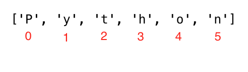

<div align="center">
  <h1> 30 Days Of Python: День 4 - Строки</h1>
  <a class="header-badge" target="_blank" href="https://www.linkedin.com/in/asabeneh/">
  
  </a>
  <a class="header-badge" target="_blank" href="https://twitter.com/Asabeneh">
  
  </a>

<sub>Автор:
<a href="https://www.linkedin.com/in/asabeneh/" target="_blank">Asabeneh Yetayeh</a><br>
<small> Второе издание: июль 2021</small>
</sub>

</div>

[<< День 3](./03_operators_ru.md) | [День 5 >>](./05_lists_ru.md)


- [День 4](#день-4)
  - [Строки](#строки)
    - [Создание строки](#создание-строки)
    - [Конкатенация строк](#конкатенация-строк)
    - [Управляющие последовательности в строках](#управляющие-последовательности-в-строках)
    - [Форматирование строк](#форматирование-строк)
      - [Форматирование строк в старом стиле (оператор %)](#форматирование-строк-в-старом-стиле-оператор-)
      - [Форматирование строк в новом стиле (str.format)](#форматирование-строк-в-новом-стиле-strformat)
      - [Интерполяция строк / f-строки (Python 3.6+)](#интерполяция-строк--f-строки-python-36)
    - [Строки Python как последовательности символов](#строки-python-как-последовательности-символов)
      - [Распаковка символов](#распаковка-символов)
      - [Доступ к символам строки по индексу](#доступ-к-символам-строки-по-индексу)
      - [Срезы строк Python](#срезы-строк-python)
      - [Обратный порядок строки](#обратный-порядок-строки)
      - [Пропуск символов при срезе](#пропуск-символов-при-срезе)
    - [Методы строк](#методы-строк)
  - [💻 Упражнения - День 4](#-упражнения---день-4)

# День 4

## Строки

Текст — это строковый тип данных. Любые данные, записанные как текст, являются строкой. Любые данные в одинарных, двойных или тройных кавычках — это строки. Существуют различные методы строк и встроенные функции для работы со строковыми типами данных. Чтобы проверить длину строки, используйте метод len().

### Создание строки

```py
letter = 'P'                # Строка может быть одним символом или набором текстов
print(letter)               # P
print(len(letter))          # 1
greeting = 'Hello, World!'  # Строку можно создать с помощью одинарных или двойных кавычек, "Hello, World!"
print(greeting)             # Hello, World!
print(len(greeting))        # 13
sentence = "I hope you are enjoying 30 days of Python Challenge"
print(sentence)
```

Многострочная строка создаётся с помощью тройных одинарных (''') или тройных двойных кавычек ("""). Смотрите пример ниже.

```py
multiline_string = '''I am a teacher and enjoy teaching.
I didn't find anything as rewarding as empowering people.
That is why I created 30 days of python.'''
print(multiline_string)

# Другой способ сделать то же самое
multiline_string = """I am a teacher and enjoy teaching.
I didn't find anything as rewarding as empowering people.
That is why I created 30 days of python."""
print(multiline_string)
```

### Конкатенация строк

Мы можем соединять строки вместе. Объединение или соединение строк называется конкатенацией. Смотрите пример ниже:

```py
first_name = 'Asabeneh'
last_name = 'Yetayeh'
space = ' '
full_name = first_name  +  space + last_name
print(full_name) # Asabeneh Yetayeh
# Проверка длины строки с помощью встроенной функции len()
print(len(first_name))  # 8
print(len(last_name))   # 7
print(len(first_name) > len(last_name)) # True
print(len(full_name)) # 16
```

### Управляющие последовательности в строках

В Python и других языках программирования обратная косая черта \ перед символом является управляющей последовательностью. Давайте рассмотрим наиболее распространённые управляющие символы:

- \n: новая строка
- \t: табуляция (8 пробелов) 
- \\\\: обратная косая черта
- \\': одинарная кавычка (')
- \\": двойная кавычка (")

Теперь давайте рассмотрим использование приведённых выше управляющих последовательностей на примерах.

```py
print('I hope everyone is enjoying the Python Challenge.\nAre you ?') # Перенос строки
print('Days\tTopics\tExercises') # Добавление табуляции или 4 пробелов
print('Day 1\t5\t5')
print('Day 2\t6\t20')
print('Day 3\t5\t23')
print('Day 4\t1\t35')
print('This is a backslash  symbol (\\)') # Чтобы написать обратную косую черту
print('In every programming language it starts with \"Hello, World!\"') # Чтобы написать двойную кавычку внутри одинарной

# вывод
I hope every one is enjoying the Python Challenge.
Are you ?
Days  Topics  Exercises
Day 1	5	    5
Day 2	6	    20
Day 3	5	    23
Day 4	1	    35
This is a backslash  symbol (\)
In every programming language it starts with "Hello, World!"
```

### Форматирование строк

#### Форматирование строк в старом стиле (оператор %)

В Python есть много способов форматирования строк. В этом разделе мы рассмотрим некоторые из них.
Оператор "%" используется для форматирования набора переменных, заключённых в "кортеж" (список фиксированного размера), вместе со строкой формата, которая содержит обычный текст вместе со "спецификаторами аргументов" — специальными символами, такими как "%s", "%d", "%f", "%.<small>количество цифр</small>f".

- %s - строка (или любой объект, имеющий строковое представление, например числа)
- %d - целые числа
- %f - числа с плавающей запятой
- "%.<small>количество цифр</small>f" - числа с плавающей запятой с фиксированной точностью

```py
# Только строки
first_name = 'Asabeneh'
last_name = 'Yetayeh'
language = 'Python'
formated_string = 'I am %s %s. I teach %s' %(first_name, last_name, language)
print(formated_string)

# Строки и числа
radius = 10
pi = 3.14
area = pi * radius ** 2
formated_string = 'The area of circle with a radius %d is %.2f.' %(radius, area) # 2 означает 2 значащие цифры после точки

python_libraries = ['Django', 'Flask', 'NumPy', 'Matplotlib','Pandas']
formated_string = 'The following are python libraries:%s' % (python_libraries)
print(formated_string) # "The following are python libraries:['Django', 'Flask', 'NumPy', 'Matplotlib','Pandas']"
```

#### Форматирование строк в новом стиле (str.format)

Этот формат был представлен в Python версии 3.

```py

first_name = 'Asabeneh'
last_name = 'Yetayeh'
language = 'Python'
formated_string = 'I am {} {}. I teach {}'.format(first_name, last_name, language)
print(formated_string)
a = 4
b = 3

print('{} + {} = {}'.format(a, b, a + b))
print('{} - {} = {}'.format(a, b, a - b))
print('{} * {} = {}'.format(a, b, a * b))
print('{} / {} = {:.2f}'.format(a, b, a / b)) # ограничивает двумя цифрами после запятой
print('{} % {} = {}'.format(a, b, a % b))
print('{} // {} = {}'.format(a, b, a // b))
print('{} ** {} = {}'.format(a, b, a ** b))

# вывод
4 + 3 = 7
4 - 3 = 1
4 * 3 = 12
4 / 3 = 1.33
4 % 3 = 1
4 // 3 = 1
4 ** 3 = 64

# Строки и числа
radius = 10
pi = 3.14
area = pi * radius ** 2
formated_string = 'The area of a circle with a radius {} is {:.2f}.'.format(radius, area) # 2 цифры после запятой
print(formated_string)

```

#### Интерполяция строк / f-строки (Python 3.6+)

Ещё один новый способ форматирования строк — интерполяция строк, f-строки. Строки начинаются с f, и мы можем вставлять данные в соответствующие позиции.

```py
a = 4
b = 3
print(f'{a} + {b} = {a +b}')
print(f'{a} - {b} = {a - b}')
print(f'{a} * {b} = {a * b}')
print(f'{a} / {b} = {a / b:.2f}')
print(f'{a} % {b} = {a % b}')
print(f'{a} // {b} = {a // b}')
print(f'{a} ** {b} = {a ** b}')
```

### Строки Python как последовательности символов

Строки Python — это последовательности символов, и они разделяют основные методы доступа с другими упорядоченными последовательностями объектов в Python — списками и кортежами. Самый простой способ извлечь отдельные символы из строк (и отдельные элементы из любой последовательности) — распаковать их в соответствующие переменные.

#### Распаковка символов

```
language = 'Python'
a,b,c,d,e,f = language # распаковка символов последовательности в переменные
print(a) # P
print(b) # y
print(c) # t
print(d) # h
print(e) # o
print(f) # n
```

#### Доступ к символам строки по индексу

В программировании отсчёт начинается с нуля. Поэтому первая буква строки находится по нулевому индексу, а последняя буква строки — это длина строки минус один.



```py
language = 'Python'
first_letter = language[0]
print(first_letter) # P
second_letter = language[1]
print(second_letter) # y
last_index = len(language) - 1
last_letter = language[last_index]
print(last_letter) # n
```

Если мы хотим начать с правого конца, мы можем использовать отрицательную индексацию. -1 — это последний индекс.

```py
language = 'Python'
last_letter = language[-1]
print(last_letter) # n
second_last = language[-2]
print(second_last) # o
```

#### Срезы строк Python

В Python мы можем нарезать строки на подстроки.

```py
language = 'Python'
first_three = language[0:3] # начинается с нулевого индекса и до 3, но не включает 3
print(first_three) #Pyt
last_three = language[3:6]
print(last_three) # hon
# Другой способ
last_three = language[-3:]
print(last_three)   # hon
last_three = language[3:]
print(last_three)   # hon
```

#### Обратный порядок строки

Мы можем легко перевернуть строки в Python.

```py
greeting = 'Hello, World!'
print(greeting[::-1]) # !dlroW ,olleH
```

#### Пропуск символов при срезе

Можно пропускать символы при срезе, передав аргумент шага в метод среза.

```py
language = 'Python'
pto = language[0:6:2] #
print(pto) # Pto
```

### Методы строк

Существует множество методов строк, которые позволяют нам форматировать строки. Смотрите некоторые методы строк в следующем примере:

- capitalize(): преобразует первый символ строки в заглавную букву

```py
challenge = 'thirty days of python'
print(challenge.capitalize()) # 'Thirty days of python'
```

- count(): возвращает количество вхождений подстроки в строке, count(substring, start=.., end=..). Start — начальный индекс для подсчёта, а end — последний индекс для подсчёта.

```py
challenge = 'thirty days of python'
print(challenge.count('y')) # 3
print(challenge.count('y', 7, 14)) # 1, 
print(challenge.count('th')) # 2`
```

- endswith(): проверяет, заканчивается ли строка указанным окончанием

```py
challenge = 'thirty days of python'
print(challenge.endswith('on'))   # True
print(challenge.endswith('tion')) # False
```

- expandtabs(): заменяет символ табуляции пробелами, размер табуляции по умолчанию — 8. Принимает аргумент размера табуляции

```py
challenge = 'thirty\tdays\tof\tpython'
print(challenge.expandtabs())   # 'thirty  days    of      python'
print(challenge.expandtabs(10)) # 'thirty    days      of        python'
```

- find(): возвращает индекс первого вхождения подстроки, если не найдено, возвращает -1

```py
challenge = 'thirty days of python'
print(challenge.find('y'))  # 5
print(challenge.find('th')) # 0
```

- rfind(): возвращает индекс последнего вхождения подстроки, если не найдено, возвращает -1

```py
challenge = 'thirty days of python'
print(challenge.rfind('y'))  # 16
print(challenge.rfind('th')) # 17
```

- format(): форматирует строку в более красивый вывод  
   Подробнее о форматировании строк смотрите по этой [ссылке](https://www.programiz.com/python-programming/methods/string/format)

```py
first_name = 'Asabeneh'
last_name = 'Yetayeh'
age = 250
job = 'teacher'
country = 'Finland'
sentence = 'I am {} {}. I am a {}. I am {} years old. I live in {}.'.format(first_name, last_name, job, age, country)
print(sentence) # I am Asabeneh Yetayeh. I am 250 years old. I am a teacher. I live in Finland.

radius = 10
pi = 3.14
area = pi * radius ** 2
result = 'The area of a circle with radius {} is {}'.format(str(radius), str(area))
print(result) # The area of a circle with radius 10 is 314
```

- index(): возвращает наименьший индекс подстроки, дополнительные аргументы указывают начальный и конечный индекс (по умолчанию 0 и длина строки - 1). Если подстрока не найдена, возникает ошибка valueError. 

```py
challenge = 'thirty days of python'
sub_string = 'da'
print(challenge.index(sub_string))  # 7
print(challenge.index(sub_string, 9)) # ошибка
```

- rindex(): возвращает наибольший индекс подстроки, дополнительные аргументы указывают начальный и конечный индекс (по умолчанию 0 и длина строки - 1)

```py
challenge = 'thirty days of python'
sub_string = 'da'
print(challenge.rindex(sub_string))  # 7
print(challenge.rindex(sub_string, 9)) # ошибка
print(challenge.rindex('on', 8)) # 19
```

- isalnum(): проверяет алфавитно-цифровые символы

```py
challenge = 'ThirtyDaysPython'
print(challenge.isalnum()) # True

challenge = '30DaysPython'
print(challenge.isalnum()) # True

challenge = 'thirty days of python'
print(challenge.isalnum()) # False, пробел не является алфавитно-цифровым символом

challenge = 'thirty days of python 2019'
print(challenge.isalnum()) # False
```

- isalpha(): проверяет, являются ли все элементы строки буквами алфавита (a-z и A-Z)

```py
challenge = 'thirty days of python'
print(challenge.isalpha()) # False, пробел снова исключён
challenge = 'ThirtyDaysPython'
print(challenge.isalpha()) # True
num = '123'
print(num.isalpha())      # False
```

- isdecimal(): проверяет, являются ли все символы в строке десятичными (0-9)

```py
challenge = 'thirty days of python'
print(challenge.isdecimal())  # False
challenge = '123'
print(challenge.isdecimal())  # True
challenge = '\u00B2'
print(challenge.isdigit())   # True 
challenge = '12 3'
print(challenge.isdecimal())  # False, пробел не допускается
```

- isdigit(): проверяет, являются ли все символы в строке числами (0-9 и некоторые другие числовые символы Unicode)

```py
challenge = 'Thirty'
print(challenge.isdigit()) # False
challenge = '30'
print(challenge.isdigit())   # True
challenge = '\u00B2'
print(challenge.isdigit())   # True
```

- isnumeric(): проверяет, являются ли все символы в строке числами или связанными с числами (так же, как isdigit(), но принимает больше символов, например ½)

```py
num = '10'
print(num.isnumeric()) # True
num = '\u00BD' # ½
print(num.isnumeric()) # True
num = '10.5'
print(num.isnumeric()) # False
```

- isidentifier(): проверяет допустимый идентификатор — проверяет, является ли строка допустимым именем переменной

```py
challenge = '30DaysOfPython'
print(challenge.isidentifier()) # False, потому что начинается с числа
challenge = 'thirty_days_of_python'
print(challenge.isidentifier()) # True
```

- islower(): проверяет, являются ли все буквенные символы в строке строчными

```py
challenge = 'thirty days of python'
print(challenge.islower()) # True
challenge = 'Thirty days of python'
print(challenge.islower()) # False
```

- isupper(): проверяет, являются ли все буквенные символы в строке заглавными

```py
challenge = 'thirty days of python'
print(challenge.isupper()) #  False
challenge = 'THIRTY DAYS OF PYTHON'
print(challenge.isupper()) # True
```

- join(): возвращает объединённую строку

```py
web_tech = ['HTML', 'CSS', 'JavaScript', 'React']
result = ' '.join(web_tech)
print(result) # 'HTML CSS JavaScript React'
```

```py
web_tech = ['HTML', 'CSS', 'JavaScript', 'React']
result = '# '.join(web_tech)
print(result) # 'HTML# CSS# JavaScript# React'
```

- strip(): удаляет все заданные символы с начала и конца строки

```py
challenge = 'thirty days of pythoonnn'
print(challenge.strip('noth')) # 'irty days of py'
```

- replace(): заменяет подстроку заданной строкой

```py
challenge = 'thirty days of python'
print(challenge.replace('python', 'coding')) # 'thirty days of coding'
```

- split(): разбивает строку, используя заданную строку или пробел в качестве разделителя

```py
challenge = 'thirty days of python'
print(challenge.split()) # ['thirty', 'days', 'of', 'python']
challenge = 'thirty, days, of, python'
print(challenge.split(', ')) # ['thirty', 'days', 'of', 'python']
```

- title(): возвращает строку с заголовочным регистром

```py
challenge = 'thirty days of python'
print(challenge.title()) # Thirty Days Of Python
```

- swapcase(): преобразует все заглавные символы в строчные, а все строчные символы в заглавные

```py
challenge = 'thirty days of python'
print(challenge.swapcase())   # THIRTY DAYS OF PYTHON
challenge = 'Thirty Days Of Python'
print(challenge.swapcase())  # tHIRTY dAYS oF pYTHON
```

- startswith(): проверяет, начинается ли строка с указанной строки

```py
challenge = 'thirty days of python'
print(challenge.startswith('thirty')) # True

challenge = '30 days of python'
print(challenge.startswith('thirty')) # False
```

🌕 Вы необыкновенный человек, и у вас замечательный потенциал. Вы только что завершили задания дня 4, и вы на четыре шага впереди на пути к величию. А теперь сделайте несколько упражнений для мозга и мышц.

## 💻 Упражнения - День 4

1. Объедините строки 'Thirty', 'Days', 'Of', 'Python' в одну строку 'Thirty Days Of Python'.
2. Объедините строки 'Coding', 'For' , 'All' в одну строку 'Coding For All'.
3. Объявите переменную с именем company и присвойте ей начальное значение "Coding For All".
4. Выведите переменную company с помощью _print()_.
5. Выведите длину строки company с помощью метода _len()_ и _print()_.
6. Измените все символы на заглавные буквы с помощью метода _upper()_.
7. Измените все символы на строчные буквы с помощью метода _lower()_.
8. Используйте методы capitalize(), title(), swapcase() для форматирования значения строки _Coding For All_.
9. Вырежьте (сделайте срез) первое слово из строки _Coding For All_.
10. Проверьте, содержит ли строка _Coding For All_ слово Coding, используя метод index, find или другие методы.
11. Замените слово coding в строке 'Coding For All' на Python.
12. Измените "Python for Everyone" на "Python for All" с помощью метода replace или других методов. 
13. Разбейте строку 'Coding For All', используя пробел в качестве разделителя (split()) .
14. "Facebook, Google, Microsoft, Apple, IBM, Oracle, Amazon" разбейте строку по запятой.
15. Какой символ находится по индексу 0 в строке _Coding For All_.
16. Каков последний индекс строки _Coding For All_.
17. Какой символ находится по индексу 10 в строке "Coding For All".
18. Создайте акроним или аббревиатуру для названия 'Python For Everyone'.
19. Создайте акроним или аббревиатуру для названия 'Coding For All'.
20. Используйте index, чтобы определить позицию первого вхождения C в Coding For All.
21. Используйте index, чтобы определить позицию первого вхождения F в Coding For All.
22. Используйте rfind, чтобы определить позицию последнего вхождения l в Coding For All People.
23. Используйте index или find, чтобы найти позицию первого вхождения слова 'because' в следующем предложении: 'You cannot end a sentence with because because because is a conjunction'
24. Используйте rindex, чтобы найти позицию последнего вхождения слова because в следующем предложении: 'You cannot end a sentence with because because because is a conjunction'
25. Вырежьте фразу 'because because because' в следующем предложении: 'You cannot end a sentence with because because because is a conjunction'
26. Найдите позицию первого вхождения слова 'because' в следующем предложении: 'You cannot end a sentence with because because because is a conjunction'
27. Вырежьте фразу 'because because because' в следующем предложении: 'You cannot end a sentence with because because because is a conjunction'
28. Начинается ли 'Coding For All' с подстроки _Coding_?
29. Заканчивается ли 'Coding For All' подстрокой _coding_?
30. '&nbsp;&nbsp; Coding For All &nbsp;&nbsp;&nbsp; &nbsp;' &nbsp;, удалите пробелы слева и справа в заданной строке.
31. Какая из следующих переменных возвращает True, когда мы используем метод isidentifier():
    - 30DaysOfPython
    - thirty_days_of_python
32. Следующий список содержит названия некоторых библиотек Python: ['Django', 'Flask', 'Bottle', 'Pyramid', 'Falcon']. Объедините список с помощью строки с решёткой и пробелом.
33. Используйте управляющую последовательность новой строки, чтобы разделить следующие предложения.
    ```py
    I am enjoying this challenge.
    I just wonder what is next.
    ```
34. Используйте управляющую последовательность табуляции, чтобы записать следующие строки.
    ```py
    Name      Age     Country   City
    Asabeneh  250     Finland   Helsinki
    ```
35. Используйте метод форматирования строк, чтобы отобразить следующее:

```sh
radius = 10
area = 3.14 * radius ** 2
The area of a circle with radius 10 is 314 meters square.
```

36. Сделайте следующее с помощью методов форматирования строк:

```sh
8 + 6 = 14
8 - 6 = 2
8 * 6 = 48
8 / 6 = 1.33
8 % 6 = 2
8 // 6 = 1
8 ** 6 = 262144
```

🎉 ПОЗДРАВЛЯЕМ ! 🎉

[<< День 3](./03_operators_ru.md) | [День 5 >>](./05_lists_ru.md)


