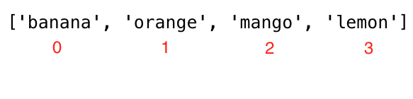
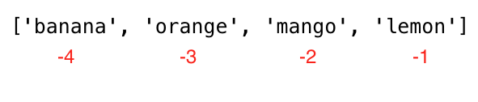

<div align="center">
  <h1> 30 Days Of Python: День 5 - Списки</h1>
  <a class="header-badge" target="_blank" href="https://www.linkedin.com/in/asabeneh/">
  
  </a>
  <a class="header-badge" target="_blank" href="https://twitter.com/Asabeneh">
  
  </a>

<sub>Автор:
<a href="https://www.linkedin.com/in/asabeneh/" target="_blank">Asabeneh Yetayeh</a><br>
<small> Второе издание: июль - 2021</small>
</sub>

</div>

[<< День 4](./04_strings_ru.md) | [День 6 >>](./06_tuples_ru.md)


- [День 5](#день-5)
  - [Списки](#списки)
    - [Как создать список](#как-создать-список)
    - [Доступ к элементам списка с помощью положительной индексации](#доступ-к-элементам-списка-с-помощью-положительной-индексации)
    - [Доступ к элементам списка с помощью отрицательной индексации](#доступ-к-элементам-списка-с-помощью-отрицательной-индексации)
    - [Распаковка элементов списка](#распаковка-элементов-списка)
    - [Срезы элементов списка](#срезы-элементов-списка)
    - [Изменение списков](#изменение-списков)
    - [Проверка элементов в списке](#проверка-элементов-в-списке)
    - [Добавление элементов в список](#добавление-элементов-в-список)
    - [Вставка элементов в список](#вставка-элементов-в-список)
    - [Удаление элементов из списка](#удаление-элементов-из-списка)
    - [Удаление элементов с помощью Pop](#удаление-элементов-с-помощью-pop)
    - [Удаление элементов с помощью Del](#удаление-элементов-с-помощью-del)
    - [Очистка элементов списка](#очистка-элементов-списка)
    - [Копирование списка](#копирование-списка)
    - [Объединение списков](#объединение-списков)
    - [Подсчёт элементов в списке](#подсчёт-элементов-в-списке)
    - [Поиск индекса элемента](#поиск-индекса-элемента)
    - [Обратный порядок списка](#обратный-порядок-списка)
    - [Сортировка элементов списка](#сортировка-элементов-списка)
  - [💻 Упражнения: День 5](#-упражнения-день-5)
    - [Упражнения: Уровень 1](#упражнения-уровень-1)
    - [Упражнения: Уровень 2](#упражнения-уровень-2)

# День 5

## Списки

В Python есть четыре типа данных-коллекций :

- Список: это коллекция, которая упорядочена и изменяема (модифицируема). Допускает повторяющиеся элементы.
- Кортеж: это коллекция, которая упорядочена и неизменяема или немодифицируема (immutable). Допускает повторяющиеся элементы.
- Множество: это коллекция, которая неупорядочена, не индексирована и неизменяема, но мы можем добавлять в множество новые элементы. Повторяющиеся элементы не допускаются.
- Словарь: это коллекция, которая неупорядочена, изменяема (модифицируема) и индексирована. Повторяющиеся элементы не допускаются.

Список — это коллекция различных типов данных, которая упорядочена и изменяема (mutable). Список может быть пустым или содержать элементы разных типов данных.

### Как создать список

В Python мы можем создавать списки двумя способами:

- С помощью встроенной функции list

```py
# синтаксис
lst = list()
```

```py
empty_list = list() # это пустой список, в списке нет элементов
print(len(empty_list)) # 0
```

- С помощью квадратных скобок, []

```py
# синтаксис
lst = []
```

```py
empty_list = [] # это пустой список, в списке нет элементов
print(len(empty_list)) # 0
```

Списки с начальными значениями. Мы используем _len()_, чтобы узнать длину списка.

```py
fruits = ['banana', 'orange', 'mango', 'lemon']                     # список фруктов
vegetables = ['Tomato', 'Potato', 'Cabbage','Onion', 'Carrot']      # список овощей
animal_products = ['milk', 'meat', 'butter', 'yoghurt']             # список продуктов животного происхождения
web_techs = ['HTML', 'CSS', 'JS', 'React','Redux', 'Node', 'MongDB'] # список веб-технологий
countries = ['Finland', 'Estonia', 'Denmark', 'Sweden', 'Norway'] 

# Вывод списков и их длины
print('Fruits:', fruits)
print('Number of fruits:', len(fruits))
print('Vegetables:', vegetables)
print('Number of vegetables:', len(vegetables))
print('Animal products:',animal_products)
print('Number of animal products:', len(animal_products))
print('Web technologies:', web_techs)
print('Number of web technologies:', len(web_techs))
print('Countries:', countries)
print('Number of countries:', len(countries))
```

```sh
вывод
Fruits: ['banana', 'orange', 'mango', 'lemon']
Number of fruits: 4
Vegetables: ['Tomato', 'Potato', 'Cabbage', 'Onion', 'Carrot']
Number of vegetables: 5
Animal products: ['milk', 'meat', 'butter', 'yoghurt']
Number of animal products: 4
Web technologies: ['HTML', 'CSS', 'JS', 'React', 'Redux', 'Node', 'MongDB']
Number of web technologies: 7
Countries: ['Finland', 'Estonia', 'Denmark', 'Sweden', 'Norway']
Number of countries: 5
```

- Списки могут содержать элементы разных типов данных

```py
 lst = ['Asabeneh', 250, True, {'country':'Finland', 'city':'Helsinki'}] # список, содержащий разные типы данных
```

### Доступ к элементам списка с помощью положительной индексации

Мы получаем доступ к каждому элементу списка по его индексу. Индекс списка начинается с 0. На рисунке ниже наглядно показано, с чего начинается индекс


```py
fruits = ['banana', 'orange', 'mango', 'lemon']
first_fruit = fruits[0] # мы получаем доступ к первому элементу по его индексу
print(first_fruit)      # banana
second_fruit = fruits[1]
print(second_fruit)     # orange
last_fruit = fruits[3]
print(last_fruit) # lemon
# Последний индекс
last_index = len(fruits) - 1
last_fruit = fruits[last_index]
```

### Доступ к элементам списка с помощью отрицательной индексации

Отрицательная индексация означает начало с конца: -1 относится к последнему элементу, -2 относится к предпоследнему элементу.



```py
fruits = ['banana', 'orange', 'mango', 'lemon']
first_fruit = fruits[-4]
last_fruit = fruits[-1]
second_last = fruits[-2]
print(first_fruit)      # banana
print(last_fruit)       # lemon
print(second_last)      # mango
```

### Распаковка элементов списка

```py
lst = ['item1','item2','item3', 'item4', 'item5']
first_item, second_item, third_item, *rest = lst
print(first_item)     # item1
print(second_item)    # item2
print(third_item)     # item3
print(rest)           # ['item4', 'item5']

```

```py
# Первый пример
fruits = ['banana', 'orange', 'mango', 'lemon','lime','apple']
first_fruit, second_fruit, third_fruit, *rest = fruits 
print(first_fruit)     # banana
print(second_fruit)    # orange
print(third_fruit)     # mango
print(rest)           # ['lemon','lime','apple']
# Второй пример распаковки списка
first, second, third,*rest, tenth = [1,2,3,4,5,6,7,8,9,10]
print(first)          # 1
print(second)         # 2
print(third)          # 3
print(rest)           # [4,5,6,7,8,9]
print(tenth)          # 10
# Третий пример распаковки списка
countries = ['Germany', 'France','Belgium','Sweden','Denmark','Finland','Norway','Iceland','Estonia']
gr, fr, bg, sw, *scandic, es = countries
print(gr) 
print(fr)
print(bg)
print(sw)
print(scandic)
print(es)
```

### Срезы элементов списка

- Положительная индексация: мы можем указать диапазон положительных индексов, задав начало, конец и шаг, возвращаемое значение будет новым списком. (значения по умолчанию: start = 0, end = len(lst) - 1 (последний элемент), step = 1)

```py
fruits = ['banana', 'orange', 'mango', 'lemon']
all_fruits = fruits[0:4] # возвращает все фрукты
# это также даст тот же результат, что и выше
all_fruits = fruits[0:] # если мы не задаём, где остановиться, берётся всё остальное
orange_and_mango = fruits[1:3] # не включает первый индекс
orange_mango_lemon = fruits[1:]
orange_and_lemon = fruits[::2] # здесь мы использовали третий аргумент, шаг. Он будет брать каждый второй элемент - ['banana', 'mango']
```

- Отрицательная индексация: мы можем указать диапазон отрицательных индексов, задав начало, конец и шаг, возвращаемое значение будет новым списком.

```py
fruits = ['banana', 'orange', 'mango', 'lemon']
all_fruits = fruits[-4:] # возвращает все фрукты
orange_and_mango = fruits[-3:-1] # не включает последний индекс, ['orange', 'mango']
orange_mango_lemon = fruits[-3:] # это даст начиная с -3 до конца, ['orange', 'mango', 'lemon']
reverse_fruits = fruits[::-1] # отрицательный шаг вернёт список в обратном порядке, ['lemon', 'mango', 'orange', 'banana']
```

### Изменение списков

Список — это изменяемая или модифицируемая упорядоченная коллекция элементов. Давайте изменим список фруктов.

```py
fruits = ['banana', 'orange', 'mango', 'lemon']
fruits[0] = 'avocado'
print(fruits)       #  ['avocado', 'orange', 'mango', 'lemon']
fruits[1] = 'apple'
print(fruits)       #  ['avocado', 'apple', 'mango', 'lemon']
last_index = len(fruits) - 1
fruits[last_index] = 'lime'
print(fruits)        #  ['avocado', 'apple', 'mango', 'lime']
```

### Проверка элементов в списке

Проверка, является ли элемент членом списка, с помощью оператора *in*. Смотрите пример ниже.

```py
fruits = ['banana', 'orange', 'mango', 'lemon']
does_exist = 'banana' in fruits
print(does_exist)  # True
does_exist = 'lime' in fruits
print(does_exist)  # False
```

### Добавление элементов в список

Чтобы добавить элемент в конец существующего списка, мы используем метод *append()*.

```py
# синтаксис
lst = list()
lst.append(item)
```

```py
fruits = ['banana', 'orange', 'mango', 'lemon']
fruits.append('apple')
print(fruits)           # ['banana', 'orange', 'mango', 'lemon', 'apple']
fruits.append('lime')   # ['banana', 'orange', 'mango', 'lemon', 'apple', 'lime']
print(fruits)
```

### Вставка элементов в список

Мы можем использовать метод *insert()*, чтобы вставить один элемент по указанному индексу в списке. Обратите внимание, что остальные элементы сдвигаются вправо. Метод *insert()* принимает два аргумента: индекс и элемент для вставки.

```py
# синтаксис
lst = ['item1', 'item2']
lst.insert(index, item)
```

```py
fruits = ['banana', 'orange', 'mango', 'lemon']
fruits.insert(2, 'apple') # вставить apple между orange и mango
print(fruits)           # ['banana', 'orange', 'apple', 'mango', 'lemon']
fruits.insert(3, 'lime')   # ['banana', 'orange', 'apple', 'lime', 'mango', 'lemon']
print(fruits)
```

### Удаление элементов из списка

Метод remove удаляет указанный элемент из списка

```py
# синтаксис
lst = ['item1', 'item2']
lst.remove(item)
```

```py
fruits = ['banana', 'orange', 'mango', 'lemon', 'banana']
fruits.remove('banana')
print(fruits)  # ['orange', 'mango', 'lemon', 'banana'] - этот метод удаляет первое вхождение элемента в списке
fruits.remove('lemon')
print(fruits)  # ['orange', 'mango', 'banana']
```

### Удаление элементов с помощью Pop

Метод *pop()* удаляет указанный индекс (или последний элемент, если индекс не указан):

```py
# синтаксис
lst = ['item1', 'item2']
lst.pop()       # последний элемент
lst.pop(index)
```

```py
fruits = ['banana', 'orange', 'mango', 'lemon']
fruits.pop()
print(fruits)       # ['banana', 'orange', 'mango']

fruits.pop(0)
print(fruits)       # ['orange', 'mango']
```

### Удаление элементов с помощью Del

Ключевое слово *del* удаляет указанный индекс, и его также можно использовать для удаления элементов в диапазоне индексов. Оно также может удалить список полностью

```py
# синтаксис
lst = ['item1', 'item2']
del lst[index] # только один элемент
del lst        # чтобы удалить список полностью
```

```py
fruits = ['banana', 'orange', 'mango', 'lemon', 'kiwi', 'lime']
del fruits[0]
print(fruits)       # ['orange', 'mango', 'lemon', 'kiwi', 'lime']
del fruits[1]
print(fruits)       # ['orange', 'lemon', 'kiwi', 'lime']
del fruits[1:3]     # это удаляет элементы между заданными индексами, поэтому оно не удаляет элемент с индексом 3!
print(fruits)       # ['orange', 'lime']
del fruits
print(fruits)       # Это должно дать: NameError: name 'fruits' is not defined
```

### Очистка элементов списка

Метод *clear()* опустошает список:

```py
# синтаксис
lst = ['item1', 'item2']
lst.clear()
```

```py
fruits = ['banana', 'orange', 'mango', 'lemon']
fruits.clear()
print(fruits)       # []
```

### Копирование списка

Список можно скопировать, переназначив его новой переменной следующим образом: list2 = list1. Теперь list2 — это ссылка на list1, любые изменения, которые мы вносим в list2, также изменят оригинал, list1. Но есть много случаев, когда мы не хотим изменять оригинал, а хотим иметь отдельную копию. Один из способов избежать описанной проблемы — использовать _copy()_.

```py
# синтаксис
lst = ['item1', 'item2']
lst_copy = lst.copy()
```

```py
fruits = ['banana', 'orange', 'mango', 'lemon']
fruits_copy = fruits.copy()
print(fruits_copy)       # ['banana', 'orange', 'mango', 'lemon']
```

### Объединение списков

В Python есть несколько способов объединить или соединить два или более списков.

- Оператор плюс (+)

```py
# синтаксис
list3 = list1 + list2
```

```py
positive_numbers = [1, 2, 3, 4, 5]
zero = [0]
negative_numbers = [-5,-4,-3,-2,-1]
integers = negative_numbers + zero + positive_numbers
print(integers) # [-5, -4, -3, -2, -1, 0, 1, 2, 3, 4, 5]
fruits = ['banana', 'orange', 'mango', 'lemon']
vegetables = ['Tomato', 'Potato', 'Cabbage', 'Onion', 'Carrot']
fruits_and_vegetables = fruits + vegetables
print(fruits_and_vegetables ) # ['banana', 'orange', 'mango', 'lemon', 'Tomato', 'Potato', 'Cabbage', 'Onion', 'Carrot']
```

- Объединение с помощью метода extend()
  Метод *extend()* позволяет добавить список в список. Смотрите пример ниже.

```py
# синтаксис
list1 = ['item1', 'item2']
list2 = ['item3', 'item4', 'item5']
list1.extend(list2) # ['item1', 'item2', 'item3', 'item4', 'item5']
```

```py
num1 = [0, 1, 2, 3]
num2= [4, 5, 6]
num1.extend(num2)
print('Numbers:', num1) # Numbers: [0, 1, 2, 3, 4, 5, 6]
negative_numbers = [-5,-4,-3,-2,-1]
positive_numbers = [1, 2, 3,4,5]
zero = [0]

negative_numbers.extend(zero)
negative_numbers.extend(positive_numbers)
print('Integers:', negative_numbers) # Integers: [-5, -4, -3, -2, -1, 0, 1, 2, 3, 4, 5]
fruits = ['banana', 'orange', 'mango', 'lemon']
vegetables = ['Tomato', 'Potato', 'Cabbage', 'Onion', 'Carrot']
fruits.extend(vegetables)
print('Fruits and vegetables:', fruits ) # Fruits and vegetables: ['banana', 'orange', 'mango', 'lemon', 'Tomato', 'Potato', 'Cabbage', 'Onion', 'Carrot']
```

### Подсчёт элементов в списке

Метод *count()* возвращает количество раз, которое элемент появляется в списке:

```py
# синтаксис
lst = ['item1', 'item2']
lst.count(item)
```

```py
fruits = ['banana', 'orange', 'mango', 'lemon']
print(fruits.count('orange'))   # 1
ages = [22, 19, 24, 25, 26, 24, 25, 24]
print(ages.count(24))           # 3
```

### Поиск индекса элемента

Метод *index()* возвращает индекс элемента в списке:

```py
# синтаксис
lst = ['item1', 'item2']
lst.index(item)
```

```py
fruits = ['banana', 'orange', 'mango', 'lemon']
print(fruits.index('orange'))   # 1
ages = [22, 19, 24, 25, 26, 24, 25, 24]
print(ages.index(24))           # 2, первое вхождение
```

### Обратный порядок списка

Метод *reverse()* меняет порядок списка на обратный.

```py
# синтаксис
lst = ['item1', 'item2']
lst.reverse()

```

```py
fruits = ['banana', 'orange', 'mango', 'lemon']
fruits.reverse()
print(fruits) # ['lemon', 'mango', 'orange', 'banana']
ages = [22, 19, 24, 25, 26, 24, 25, 24]
ages.reverse()
print(ages) # [24, 25, 24, 26, 25, 24, 19, 22]
```

### Сортировка элементов списка

Для сортировки списков мы можем использовать метод _sort()_ или встроенные функции _sorted()_. Метод _sort()_ переупорядочивает элементы списка по возрастанию и изменяет исходный список. Если аргумент reverse метода _sort()_ равен true, он расположит список по убыванию.

- sort(): этот метод изменяет исходный список

  ```py
  # синтаксис
  lst = ['item1', 'item2']
  lst.sort()                # по возрастанию
  lst.sort(reverse=True)    # по убыванию
  ```

  **Пример:**

  ```py
  fruits = ['banana', 'orange', 'mango', 'lemon']
  fruits.sort()
  print(fruits)             # отсортировано в алфавитном порядке, ['banana', 'lemon', 'mango', 'orange']
  fruits.sort(reverse=True)
  print(fruits) # ['orange', 'mango', 'lemon', 'banana']
  ages = [22, 19, 24, 25, 26, 24, 25, 24]
  ages.sort()
  print(ages) #  [19, 22, 24, 24, 24, 25, 25, 26]
 
  ages.sort(reverse=True)
  print(ages) #  [26, 25, 25, 24, 24, 24, 22, 19]
  ```

  sorted(): возвращает упорядоченный список, не изменяя исходный список
  **Пример:**

  ```py
  fruits = ['banana', 'orange', 'mango', 'lemon']
  print(sorted(fruits))   # ['banana', 'lemon', 'mango', 'orange']
  # Обратный порядок
  fruits = ['banana', 'orange', 'mango', 'lemon']
  fruits = sorted(fruits,reverse=True)
  print(fruits)     # ['orange', 'mango', 'lemon', 'banana']
  ```

🌕 Вы старательны и уже многого достигли. Вы только что завершили задания дня 5, и вы на 5 шагов впереди на пути к величию. А теперь сделайте несколько упражнений для мозга и мышц.

## 💻 Упражнения: День 5

### Упражнения: Уровень 1

1. Объявите пустой список
2. Объявите список с более чем 5 элементами
3. Найдите длину вашего списка
4. Получите первый элемент, средний элемент и последний элемент списка
5. Объявите список с именем mixed_data_types, поместите туда свои данные (имя, возраст, рост, семейное положение, адрес)
6. Объявите переменную-список с именем it_companies и присвойте начальные значения Facebook, Google, Microsoft, Apple, IBM, Oracle и Amazon.
7. Выведите список с помощью _print()_
8. Выведите количество компаний в списке
9. Выведите первую, среднюю и последнюю компанию
10. Выведите список после изменения одной из компаний
11. Добавьте IT-компанию в it_companies
12. Вставьте IT-компанию в середину списка компаний
13. Измените название одной из it_companies на верхний регистр (IBM исключена!)
14. Объедините it_companies с помощью строки '#;&nbsp; '
15. Проверьте, существует ли определённая компания в списке it_companies.
16. Отсортируйте список с помощью метода sort()
17. Измените порядок списка на обратный с помощью метода reverse()
18. Вырежьте первые 3 компании из списка
19. Вырежьте последние 3 компании из списка
20. Вырежьте среднюю IT-компанию или компании из списка
21. Удалите первую IT-компанию из списка
22. Удалите среднюю IT-компанию или компании из списка
23. Удалите последнюю IT-компанию из списка
24. Удалите все IT-компании из списка
25. Уничтожьте список IT-компаний
26. Объедините следующие списки:

    ```py
    front_end = ['HTML', 'CSS', 'JS', 'React', 'Redux']
    back_end = ['Node','Express', 'MongoDB']
    ```

27. После объединения списков из вопроса 26. Скопируйте объединённый список и присвойте его переменной full_stack, затем вставьте Python и SQL после Redux.

### Упражнения: Уровень 2

1. Ниже приведён список возрастов 10 студентов:

```sh
ages = [19, 22, 19, 24, 20, 25, 26, 24, 25, 24]
```

- Отсортируйте список и найдите минимальный и максимальный возраст
- Снова добавьте минимальный и максимальный возраст в список
- Найдите медианный возраст (один средний элемент или два средних элемента, разделённые на два)
- Найдите средний возраст (сумма всех элементов, разделённая на их количество )
- Найдите размах возрастов (максимум минус минимум)
- Сравните значение (min - average) и (max - average), используйте метод _abs()_

1. Найдите среднюю страну (страны) в [списке стран](https://github.com/Asabeneh/30-Days-Of-Python/tree/master/data/countries.py)
1. Разделите список стран на два равных списка, если он чётный, если нет — на одну страну больше в первой половине.
1. ['China', 'Russia', 'USA', 'Finland', 'Sweden', 'Norway', 'Denmark']. Распакуйте первые три страны, а остальные — как скандинавские страны.

🎉 ПОЗДРАВЛЯЕМ ! 🎉

[<< День 4](./04_strings_ru.md) | [День 6 >>](./06_tuples_ru.md)
