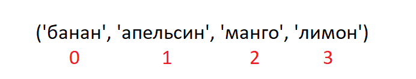
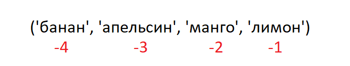

<div align="center">
  <h1> 30 Дней Python: День 6 - Кортежи</h1>
  <a class="header-badge" target="_blank" href="https://www.linkedin.com/in/asabeneh/">
  
  </a>
  <a class="header-badge" target="_blank" href="https://twitter.com/Asabeneh">
  
  </a>

<sub>Автор:
<a href="https://www.linkedin.com/in/asabeneh/" target="_blank">Асабенех Йетаех</a><br>
<small> Второе издание: июль 2021</small>
</sub>

</div>

[<< День 5](../05_Day_Lists/05_lists.md) | [День 7 >>](../07_Day_Sets/07_sets.md)


- [День 6:](#день-6)
  - [Кортежи](#кортежи)
    - [Создание кортежа](#создание-кортежа)
    - [Длина кортежа](#длина-кортежа)
    - [Доступ к элементам кортежа](#доступ-к-элементам-кортежа)
    - [Нарезка кортежей](#нарезка-кортежей)
    - [Преобразование кортежей в списки](#преобразование-кортежей-в-списки)
    - [Проверка элемента в кортеже](#проверка-элемента-в-кортеже)
    - [Объединение кортежей](#объединение-кортежей)
    - [Удаление кортежей](#удаление-кортежей)
  - [💻 Упражнения: День 6](#-упражнения-день-6)
    - [Упражнения: Уровень 1](#упражнения-уровень-1)
    - [Упражнения: Уровень 2](#упражнения-уровень-2)

# День 6:

## Кортежи

Кортеж - это коллекция различных типов данных, которая является упорядоченной и неизменяемой (immutable). Кортежи записываются в круглых скобках, (). После создания кортежа мы не можем изменить его значения. Мы не можем использовать методы add, insert, remove в кортеже, потому что он не является модифицируемым (изменяемым). В отличие от списка, у кортежа мало методов. Методы, относящиеся к кортежам:

- tuple(): для создания пустого кортежа
- count(): для подсчёта количества указанного элемента в кортеже
- index(): для поиска индекса указанного элемента в кортеже
- оператор `+`: для объединения двух или более кортежей и создания нового кортежа

### Создание кортежа

- Пустой кортеж: создание пустого кортежа
  
  ```py
  # синтаксис
  empty_tuple = ()
  # или с помощью конструктора tuple
  empty_tuple = tuple()
  ```

- Кортеж с начальными значениями
  
  ```py
  # синтаксис
  tpl = ('item1', 'item2','item3')
  ```

  ```py
  fruits = ('banana', 'orange', 'mango', 'lemon')
  ```

### Длина кортежа

Мы используем метод _len()_ для получения длины кортежа.

```py
# синтаксис
tpl = ('item1', 'item2', 'item3')
len(tpl)
```

### Доступ к элементам кортежа

- Положительная индексация
  Аналогично типу данных список, мы используем положительную или отрицательную индексацию для доступа к элементам кортежа.
  

  ```py
  # Синтаксис
  tpl = ('item1', 'item2', 'item3')
  first_item = tpl[0]
  second_item = tpl[1]
  ```

  ```py
  fruits = ('banana', 'orange', 'mango', 'lemon')
  first_fruit = fruits[0]
  second_fruit = fruits[1]
  last_index =len(fruits) - 1
  last_fruit = fruits[last_index]
  ```

- Отрицательная индексация
  Отрицательная индексация означает отсчёт с конца, -1 относится к последнему элементу, -2 относится к предпоследнему, а отрицательное значение длины списка/кортежа относится к первому элементу.
  

  ```py
  # Синтаксис
  tpl = ('item1', 'item2', 'item3','item4')
  first_item = tpl[-4]
  second_item = tpl[-3]
  ```

  ```py
  fruits = ('banana', 'orange', 'mango', 'lemon')
  first_fruit = fruits[-4]
  second_fruit = fruits[-3]
  last_fruit = fruits[-1]
  ```

### Нарезка кортежей

Мы можем вырезать под-кортеж, указав диапазон индексов, с которого начинать и на котором заканчивать в кортеже; возвращаемое значение будет новым кортежем с указанными элементами.

- Диапазон положительных индексов

  ```py
  # Синтаксис
  tpl = ('item1', 'item2', 'item3','item4')
  all_items = tpl[0:4]         # все элементы
  all_items = tpl[0:]         # все элементы
  middle_two_items = tpl[1:3]  # не включает элемент с индексом 3
  ```

  ```py
  fruits = ('banana', 'orange', 'mango', 'lemon')
  all_fruits = fruits[0:4]    # все элементы
  all_fruits= fruits[0:]      # все элементы
  orange_mango = fruits[1:3]  # не включает элемент с индексом 3
  orange_to_the_rest = fruits[1:]
  ```

- Диапазон отрицательных индексов

  ```py
  # Синтаксис
  tpl = ('item1', 'item2', 'item3','item4')
  all_items = tpl[-4:]         # все элементы
  middle_two_items = tpl[-3:-1]  # не включает элемент с индексом 3 (-1)
  ```

  ```py
  fruits = ('banana', 'orange', 'mango', 'lemon')
  all_fruits = fruits[-4:]    # все элементы
  orange_mango = fruits[-3:-1]  # не включает элемент с индексом 3
  orange_to_the_rest = fruits[-3:]
  ```

### Преобразование кортежей в списки

Мы можем преобразовывать кортежи в списки и списки в кортежи. Кортеж является неизменяемым, поэтому если мы хотим изменить кортеж, мы должны сначала преобразовать его в список.

```py
# Синтаксис
tpl = ('item1', 'item2', 'item3','item4')
lst = list(tpl)
```

```py
fruits = ('banana', 'orange', 'mango', 'lemon')
fruits = list(fruits)
fruits[0] = 'apple'
print(fruits)     # ['apple', 'orange', 'mango', 'lemon']
fruits = tuple(fruits)
print(fruits)     # ('apple', 'orange', 'mango', 'lemon')
```

### Проверка элемента в кортеже

Мы можем проверить, существует ли элемент в кортеже или нет, с помощью _in_, это возвращает логическое значение.

```py
# Синтаксис
tpl = ('item1', 'item2', 'item3','item4')
'item2' in tpl # True
```

```py
fruits = ('banana', 'orange', 'mango', 'lemon')
print('orange' in fruits) # True
print('apple' in fruits) # False
fruits[0] = 'apple' # TypeError: 'tuple' object does not support item assignment
```

### Объединение кортежей

Мы можем объединить два или более кортежей с помощью оператора +

```py
# синтаксис
tpl1 = ('item1', 'item2', 'item3')
tpl2 = ('item4', 'item5','item6')
tpl3 = tpl1 + tpl2
```

```py
fruits = ('banana', 'orange', 'mango', 'lemon')
vegetables = ('Tomato', 'Potato', 'Cabbage','Onion', 'Carrot')
fruits_and_vegetables = fruits + vegetables
```

### Удаление кортежей

Невозможно удалить один элемент в кортеже, но можно удалить сам кортеж с помощью _del_.

```py
# синтаксис
tpl1 = ('item1', 'item2', 'item3')
del tpl1

```

```py
fruits = ('banana', 'orange', 'mango', 'lemon')
del fruits
```

🌕 Ты такой смелый, ты добрался до этого места. Ты только что завершил испытания шестого дня, и ты на 6 шагов впереди на пути к величию. Теперь выполни несколько упражнений для своего мозга и для своих мышц.

## 💻 Упражнения: День 6

### Упражнения: Уровень 1

1. Создай пустой кортеж
2. Создай кортеж с именами своих сестёр и братьев (воображаемые братья и сёстры подойдут)
3. Объедини кортежи братьев и сестёр и присвой его переменной siblings
4. Сколько у тебя братьев и сестёр?
5. Измени кортеж siblings и добавь имена своего отца и матери, присвой это переменной family_members

### Упражнения: Уровень 2

1. Распакуй siblings и parents из family_members
1. Создай кортежи fruits, vegetables и animal products. Объедини три кортежа и присвой результат переменной food_stuff_tp.
1. Измени кортеж food_stuff_tp на список food_stuff_lt
1. Вырежи средний элемент или элементы из кортежа food_stuff_tp или списка food_stuff_lt.
1. Вырежи первые три элемента и последние три элемента из списка food_stuff_lt
1. Полностью удали кортеж food_stuff_tp
1. Проверь, существует ли элемент в кортеже:

- Проверь, является ли 'Estonia' скандинавской страной
- Проверь, является ли 'Iceland' скандинавской страной

  ```py
  nordic_countries = ('Denmark', 'Finland','Iceland', 'Norway', 'Sweden')
  ```


[<< День 5](../05_Day_Lists/05_lists.md) | [День 7 >>](../07_Day_Sets/07_sets.md)
