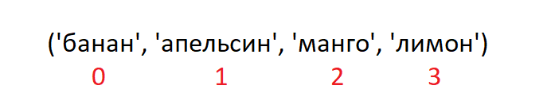
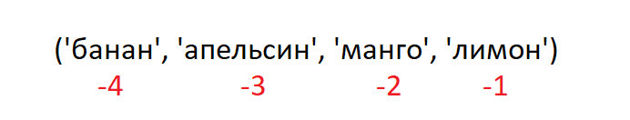

<div align="center">
  <h1> 30 Days Of Python: День 6 - Кортежи</h1>
  <a class="header-badge" target="_blank" href="https://www.linkedin.com/in/asabeneh/">
  
  </a>
  <a class="header-badge" target="_blank" href="https://twitter.com/Asabeneh">
  
  </a>

<sub>Автор:
<a href="https://www.linkedin.com/in/asabeneh/" target="_blank">Asabeneh Yetayeh</a><br>
<small> Второе издание: июль 2021</small>
</sub>

</div>

[<< День 5](./05_lists_ru.md) | [День 7 >>](./07_sets_ru.md)


- [День 6:](#день-6)
  - [Кортежи](#кортежи)
    - [Создание кортежа](#создание-кортежа)
    - [Длина кортежа](#длина-кортежа)
    - [Доступ к элементам кортежа](#доступ-к-элементам-кортежа)
    - [Срезы кортежей](#срезы-кортежей)
    - [Преобразование кортежей в списки](#преобразование-кортежей-в-списки)
    - [Проверка наличия элемента в кортеже](#проверка-наличия-элемента-в-кортеже)
    - [Объединение кортежей](#объединение-кортежей)
    - [Удаление кортежей](#удаление-кортежей)
  - [💻 Упражнения: День 6](#-упражнения-день-6)
    - [Упражнения: Уровень 1](#упражнения-уровень-1)
    - [Упражнения: Уровень 2](#упражнения-уровень-2)

# День 6:

## Кортежи

Кортеж — это коллекция различных типов данных, которая упорядочена и неизменяема (immutable). Кортежи записываются в круглых скобках, (). После создания кортежа мы не можем изменить его значения. Мы не можем использовать методы add, insert, remove в кортеже, потому что он не модифицируемый (mutable). В отличие от списка, у кортежа мало методов. Методы, связанные с кортежами:

- tuple(): создать пустой кортеж
- count(): подсчитать количество указанного элемента в кортеже
- index(): найти индекс указанного элемента в кортеже
- оператор `+`: объединить два или более кортежа и создать новый кортеж

### Создание кортежа

- Пустой кортеж: создание пустого кортежа
  
  ```py
  # синтаксис
  empty_tuple = ()
  # или с помощью конструктора tuple
  empty_tuple = tuple()
  ```

- Кортеж с начальными значениями
  
  ```py
  # синтаксис
  tpl = ('item1', 'item2','item3')
  ```

  ```py
  fruits = ('banana', 'orange', 'mango', 'lemon')
  ```

### Длина кортежа

Мы используем метод _len()_, чтобы получить длину кортежа.

```py
# синтаксис
tpl = ('item1', 'item2', 'item3')
len(tpl)
```

### Доступ к элементам кортежа

- Положительная индексация
  Как и в случае с типом данных list, мы используем положительную или отрицательную индексацию для доступа к элементам кортежа.
  

  ```py
  # Синтаксис
  tpl = ('item1', 'item2', 'item3')
  first_item = tpl[0]
  second_item = tpl[1]
  ```

  ```py
  fruits = ('banana', 'orange', 'mango', 'lemon')
  first_fruit = fruits[0]
  second_fruit = fruits[1]
  last_index =len(fruits) - 1
  last_fruit = fruits[last_index]
  ```

- Отрицательная индексация
  Отрицательная индексация означает начало с конца, -1 относится к последнему элементу, -2 относится ко второму с конца, а отрицательное значение длины списка/кортежа относится к первому элементу.
  

  ```py
  # Синтаксис
  tpl = ('item1', 'item2', 'item3','item4')
  first_item = tpl[-4]
  second_item = tpl[-3]
  ```

  ```py
  fruits = ('banana', 'orange', 'mango', 'lemon')
  first_fruit = fruits[-4]
  second_fruit = fruits[-3]
  last_fruit = fruits[-1]
  ```

### Срезы кортежей

Мы можем вырезать подкортеж, указав диапазон индексов, где начать и где закончить в кортеже, возвращаемое значение будет новым кортежем с указанными элементами.

- Диапазон положительных индексов

  ```py
  # Синтаксис
  tpl = ('item1', 'item2', 'item3','item4')
  all_items = tpl[0:4]         # все элементы
  all_items = tpl[0:]         # все элементы
  middle_two_items = tpl[1:3]  # не включает элемент с индексом 3
  ```

  ```py
  fruits = ('banana', 'orange', 'mango', 'lemon')
  all_fruits = fruits[0:4]    # все элементы
  all_fruits= fruits[0:]      # все элементы
  orange_mango = fruits[1:3]  # не включает элемент с индексом 3
  orange_to_the_rest = fruits[1:]
  ```

- Диапазон отрицательных индексов

  ```py
  # Синтаксис
  tpl = ('item1', 'item2', 'item3','item4')
  all_items = tpl[-4:]         # все элементы
  middle_two_items = tpl[-3:-1]  # не включает элемент с индексом 3 (-1)
  ```

  ```py
  fruits = ('banana', 'orange', 'mango', 'lemon')
  all_fruits = fruits[-4:]    # все элементы
  orange_mango = fruits[-3:-1]  # не включает элемент с индексом 3
  orange_to_the_rest = fruits[-3:]
  ```

### Преобразование кортежей в списки

Мы можем преобразовывать кортежи в списки, а списки в кортежи. Кортеж неизменяем, если мы хотим изменить кортеж, мы должны преобразовать его в список.

```py
# Синтаксис
tpl = ('item1', 'item2', 'item3','item4')
lst = list(tpl)
```

```py
fruits = ('banana', 'orange', 'mango', 'lemon')
fruits = list(fruits)
fruits[0] = 'apple'
print(fruits)     # ['apple', 'orange', 'mango', 'lemon']
fruits = tuple(fruits)
print(fruits)     # ('apple', 'orange', 'mango', 'lemon')
```

### Проверка наличия элемента в кортеже

Мы можем проверить, существует ли элемент в кортеже или нет, используя _in_, это возвращает логическое значение.

```py
# Синтаксис
tpl = ('item1', 'item2', 'item3','item4')
'item2' in tpl # True
```

```py
fruits = ('banana', 'orange', 'mango', 'lemon')
print('orange' in fruits) # True
print('apple' in fruits) # False
fruits[0] = 'apple' # TypeError: 'tuple' object does not support item assignment
```

### Объединение кортежей

Мы можем объединить два или более кортежа с помощью оператора +

```py
# синтаксис
tpl1 = ('item1', 'item2', 'item3')
tpl2 = ('item4', 'item5','item6')
tpl3 = tpl1 + tpl2
```

```py
fruits = ('banana', 'orange', 'mango', 'lemon')
vegetables = ('Tomato', 'Potato', 'Cabbage','Onion', 'Carrot')
fruits_and_vegetables = fruits + vegetables
```

### Удаление кортежей

Невозможно удалить отдельный элемент в кортеже, но можно удалить сам кортеж с помощью _del_.

```py
# синтаксис
tpl1 = ('item1', 'item2', 'item3')
del tpl1

```

```py
fruits = ('banana', 'orange', 'mango', 'lemon')
del fruits
```

🌕 Вы очень смелы, вы дошли до этого места. Вы только что завершили испытания дня 6, и вы на 6 шагов впереди на пути к величию. Теперь сделайте несколько упражнений для своего мозга и мышц.

## 💻 Упражнения: День 6

### Упражнения: Уровень 1

1. Создайте пустой кортеж
2. Создайте кортеж, содержащий имена ваших сестёр и братьев (воображаемые братья и сёстры вполне подойдут)
3. Объедините кортежи братьев и сестёр и присвойте его переменной siblings
4. Сколько у вас братьев и сестёр?
5. Измените кортеж siblings, добавив имена вашего отца и матери, и присвойте его переменной family_members

### Упражнения: Уровень 2

1. Распакуйте братьев, сестёр и родителей из family_members
1. Создайте кортежи fruits, vegetables и animal products. Объедините эти три кортежа и присвойте его переменной с именем food_stuff_tp.
1. Преобразуйте кортеж food_stuff_tp в список food_stuff_lt
1. Вырежьте средний элемент или элементы из кортежа food_stuff_tp или списка food_stuff_lt.
1. Вырежьте первые три элемента и последние три элемента из списка food_stuff_lt
1. Полностью удалите кортеж food_stuff_tp
1. Проверьте, существует ли элемент в кортеже:

- Проверьте, является ли 'Estonia' северной страной
- Проверьте, является ли 'Iceland' северной страной

  ```py
  nordic_countries = ('Denmark', 'Finland','Iceland', 'Norway', 'Sweden')
  ```


[<< День 5](./05_lists_ru.md) | [День 7 >>](./07_sets_ru.md)
