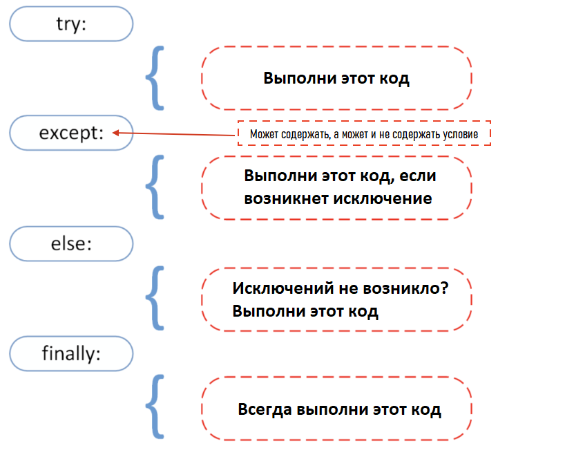

<div align="center">
  <h1> 30 дней Python: День 17 - Обработка исключений </h1>
  <a class="header-badge" target="_blank" href="https://www.linkedin.com/in/asabeneh/">
  
  </a>
  <a class="header-badge" target="_blank" href="https://twitter.com/Asabeneh">
  
  </a>

  <sub>Автор:
  <a href="https://www.linkedin.com/in/asabeneh/" target="_blank">Asabeneh Yetayeh</a><br>
  <small> Второе издание: июль 2021</small>
  </sub>
</div>

[<< День 16](./16_python_datetime_ru.md) | [День 18 >>](./18_regular_expressions_ru.md)


- [📘 День 17](#-день-17)
  - [Обработка исключений](#обработка-исключений)
  - [Упаковка и распаковка аргументов в Python](#упаковка-и-распаковка-аргументов-в-python)
    - [Распаковка](#распаковка)
      - [Распаковка списков](#распаковка-списков)
      - [Распаковка словарей](#распаковка-словарей)
    - [Упаковка](#упаковка)
    - [Упаковка списков](#упаковка-списков)
      - [Упаковка словарей](#упаковка-словарей)
  - [Распространение (spreading) в Python](#распространение-spreading-в-python)
  - [Enumerate](#enumerate)
  - [Zip](#zip)
  - [Упражнения: День 17](#упражнения-день-17)

# 📘 День 17

## Обработка исключений

Python использует _try_ и _except_ для изящной обработки ошибок. Изящный выход (или изящная обработка) ошибок — простой программный идиом: программа обнаруживает серьёзную ошибку и в результате «изящно завершается» контролируемым образом. Часто в рамках такого завершения программа выводит информативное сообщение об ошибке в терминал или лог, что делает наше приложение более устойчивым. Причина исключения часто находится вне самой программы. Примерами исключений могут быть неверный ввод, неправильное имя файла, невозможность найти файл, неисправное устройство ввода-вывода. Изящная обработка ошибок не даёт нашим приложениям падать.

В предыдущем разделе мы рассмотрели различные типы _ошибок_ Python. Если мы используем _try_ и _except_ в нашей программе, то ошибки в этих блоках не будут возникать.



```py
try:
    code in this block if things go well
except:
    code in this block run if things go wrong
```

**Пример:**

```py
try:
    print(10 + '5')
except:
    print('Something went wrong')
```

В примере выше второй операнд — строка. Мы могли бы преобразовать её в float или int, чтобы сложить с числом и всё заработало. Но без изменений будет выполнен второй блок, _except_.

**Пример:**

```py
try:
    name = input('Enter your name:')
    year_born = input('Year you were born:')
    age = 2019 - year_born
    print(f'You are {name}. And your age is {age}.')
except:
    print('Something went wrong')
```

```sh
Something went wrong
```

В приведённом выше примере выполнится блок исключения, и мы не узнаем точно, в чём проблема. Чтобы проанализировать проблему, мы можем использовать различные типы ошибок с except.

В следующем примере ошибка будет обработана, и нам также сообщат, какой тип ошибки возник.

```py
try:
    name = input('Enter your name:')
    year_born = input('Year you were born:')
    age = 2019 - year_born
    print(f'You are {name}. And your age is {age}.')
except TypeError:
    print('Type error occured')
except ValueError:
    print('Value error occured')
except ZeroDivisionError:
    print('zero division error occured')
```

```sh
Enter your name:Asabeneh
Year you born:1920
Type error occured
```

В коде выше выводом будет _TypeError_.
Теперь давайте добавим дополнительный блок:

```py
try:
    name = input('Enter your name:')
    year_born = input('Year you born:')
    age = 2019 - int(year_born)
    print(f'You are {name}. And your age is {age}.')
except TypeError:
    print('Type error occur')
except ValueError:
    print('Value error occur')
except ZeroDivisionError:
    print('zero division error occur')
else:
    print('I usually run with the try block')
finally:
    print('I alway run.')
```

```sh
Enter your name:Asabeneh
Year you born:1920
You are Asabeneh. And your age is 99.
I usually run with the try block
I alway run.
```

Также можно сократить приведённый выше код следующим образом:

```py
try:
    name = input('Enter your name:')
    year_born = input('Year you born:')
    age = 2019 - int(year_born)
    print(f'You are {name}. And your age is {age}.')
except Exception as e:
    print(e)

```

## Упаковка и распаковка аргументов в Python

Мы используем два оператора:

- \* для кортежей
- \*\* для словарей

Рассмотрим пример ниже. Функция принимает только аргументы, а у нас есть список. Мы можем распаковать список и превратить его в аргументы.

### Распаковка

#### Распаковка списков

```py
def sum_of_five_nums(a, b, c, d, e):
    return a + b + c + d + e

lst = [1, 2, 3, 4, 5]
print(sum_of_five_nums(lst)) # TypeError: sum_of_five_nums() missing 4 required positional arguments: 'b', 'c', 'd', and 'e'
```

Когда мы запускаем этот код, возникает ошибка, потому что функция принимает числа (а не список) в качестве аргументов. Давайте распакуем/деструктурируем список.

```py
def sum_of_five_nums(a, b, c, d, e):
    return a + b + c + d + e

lst = [1, 2, 3, 4, 5]
print(sum_of_five_nums(*lst))  # 15
```

Мы также можем использовать распаковку во встроенной функции range, которая ожидает начало и конец.

```py
numbers = range(2, 7)  # обычный вызов с отдельными аргументами
print(list(numbers)) # [2, 3, 4, 5, 6]
args = [2, 7]
numbers = range(*args)  # вызов с аргументами, распакованными из списка
print(numbers)      # [2, 3, 4, 5,6]

```

Список или кортеж также можно распаковать так:

```py
countries = ['Finland', 'Sweden', 'Norway', 'Denmark', 'Iceland']
fin, sw, nor, *rest = countries
print(fin, sw, nor, rest)   # Finland Sweden Norway ['Denmark', 'Iceland']
numbers = [1, 2, 3, 4, 5, 6, 7]
one, *middle, last = numbers
print(one, middle, last)      #  1 [2, 3, 4, 5, 6] 7
```

#### Распаковка словарей

```py
def unpacking_person_info(name, country, city, age):
    return f'{name} lives in {country}, {city}. He is {age} year old.'
dct = {'name':'Asabeneh', 'country':'Finland', 'city':'Helsinki', 'age':250}
print(unpacking_person_info(**dct)) # Asabeneh lives in Finland, Helsinki. He is 250 years old.
```

### Упаковка

Иногда мы заранее не знаем, сколько аргументов нужно передать в функцию Python. Мы можем использовать упаковку, чтобы функция принимала неограниченное или произвольное число аргументов.

### Упаковка списков

```py
def sum_all(*args):
    s = 0
    for i in args:
        s += i
    return s
print(sum_all(1, 2, 3))             # 6
print(sum_all(1, 2, 3, 4, 5, 6, 7)) # 28
```

#### Упаковка словарей

```py
def packing_person_info(**kwargs):
    # проверяем тип kwargs - это тип dict
    # print(type(kwargs))
    # Вывод элементов словаря
    for key in kwargs:
        print(f"{key} = {kwargs[key]}")
    return kwargs

print(packing_person_info(name="Asabeneh",
      country="Finland", city="Helsinki", age=250))
```

```sh
name = Asabeneh
country = Finland
city = Helsinki
age = 250
{'name': 'Asabeneh', 'country': 'Finland', 'city': 'Helsinki', 'age': 250}
```

## Распространение (spreading) в Python

Как и в JavaScript, в Python возможно распространение (spreading). Давайте посмотрим на пример ниже:

```py
lst_one = [1, 2, 3]
lst_two = [4, 5, 6, 7]
lst = [0, *lst_one, *lst_two]
print(lst)          # [0, 1, 2, 3, 4, 5, 6, 7]
country_lst_one = ['Finland', 'Sweden', 'Norway']
country_lst_two = ['Denmark', 'Iceland']
nordic_countries = [*country_lst_one, *country_lst_two]
print(nordic_countries)  # ['Finland', 'Sweden', 'Norway', 'Denmark', 'Iceland']
```

## Enumerate

Если нас интересует индекс в списке, мы используем встроенную функцию _enumerate_, чтобы получить индекс каждого элемента списка.

```py
for index, item in enumerate([20, 30, 40]):
    print(index, item)
```

```py
countries = ['Finland', 'Sweden', 'Norway', 'Denmark', 'Iceland']
for index, i in enumerate(countries):
    if i == 'Finland':
        print(f'The country {i} has been found at index {index}')
```

```sh
The country Finland has been found at index 0.
```

## Zip

Иногда при переборе списков мы хотим объединить их. Смотрите пример ниже:

```py
fruits = ['banana', 'orange', 'mango', 'lemon', 'lime']                    
vegetables = ['Tomato', 'Potato', 'Cabbage','Onion', 'Carrot']
fruits_and_veges = []
for f, v in zip(fruits, vegetables):
    fruits_and_veges.append({'fruit':f, 'veg':v})

print(fruits_and_veges)
```

```sh
[{'fruit': 'banana', 'veg': 'Tomato'}, {'fruit': 'orange', 'veg': 'Potato'}, {'fruit': 'mango', 'veg': 'Cabbage'}, {'fruit': 'lemon', 'veg': 'Onion'}, {'fruit': 'lime', 'veg': 'Carrot'}]
```

🌕 Вы решительны. Вы на 17 шагов впереди на пути к величию. Теперь сделайте несколько упражнений для ума и мышц.

## Упражнения: День 17

1. names = ['Finland', 'Sweden', 'Norway','Denmark','Iceland', 'Estonia','Russia']. Распакуйте первые пять стран и сохраните их в переменной nordic_countries, сохраните Estonia и Russia в es и ru соответственно.


🎉 ПОЗДРАВЛЯЕМ ! 🎉

[<< День 16](./16_python_datetime_ru.md) | [День 18 >>](./18_regular_expressions_ru.md)
