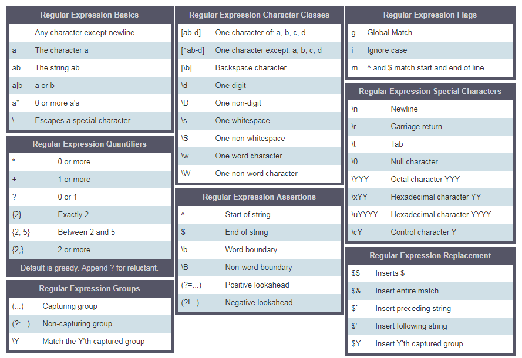

<div align="center">
  <h1> 30 дней Python: День 18 - Регулярные выражения</h1>
  <a class="header-badge" target="_blank" href="https://www.linkedin.com/in/asabeneh/">
  
  </a>
  <a class="header-badge" target="_blank" href="https://twitter.com/Asabeneh">
  
  </a>

  <sub>Автор:
  <a href="https://www.linkedin.com/in/asabeneh/" target="_blank">Асабенех Йетаех</a><br>
  <small> Первое издание: 22 ноября - 22 декабря 2019</small>
  </sub>
</div>


[<< День 17](../17_Day_Exception_handling/17_exception_handling.md) | [День 19>>](../19_Day_File_handling/19_file_handling.md)


- [📘 День 18](#-день-18)
  - [Регулярные выражения](#регулярные-выражения)
    - [Модуль *re*](#модуль-re)
    - [Методы модуля *re*](#методы-модуля-re)
      - [Match](#match)
      - [Search](#search)
      - [Поиск всех совпадений с помощью *findall*](#поиск-всех-совпадений-с-помощью-findall)
      - [Замена подстроки](#замена-подстроки)
  - [Разбиение текста с помощью RegEx Split](#разбиение-текста-с-помощью-regex-split)
  - [Написание шаблонов RegEx](#написание-шаблонов-regex)
    - [Квадратные скобки](#квадратные-скобки)
    - [Символ экранирования (\\) в RegEx](#символ-экранирования-в-regex)
    - [Один или более раз (+)](#один-или-более-раз-)
    - [Точка (.)](#точка)
    - [Ноль или более раз (*)](#ноль-или-более-раз-)
    - [Ноль или один раз (?)](#ноль-или-один-раз-)
    - [Квантификатор в RegEx](#квантификатор-в-regex)
    - [Крышка ^](#крышка-)
  - [💻 Упражнения: День 18](#-упражнения-день-18)
    - [Упражнения: Уровень 1](#упражнения-уровень-1)
    - [Упражнения: Уровень 2](#упражнения-уровень-2)
    - [Упражнения: Уровень 3](#упражнения-уровень-3)

# 📘 День 18

## Регулярные выражения

Регулярное выражение (RegEx) - это специальная текстовая строка, которая помогает находить шаблоны в данных. RegEx может использоваться для проверки существования некоторого шаблона в другом типе данных. Чтобы использовать RegEx в Python, сначала мы должны импортировать модуль RegEx, который называется *re*.

### Модуль *re*

После импорта модуля мы можем использовать его для обнаружения или поиска шаблонов.

```py
import re
```

### Методы модуля *re*

Чтобы найти шаблон, мы используем различные наборы символов *re*, которые позволяют искать совпадение в строке.

- *re.match()*: ищет только в начале первой строки и возвращает объекты совпадений, если они найдены, иначе возвращает None.
- *re.search*: возвращает объект совпадения, если оно есть где-либо в строке, включая многострочные строки.
- *re.findall*: возвращает список, содержащий все совпадения
- *re.split*: принимает строку, разбивает её в точках совпадения, возвращает список
- *re.sub*: заменяет одно или несколько совпадений в строке

#### Match

```py
# синтаксис
re.match(substring, string, re.I)
# substring - строка или шаблон, string - текст, в котором мы ищем шаблон, re.I - игнорирование регистра
```

```py
import re

txt = 'I love to teach python and javaScript'
# Он возвращает объект с span и match
match = re.match('I love to teach', txt, re.I)
print(match)  # <re.Match object; span=(0, 15), match='I love to teach'>
# Мы можем получить начальную и конечную позиции совпадения в виде кортежа, используя span
span = match.span()
print(span)     # (0, 15)
# Давайте найдём начальную и конечную позиции из span
start, end = span
print(start, end)  # 0 15
substring = txt[start:end]
print(substring)       # I love to teach
```

Как вы видите из примера выше, шаблон, который мы ищем (или подстрока, которую мы ищем), - это *I love to teach*. Функция match возвращает объект **только** в том случае, если текст начинается с этого шаблона.

```py
import re

txt = 'I love to teach python and javaScript'
match = re.match('I like to teach', txt, re.I)
print(match)  # None
```

Строка не начинается с *I like to teach*, поэтому совпадения не было, и метод match вернул None.

#### Search

```py
# синтаксис
re.search(substring, string, re.I)
# substring - шаблон, string - текст, в котором мы ищем шаблон, re.I - флаг игнорирования регистра
```

```py
import re

txt = '''Python is the most beautiful language that a human being has ever created.
I recommend python for a first programming language'''

# Он возвращает объект с span и match
match = re.search('first', txt, re.I)
print(match)  # <re.Match object; span=(100, 105), match='first'>
# Мы можем получить начальную и конечную позиции совпадения в виде кортежа, используя span
span = match.span()
print(span)     # (100, 105)
# Давайте найдём начальную и конечную позиции из span
start, end = span
print(start, end)  # 100 105
substring = txt[start:end]
print(substring)       # first
```

Как видите, search гораздо лучше, чем match, потому что может искать шаблон по всему тексту. Search возвращает объект совпадения с первым найденным совпадением, иначе возвращает *None*. Гораздо лучшей функцией *re* является *findall*. Эта функция проверяет шаблон по всей строке и возвращает все совпадения в виде списка.

#### Поиск всех совпадений с помощью *findall*

*findall()* возвращает все совпадения в виде списка

```py
txt = '''Python is the most beautiful language that a human being has ever created.
I recommend python for a first programming language'''

# Он возвращает список
matches = re.findall('language', txt, re.I)
print(matches)  # ['language', 'language']
```

Как видите, слово *language* было найдено в строке два раза. Давайте потренируемся ещё.
Теперь мы будем искать в строке слова Python и python:

```py
txt = '''Python is the most beautiful language that a human being has ever created.
I recommend python for a first programming language'''

# Он возвращает список
matches = re.findall('python', txt, re.I)
print(matches)  # ['Python', 'python']

```

Поскольку мы используем *re.I*, включаются и строчные, и заглавные буквы. Если у нас нет флага re.I, нам придётся записать наш шаблон иначе. Давайте проверим это:

```py
txt = '''Python is the most beautiful language that a human being has ever created.
I recommend python for a first programming language'''

matches = re.findall('Python|python', txt)
print(matches)  # ['Python', 'python']

#
matches = re.findall('[Pp]ython', txt)
print(matches)  # ['Python', 'python']

```

#### Замена подстроки

```py
txt = '''Python is the most beautiful language that a human being has ever created.
I recommend python for a first programming language'''

match_replaced = re.sub('Python|python', 'JavaScript', txt, re.I)
print(match_replaced)  # JavaScript is the most beautiful language that a human being has ever created.I recommend python for a first programming language
# ИЛИ
match_replaced = re.sub('[Pp]ython', 'JavaScript', txt, re.I)
print(match_replaced)  # JavaScript is the most beautiful language that a human being has ever created.I recommend python for a first programming language
```

Давайте добавим ещё один пример. Следующую строку очень трудно читать, если мы не удалим символ %. Замена % на пустую строку очистит текст.

```py

txt = '''%I a%m te%%a%%che%r% a%n%d %% I l%o%ve te%ach%ing.
T%he%re i%s n%o%th%ing as r%ewarding a%s e%duc%at%i%ng a%n%d e%m%p%ow%er%ing p%e%o%ple.
I fo%und te%a%ching m%ore i%n%t%er%%es%ting t%h%an any other %jobs.
D%o%es thi%s m%ot%iv%a%te %y%o%u to b%e a t%e%a%cher?'''

matches = re.sub('%', '', txt)
print(matches)
```

```sh
I am teacher and I love teaching.
There is nothing as rewarding as educating and empowering people.
I found teaching more interesting than any other jobs. Does this motivate you to be a teacher?
```

## Разбиение текста с помощью RegEx Split

```py
txt = '''I am teacher and  I love teaching.
There is nothing as rewarding as educating and empowering people.
I found teaching more interesting than any other jobs.
Does this motivate you to be a teacher?'''
print(re.split('\n', txt)) # разбиение с помощью \n - символа конца строки
```

```sh
['I am teacher and  I love teaching.', 'There is nothing as rewarding as educating and empowering people.', 'I found teaching more interesting than any other jobs.', 'Does this motivate you to be a teacher?']
```

## Написание шаблонов RegEx

Для объявления строковой переменной мы используем одинарную или двойную кавычку. Для объявления переменной RegEx - *r''*.
Следующий шаблон распознаёт только apple в нижнем регистре; чтобы сделать его нечувствительным к регистру, мы должны либо переписать наш шаблон, либо добавить флаг.

```py
import re

regex_pattern = r'apple'
txt = 'Apple and banana are fruits. An old cliche says an apple a day a doctor way has been replaced by a banana a day keeps the doctor far far away. '
matches = re.findall(regex_pattern, txt)
print(matches)  # ['apple']

# Чтобы сделать нечувствительным к регистру, добавляем флаг '
matches = re.findall(regex_pattern, txt, re.I)
print(matches)  # ['Apple', 'apple']
# или мы можем использовать метод набора символов
regex_pattern = r'[Aa]pple'  # это означает, что первая буква может быть Apple или apple
matches = re.findall(regex_pattern, txt)
print(matches)  # ['Apple', 'apple']

```

* []:  набор символов
  - [a-c] означает, a или b или c
  - [a-z] означает, любая буква от a до z
  - [A-Z] означает, любой символ от A до Z
  - [0-3] означает, 0 или 1 или 2 или 3
  - [0-9] означает любое число от 0 до 9
  - [A-Za-z0-9] любой одиночный символ, то есть от a до z, от A до Z или от 0 до 9
- \\:  используется для экранирования специальных символов
  - \d означает: совпадение там, где строка содержит цифры (числа от 0-9)
  - \D означает: совпадение там, где строка не содержит цифр
- . : любой символ, кроме символа новой строки (\n)
- ^: начинается с
  - r'^substring', например r'^love', предложение, которое начинается со слова love
  - r'[^abc] означает не a, не b, не c.
- $: заканчивается на
  - r'substring$', например r'love$', предложение, которое заканчивается словом love
- *: ноль или более раз
  - r'[a]*' означает a необязательно или может встречаться много раз.
- +: один или более раз
  - r'[a]+' означает по крайней мере один раз (или более)
- ?: ноль или один раз
  - r'[a]?' означает ноль раз или один раз
- {3}: ровно 3 символа
- {3,}: не менее 3 символов
- {3,8}: от 3 до 8 символов
- |: либо или
  - r'apple|banana' означает либо apple, либо banana
- (): захват и группировка



Давайте используем примеры, чтобы пояснить приведённые выше метасимволы

### Квадратные скобки

Давайте используем квадратные скобки для включения нижнего и верхнего регистра

```py
regex_pattern = r'[Aa]pple' # эта квадратная скобка означает либо A, либо a
txt = 'Apple and banana are fruits. An old cliche says an apple a day a doctor way has been replaced by a banana a day keeps the doctor far far away.'
matches = re.findall(regex_pattern, txt)
print(matches)  # ['Apple', 'apple']
```

Если мы хотим искать banana, мы записываем шаблон следующим образом:

```py
regex_pattern = r'[Aa]pple|[Bb]anana' # эта квадратная скобка означает либо A, либо a
txt = 'Apple and banana are fruits. An old cliche says an apple a day a doctor way has been replaced by a banana a day keeps the doctor far far away.'
matches = re.findall(regex_pattern, txt)
print(matches)  # ['Apple', 'banana', 'apple', 'banana']
```

Используя квадратные скобки и оператор или, нам удалось извлечь Apple, apple, Banana и banana.

### Символ экранирования (\\) в RegEx

```py
regex_pattern = r'\d'  # d - специальный символ, который означает цифры
txt = 'This regular expression example was made on December 6,  2019 and revised on July 8, 2021'
matches = re.findall(regex_pattern, txt)
print(matches)  # ['6', '2', '0', '1', '9', '8', '2', '0', '2', '1'], это не то, что мы хотим
```

### Один или более раз (+)

```py
regex_pattern = r'\d+'  # d - специальный символ, который означает цифры, + означает один или более раз
txt = 'This regular expression example was made on December 6,  2019 and revised on July 8, 2021'
matches = re.findall(regex_pattern, txt)
print(matches)  # ['6', '2019', '8', '2021'] - теперь это лучше!
```

### Точка (.)

```py
regex_pattern = r'[a].'  # эта квадратная скобка означает a, а . означает любой символ, кроме новой строки
txt = '''Apple and banana are fruits'''
matches = re.findall(regex_pattern, txt)
print(matches)  # ['an', 'an', 'an', 'a ', 'ar']

regex_pattern = r'[a].+'  # . любой символ, + любой символ один или более раз
matches = re.findall(regex_pattern, txt)
print(matches)  # ['and banana are fruits']
```

### Ноль или более раз (*)

Ноль или много раз. Шаблон может не встречаться или встречаться много раз.

```py
regex_pattern = r'[a].*'  # . любой символ, * любой символ ноль или более раз
txt = '''Apple and banana are fruits'''
matches = re.findall(regex_pattern, txt)
print(matches)  # ['and banana are fruits']
```

### Ноль или один раз (?)

Ноль или один раз. Шаблон может не встречаться или может встретиться один раз.

```py
txt = '''I am not sure if there is a convention how to write the word e-mail.
Some people write it as email others may write it as Email or E-mail.'''
regex_pattern = r'[Ee]-?mail'  # ? означает здесь, что '-' необязателен
matches = re.findall(regex_pattern, txt)
print(matches)  # ['e-mail', 'email', 'Email', 'E-mail']
```

### Квантификатор в RegEx

Мы можем указать длину подстроки, которую мы ищем в тексте, с помощью фигурных скобок. Представим, что нас интересует подстрока длиной 4 символа:

```py
txt = 'This regular expression example was made on December 6,  2019 and revised on July 8, 2021'
regex_pattern = r'\d{4}'  # ровно четыре раза
matches = re.findall(regex_pattern, txt)
print(matches)  # ['2019', '2021']

txt = 'This regular expression example was made on December 6,  2019 and revised on July 8, 2021'
regex_pattern = r'\d{1,4}'
matches = re.findall(regex_pattern, txt)
print(matches)  # ['6', '2019', '8', '2021'] 
```

### Крышка ^

- Начинается с

```py
txt = 'This regular expression example was made on December 6,  2019 and revised on July 8, 2021'
regex_pattern = r'^This'  # ^ означает начинается с
matches = re.findall(regex_pattern, txt)
print(matches)  # ['This']
```

- Отрицание

```py
txt = 'This regular expression example was made on December 6,  2019 and revised on July 8, 2021'
regex_pattern = r'[^A-Za-z ]+'  # ^ в наборе символов означает отрицание, не от A до Z, не от a до z, без пробела
matches = re.findall(regex_pattern, txt)
print(matches)  # ['6,', '2019', '8', '2021']
```

## 💻 Упражнения: День 18

### Упражнения: Уровень 1

 1. Какое слово является самым частым в следующем абзаце?

```py
    paragraph = 'I love teaching. If you do not love teaching what else can you love. I love Python if you do not love something which can give you all the capabilities to develop an application what else can you love.
```

```sh
    [
    (6, 'love'),
    (5, 'you'),
    (3, 'can'),
    (2, 'what'),
    (2, 'teaching'),
    (2, 'not'),
    (2, 'else'),
    (2, 'do'),
    (2, 'I'),
    (1, 'which'),
    (1, 'to'),
    (1, 'the'),
    (1, 'something'),
    (1, 'if'),
    (1, 'give'),
    (1, 'develop'),
    (1, 'capabilities'),
    (1, 'application'),
    (1, 'an'),
    (1, 'all'),
    (1, 'Python'),
    (1, 'If')
    ]
```

2. Положения некоторых частиц на горизонтальной оси x равны -12, -4, -3 и -1 в отрицательном направлении, 0 в начале координат, 4 и 8 в положительном направлении. Извлеките эти числа из всего текста и найдите расстояние между двумя самыми удалёнными частицами.

```py
points = ['-12', '-4', '-3', '-1', '0', '4', '8']
sorted_points =  [-12, -4, -3, -1, -1, 0, 2, 4, 8]
distance = 8 -(-12) # 20
```

### Упражнения: Уровень 2

1. Напиши шаблон, который определяет, является ли строка допустимой переменной Python

    ```sh
    is_valid_variable('first_name') # True
    is_valid_variable('first-name') # False
    is_valid_variable('1first_name') # False
    is_valid_variable('firstname') # True
    ```

### Упражнения: Уровень 3

1. Очисти следующий текст. После очистки подсчитай три наиболее частых слова в строке.

    ```py
    sentence = '''%I $am@% a %tea@cher%, &and& I lo%#ve %tea@ching%;. There $is nothing; &as& mo@re rewarding as educa@ting &and& @emp%o@wering peo@ple. ;I found tea@ching m%o@re interesting tha@n any other %jo@bs. %Do@es thi%s mo@tivate yo@u to be a tea@cher!?'''

    print(clean_text(sentence));
    I am a teacher and I love teaching There is nothing as more rewarding as educating and empowering people I found teaching more interesting than any other jobs Does this motivate you to be a teacher
    print(most_frequent_words(cleaned_text)) # [(3, 'I'), (2, 'teaching'), (2, 'teacher')]
    ```

🎉 ПОЗДРАВЛЯЕМ! 🎉

[<< День 17](../17_Day_Exception_handling/17_exception_handling.md) | [День 19>>](../19_Day_File_handling/19_file_handling.md)
