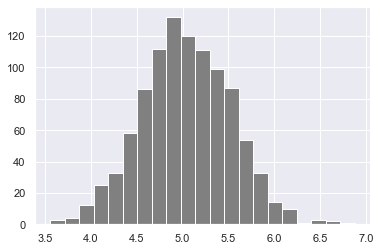
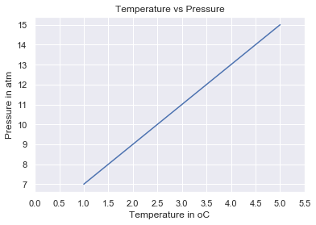
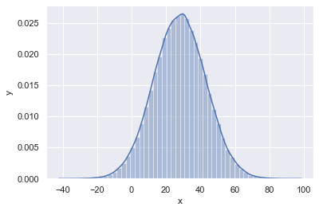

<div align="center">
  <h1> 30 Days Of Python: День 24 - Статистика</h1>
  <a class="header-badge" target="_blank" href="https://www.linkedin.com/in/asabeneh/">
  
  </a>
  <a class="header-badge" target="_blank" href="https://twitter.com/Asabeneh">
  
  </a>

<sub>Автор:
<a href="https://www.linkedin.com/in/asabeneh/" target="_blank">Asabeneh Yetayeh</a><br>
<small>Второе издание: июль 2021</small>
</sub>
</div>

[<< День 23](./23_virtual_environment_ru.md) | [День 25 >>](./25_pandas_ru.md)


- [📘 День 24](#-день-24)
  - [Python для статистического анализа](#python-для-статистического-анализа)
  - [Статистика](#статистика)
  - [Данные](#данные)
  - [Модуль statistics](#модуль-statistics)
- [NumPy](#numpy)

# 📘 День 24

## Python для статистического анализа

## Статистика

Статистика — это дисциплина, которая изучает _сбор_, _организацию_, _отображение_, _анализ_, _интерпретацию_ и _представление_ данных.
Статистика — это раздел математики, который рекомендуется как предварительное условие для data science и машинного обучения. Статистика — очень широкая область, но в этом разделе мы сосредоточимся только на самой релевантной части.
После завершения этого испытания вы можете пойти по пути веб-разработки, анализа данных, машинного обучения или data science. Какой бы путь вы ни выбрали, в какой-то момент вашей карьеры вы получите данные, с которыми, возможно, будете работать. Некоторые знания статистики помогут вам принимать решения на основе данных — _данные говорят, как говорится_.

## Данные

Что такое данные? Данные — это любой набор символов, который собран и переведён для какой-то цели, обычно для анализа. Это может быть любой символ, включая текст и числа, изображения, звук или видео. Если данные не помещены в контекст, они не имеют смысла ни для человека, ни для компьютера. Чтобы извлечь смысл из данных, нам нужно поработать с ними, используя различные инструменты.

Рабочий процесс анализа данных, data science или машинного обучения начинается с данных. Данные могут быть предоставлены из некоторого источника данных или созданы. Существуют структурированные и неструктурированные данные.

Данные могут встречаться в небольшом или большом формате. Большинство типов данных, с которыми мы будем иметь дело, были рассмотрены в разделе о работе с файлами.

## Модуль statistics

Модуль Python _statistics_ предоставляет функции для вычисления математической статистики числовых данных. Модуль не задуман как конкурент сторонним библиотекам, таким как NumPy, SciPy, или проприетарным полнофункциональным статистическим пакетам, предназначенным для профессиональных статистиков, таким как Minitab, SAS и Matlab. Он ориентирован на уровень графических и научных калькуляторов.

# NumPy

В первом разделе мы определили Python как отличный универсальный язык программирования сам по себе, но с помощью других популярных библиотек (numpy, scipy, matplotlib, pandas и т. д.) он становится мощной средой для научных вычислений.

NumPy — это основная библиотека для научных вычислений на Python. Она предоставляет высокопроизводительный объект многомерного массива и инструменты для работы с массивами.

До сих пор мы использовали vscode, но с этого момента я рекомендую использовать Jupyter Notebook. Чтобы получить доступ к Jupyter Notebook, давайте установим [anaconda](https://www.anaconda.com/). Если вы используете anaconda, большинство распространённых пакетов уже включены, и вам не нужно устанавливать пакеты, если вы установили anaconda.

```sh
asabeneh@Asabeneh:~/Desktop/30DaysOfPython$ pip install numpy
```

## Импорт NumPy

Jupyter notebook доступен, если вы предпочитаете [jupyter notebook](https://github.com/Asabeneh/data-science-for-everyone/blob/master/numpy/numpy.ipynb)

```py
    # Как импортировать numpy
    import numpy as np
    # Как проверить версию пакета numpy
    print('numpy:', np.__version__)
    # Проверка доступных методов
    print(dir(np))
```

## Создание массива numpy с помощью

### Создание целочисленных массивов numpy

```py
    # Создание списка Python
    python_list = [1,2,3,4,5]

    # Проверка типов данных
    print('Type:', type (python_list)) # <class 'list'>
    #
    print(python_list) # [1, 2, 3, 4, 5]

    two_dimensional_list = [[0,1,2], [3,4,5], [6,7,8]]

    print(two_dimensional_list)  # [[0, 1, 2], [3, 4, 5], [6, 7, 8]]

    # Создание массива Numpy (Numerical Python) из списка Python

    numpy_array_from_list = np.array(python_list)
    print(type (numpy_array_from_list))   # <class 'numpy.ndarray'>
    print(numpy_array_from_list) # array([1, 2, 3, 4, 5])
```

### Создание вещественных массивов numpy

Создание вещественного массива numpy из списка с параметром типа данных float

```py
    # Список Python
    python_list = [1,2,3,4,5]

    numy_array_from_list2 = np.array(python_list, dtype=float)
    print(numy_array_from_list2) # array([1., 2., 3., 4., 5.])
```

### Создание булевых массивов numpy

Создание булевого массива numpy из списка

```py
    numpy_bool_array = np.array([0, 1, -1, 0, 0], dtype=bool)
    print(numpy_bool_array) # array([False,  True,  True, False, False])
```

### Создание многомерного массива с помощью numpy

Массив numpy может иметь одну или несколько строк и столбцов

```py
    two_dimensional_list = [[0,1,2], [3,4,5], [6,7,8]]
    numpy_two_dimensional_list = np.array(two_dimensional_list)
    print(type (numpy_two_dimensional_list))
    print(numpy_two_dimensional_list)
```

```sh
    <class 'numpy.ndarray'>
    [[0 1 2]
     [3 4 5]
     [6 7 8]]
```

### Преобразование массива numpy в список

```python
# Мы всегда можем преобразовать массив обратно в список Python с помощью tolist().
np_to_list = numpy_array_from_list.tolist()
print(type (np_to_list))
print('one dimensional array:', np_to_list)
print('two dimensional array: ', numpy_two_dimensional_list.tolist())
```

```sh
    <class 'list'>
    one dimensional array: [1, 2, 3, 4, 5]
    two dimensional array:  [[0, 1, 2], [3, 4, 5], [6, 7, 8]]
```

### Создание массива numpy из кортежа

```py
# Массив Numpy из кортежа
# Создание кортежа в Python
python_tuple = (1,2,3,4,5)
print(type (python_tuple)) # <class 'tuple'>
print('python_tuple: ', python_tuple) # python_tuple:  (1, 2, 3, 4, 5)

numpy_array_from_tuple = np.array(python_tuple)
print(type (numpy_array_from_tuple)) # <class 'numpy.ndarray'>
print('numpy_array_from_tuple: ', numpy_array_from_tuple) # numpy_array_from_tuple:  [1 2 3 4 5]
```

### Форма массива numpy

Метод shape возвращает форму массива в виде кортежа. Первый элемент — строка, второй — столбец. Если массив одномерный, он возвращает размер массива.

```py
    nums = np.array([1, 2, 3, 4, 5])
    print(nums)
    print('shape of nums: ', nums.shape)
    numpy_two_dimensional_list = np.array([[0,1,2],[3,4,5],[6,7,8]])
    print(numpy_two_dimensional_list)
    print('shape of numpy_two_dimensional_list: ', numpy_two_dimensional_list.shape)
    three_by_four_array = np.array([[0, 1, 2, 3],
        [4,5,6,7],
        [8,9,10,11]]
    print(three_by_four_array)
    print('shape of three_by_four_array: ', three_by_four_array.shape)

```

```sh
    [1 2 3 4 5]
    shape of nums:  (5,)
    [[0 1 2]
     [3 4 5]
     [6 7 8]]
    shape of numpy_two_dimensional_list:  (3, 3)
    (3, 4)
```

### Тип данных массива numpy

Типы данных: str, int, float, complex, bool, list, None

```py
int_lists = [-3, -2, -1, 0, 1, 2,3]
int_array = np.array(int_lists)
float_array = np.array(int_lists, dtype=float)

print(int_array)
print(int_array.dtype)
print(float_array)
print(float_array.dtype)
```

```sh
    [-3 -2 -1  0  1  2  3]
    int64
    [-3. -2. -1.  0.  1.  2.  3.]
    float64
```

### Размер массива numpy

В numpy, чтобы узнать количество элементов в массиве numpy, мы используем size

```py
numpy_array_from_list = np.array([1, 2, 3, 4, 5])
two_dimensional_list = np.array([[0, 1, 2],
                              [3, 4, 5],
                              [6, 7, 8]])

print('The size:', numpy_array_from_list.size) # 5
print('The size:', two_dimensional_list.size)  # 3

```

```sh
    The size: 5
    The size: 9
```

## Математические операции с numpy

Массив NumPy не совсем такой же, как список Python. Чтобы выполнить математическую операцию над списком Python, нам нужно перебрать элементы в цикле, а numpy позволяет выполнять любую математическую операцию без циклов.
Математическая операция:

- Сложение (+)
- Вычитание (-)
- Умножение (\*)
- Деление (/)
- Остаток от деления (%)
- Целочисленное деление (//)
- Возведение в степень (\*\*)

### Сложение

```py
# Математическая операция
# Сложение
numpy_array_from_list = np.array([1, 2, 3, 4, 5])
print('original array: ', numpy_array_from_list)
ten_plus_original = numpy_array_from_list  + 10
print(ten_plus_original)

```

```sh
    original array:  [1 2 3 4 5]
    [11 12 13 14 15]
```

### Вычитание

```python
# Вычитание
numpy_array_from_list = np.array([1, 2, 3, 4, 5])
print('original array: ', numpy_array_from_list)
ten_minus_original = numpy_array_from_list  - 10
print(ten_minus_original)
```

```sh
    original array:  [1 2 3 4 5]
    [-9 -8 -7 -6 -5]
```

### Умножение

```python
# Умножение
numpy_array_from_list = np.array([1, 2, 3, 4, 5])
print('original array: ', numpy_array_from_list)
ten_times_original = numpy_array_from_list * 10
print(ten_times_original)
```

```sh
    original array:  [1 2 3 4 5]
    [10 20 30 40 50]
```

### Деление

```python
# Деление
numpy_array_from_list = np.array([1, 2, 3, 4, 5])
print('original array: ', numpy_array_from_list)
ten_times_original = numpy_array_from_list / 10
print(ten_times_original)
```

```sh
    original array:  [1 2 3 4 5]
    [0.1 0.2 0.3 0.4 0.5]
```

### Остаток от деления

```python
# Остаток от деления; нахождение остатка
numpy_array_from_list = np.array([1, 2, 3, 4, 5])
print('original array: ', numpy_array_from_list)
ten_times_original = numpy_array_from_list % 3
print(ten_times_original)
```

```sh
    original array:  [1 2 3 4 5]
    [1 2 0 1 2]
```

### Целочисленное деление

```py
# Целочисленное деление: результат деления без остатка
numpy_array_from_list = np.array([1, 2, 3, 4, 5])
print('original array: ', numpy_array_from_list)
ten_times_original = numpy_array_from_list // 10
print(ten_times_original)
```

### Возведение в степень

```py
# Возведение в степень — это нахождение некоторого числа в степени другого:
numpy_array_from_list = np.array([1, 2, 3, 4, 5])
print('original array: ', numpy_array_from_list)
ten_times_original = numpy_array_from_list  ** 2
print(ten_times_original)
```

```sh
    original array:  [1 2 3 4 5]
    [ 1  4  9 16 25]
```

## Проверка типов данных

```py
#Int,  Float numbers
numpy_int_arr = np.array([1,2,3,4])
numpy_float_arr = np.array([1.1, 2.0,3.2])
numpy_bool_arr = np.array([-3, -2, 0, 1,2,3], dtype='bool')

print(numpy_int_arr.dtype)
print(numpy_float_arr.dtype)
print(numpy_bool_arr.dtype)
```

```sh
    int64
    float64
    bool
```

### Преобразование типов

Мы можем преобразовывать типы данных массива numpy

1. Int в Float

```py
numpy_int_arr = np.array([1,2,3,4], dtype = 'float')
numpy_int_arr
```

    array([1., 2., 3., 4.])

2. Float в Int

```py
numpy_int_arr = np.array([1., 2., 3., 4.], dtype = 'int')
numpy_int_arr
```

```sh
    array([1, 2, 3, 4])
```

3. Int в boolean

```py
np.array([-3, -2, 0, 1,2,3], dtype='bool')

```

```sh
    array([ True,  True, False,  True,  True,  True])
```

4. Int в str

```py
numpy_float_list.astype('int').astype('str')
```

```sh
    array(['1', '2', '3'], dtype='<U21')
```

## Многомерные массивы

```py
# Двумерный массив
two_dimension_array = np.array([(1,2,3),(4,5,6), (7,8,9)])
print(type (two_dimension_array))
print(two_dimension_array)
print('Shape: ', two_dimension_array.shape)
print('Size:', two_dimension_array.size)
print('Data type:', two_dimension_array.dtype)
```

```sh
    <class 'numpy.ndarray'>
    [[1 2 3]
     [4 5 6]
     [7 8 9]]
    Shape:  (3, 3)
    Size: 9
    Data type: int64
```

### Получение элементов из массива numpy

```py
# Двумерный массив
two_dimension_array = np.array([[1,2,3],[4,5,6], [7,8,9]])
first_row = two_dimension_array[0]
second_row = two_dimension_array[1]
third_row = two_dimension_array[2]
print('First row:', first_row)
print('Second row:', second_row)
print('Third row: ', third_row)
```

```sh
    First row: [1 2 3]
    Second row: [4 5 6]
    Third row:  [7 8 9]
```

```py
first_column= two_dimension_array[:,0]
second_column = two_dimension_array[:,1]
third_column = two_dimension_array[:,2]
print('First column:', first_column)
print('Second column:', second_column)
print('Third column: ', third_column)
print(two_dimension_array)

```

```sh
    First column: [1 4 7]
    Second column: [2 5 8]
    Third column:  [3 6 9]
    [[1 2 3]
     [4 5 6]
     [7 8 9]]
```

## Срезы массива Numpy

Срезы в numpy похожи на срезы в списке Python

```py
two_dimension_array = np.array([[1,2,3],[4,5,6], [7,8,9]])
first_two_rows_and_columns = two_dimension_array[0:2, 0:2]
print(first_two_rows_and_columns)
```

```sh
    [[1 2]
     [4 5]]
```

### Как развернуть строки и весь массив?

```py
two_dimension_array[::]
```

```sh
    array([[1, 2, 3],
           [4, 5, 6],
           [7, 8, 9]])
```

### Разворот позиций строк и столбцов

```py
    two_dimension_array = np.array([[1,2,3],[4,5,6], [7,8,9]])
    two_dimension_array[::-1,::-1]
```

```sh
    array([[9, 8, 7],
           [6, 5, 4],
           [3, 2, 1]])
```

## Как представить пропущенные значения?

```python
    print(two_dimension_array)
    two_dimension_array[1,1] = 55
    two_dimension_array[1,2] =44
    print(two_dimension_array)
```

```sh
    [[1 2 3]
     [4 5 6]
     [7 8 9]]
    [[ 1  2  3]
     [ 4 55 44]
     [ 7  8  9]]
```

```py
    # Нули Numpy
    # numpy.zeros(shape, dtype=float, order='C')
    numpy_zeroes = np.zeros((3,3),dtype=int,order='C')
    numpy_zeroes
```

```sh
    array([[0, 0, 0],
           [0, 0, 0],
           [0, 0, 0]])
```

```py
# Нули Numpy
numpy_ones = np.ones((3,3),dtype=int,order='C')
print(numpy_ones)
```

```sh
    [[1 1 1]
     [1 1 1]
     [1 1 1]]
```

```py
twoes = numpy_ones * 2
```

```py
# Изменение формы
# numpy.reshape(), numpy.flatten()
first_shape  = np.array([(1,2,3), (4,5,6)])
print(first_shape)
reshaped = first_shape.reshape(3,2)
print(reshaped)

```

```sh
    [[1 2 3]
     [4 5 6]]
    [[1 2]
     [3 4]
     [5 6]]
```

```py
flattened = reshaped.flatten()
flattened
```

```sh
    array([1, 2, 3, 4, 5, 6])
```

```py
    ## Горизонтальное объединение
    np_list_one = np.array([1,2,3])
    np_list_two = np.array([4,5,6])

    print(np_list_one + np_list_two)

    print('Horizontal Append:', np.hstack((np_list_one, np_list_two)))
```

```sh
    [5 7 9]
    Horizontal Append: [1 2 3 4 5 6]
```

```py
    ## Вертикальное объединение
    print('Vertical Append:', np.vstack((np_list_one, np_list_two)))
```

```sh
    Vertical Append: [[1 2 3]
     [4 5 6]]
```

#### Генерация случайных чисел

```py
    # Генерация случайного вещественного числа
    random_float = np.random.random()
    random_float
```

```sh
    0.018929887384753874
```

```py
    # Генерация случайного вещественного числа
    random_floats = np.random.random(5)
    random_floats
```

```sh
    array([0.26392192, 0.35842215, 0.87908478, 0.41902195, 0.78926418])
```

```py
    # Генерация случайного целого числа от 0 до 10

    random_int = np.random.randint(0, 11)
    random_int
```

```sh
    4
```

```py
    # Генерация случайного целого числа от 2 до 11 и создание массива из одной строки
    random_int = np.random.randint(2,10, size=4)
    random_int
```

```sh
    array([8, 8, 8, 2])
```

```py
    # Генерация случайного целого числа от 0 до 10
    random_int = np.random.randint(2,10, size=(3,3))
    random_int
```

```sh
    array([[3, 5, 3],
           [7, 3, 6],
           [2, 3, 3]])
```

### Генерация случайных чисел

```py
    # np.random.normal(mu, sigma, size)
    normal_array = np.random.normal(79, 15, 80)
    normal_array

```

```sh
    array([ 89.49990595,  82.06056961, 107.21445842,  38.69307086,
            47.85259157,  93.07381061,  76.40724259,  78.55675184,
            72.17358173,  47.9888899 ,  65.10370622,  76.29696568,
            95.58234254,  68.14897213,  38.75862686, 122.5587927 ,
            67.0762565 ,  95.73990864,  81.97454563,  92.54264805,
            59.37035153,  77.76828101,  52.30752166,  64.43109931,
            62.63695351,  90.04616138,  75.70009094,  49.87586877,
            80.22002414,  68.56708848,  76.27791052,  67.24343975,
            81.86363935,  78.22703433, 102.85737041,  65.15700341,
            84.87033426,  76.7569997 ,  64.61321853,  67.37244562,
            74.4068773 ,  58.65119655,  71.66488727,  53.42458179,
            70.26872028,  60.96588544,  83.56129414,  72.14255326,
            81.00787609,  71.81264853,  72.64168853,  86.56608717,
            94.94667321,  82.32676973,  70.5165446 ,  85.43061003,
            72.45526212,  87.34681775,  87.69911217, 103.02831489,
            75.28598596,  67.17806893,  92.41274447, 101.06662611,
            87.70013935,  70.73980645,  46.40368207,  50.17947092,
            61.75618542,  90.26191397,  78.63968639,  70.84550744,
            88.91826581, 103.91474733,  66.3064638 ,  79.49726264,
            70.81087439,  83.90130623,  87.58555972,  59.95462521])
```

## Numpy и статистика

```py
import matplotlib.pyplot as plt
import seaborn as sns
sns.set()
plt.hist(normal_array, color="grey", bins=50)
```

```sh
    (array([2., 0., 0., 0., 1., 2., 2., 0., 2., 0., 0., 1., 2., 2., 1., 4., 3.,
            4., 2., 7., 2., 2., 5., 4., 2., 4., 3., 2., 1., 5., 3., 0., 3., 2.,
            1., 0., 0., 1., 3., 0., 1., 0., 0., 0., 0., 0., 0., 0., 0., 1.]),
     array([ 38.69307086,  40.37038529,  42.04769973,  43.72501417,
             45.4023286 ,  47.07964304,  48.75695748,  50.43427191,
             52.11158635,  53.78890079,  55.46621523,  57.14352966,
             58.8208441 ,  60.49815854,  62.17547297,  63.85278741,
             65.53010185,  67.20741628,  68.88473072,  70.56204516,
             72.23935959,  73.91667403,  75.59398847,  77.27130291,
             78.94861734,  80.62593178,  82.30324622,  83.98056065,
             85.65787509,  87.33518953,  89.01250396,  90.6898184 ,
             92.36713284,  94.04444727,  95.72176171,  97.39907615,
             99.07639058, 100.75370502, 102.43101946, 104.1083339 ,
            105.78564833, 107.46296277, 109.14027721, 110.81759164,
            112.49490608, 114.17222052, 115.84953495, 117.52684939,
            119.20416383, 120.88147826, 122.5587927 ]),
     <a list of 50 Patch objects>)
```

### Матрица в numpy

```py

four_by_four_matrix = np.matrix(np.ones((4,4), dtype=float))
```

```py
four_by_four_matrix
```

```sh
matrix([[1., 1., 1., 1.],
            [1., 1., 1., 1.],
            [1., 1., 1., 1.],
            [1., 1., 1., 1.]])
```

```py
np.asarray(four_by_four_matrix)[2] = 2
four_by_four_matrix
```

```sh

matrix([[1., 1., 1., 1.],
            [1., 1., 1., 1.],
            [2., 2., 2., 2.],
            [1., 1., 1., 1.]])
```

### Numpy numpy.arange()

#### Что такое arange?

Иногда вы хотите создать значения, равномерно распределённые в пределах заданного интервала. Например, вы хотите создать значения от 1 до 10; вы можете использовать функцию numpy.arange()

```py
# создание списка с помощью range(starting, stop, step)
lst = range(0, 11, 2)
lst
```

```python
range(0, 11, 2)
```

```python
for l in lst:
    print(l)
```

```sh 0
    2
    4
    6
    8
    10
```

```py
# Похоже на range, arange numpy.arange(start, stop, step)
whole_numbers = np.arange(0, 20, 1)
whole_numbers
```

```sh
array([ 0,  1,  2,  3,  4,  5,  6,  7,  8,  9, 10, 11, 12, 13, 14, 15, 16,
           17, 18, 19])
```

```py
natural_numbers = np.arange(1, 20, 1)
natural_numbers
```

```py
odd_numbers = np.arange(1, 20, 2)
odd_numbers
```

```sh
    array([ 1,  3,  5,  7,  9, 11, 13, 15, 17, 19])
```

```py
even_numbers = np.arange(2, 20, 2)
even_numbers
```

```sh
    array([ 2,  4,  6,  8, 10, 12, 14, 16, 18])
```

### Создание последовательности чисел с помощью linspace

```py
# numpy.linspace()
# numpy.logspace() в Python с примером
# Например, его можно использовать для создания 10 равномерно распределённых значений от 1 до 5.
np.linspace(1.0, 5.0, num=10)
```

```sh
    array([1.        , 1.44444444, 1.88888889, 2.33333333, 2.77777778,
           3.22222222, 3.66666667, 4.11111111, 4.55555556, 5.        ])
```

```py
# не включать последнее значение в интервал
np.linspace(1.0, 5.0, num=5, endpoint=False)
```

```
array([1. , 1.8, 2.6, 3.4, 4.2])
```

```py
# LogSpace
# LogSpace возвращает равномерно распределённые числа в логарифмическом масштабе. Logspace имеет те же параметры, что и np.linspace.

# Синтаксис:

# numpy.logspace(start, stop, num, endpoint)

np.logspace(2, 4.0, num=4)
```

```sh

array([  100.        ,   464.15888336,  2154.43469003, 10000.        ])
```

```py
# чтобы проверить размер массива
x = np.array([1,2,3], dtype=np.complex128)
```

```py
x
```

```sh
    array([1.+0.j, 2.+0.j, 3.+0.j])
```

```py
x.itemsize
```

```sh
16
```

```py
# индексация и срезы массивов NumPy в Python
np_list = np.array([(1,2,3), (4,5,6)])
np_list

```

```sh
    array([[1, 2, 3],
           [4, 5, 6]])
```

```py
print('First row: ', np_list[0])
print('Second row: ', np_list[1])

```

```sh

    First row:  [1 2 3]
    Second row:  [4 5 6]
```

```p
print('First column: ', np_list[:,0])
print('Second column: ', np_list[:,1])
print('Third column: ', np_list[:,2])

```

```sh
    First column:  [1 4]
    Second column:  [2 5]
    Third column:  [3 6]
```

### Статистические функции NumPy с примером

NumPy имеет довольно полезные статистические функции для нахождения минимума, максимума, среднего, медианы, процентиля, стандартного отклонения и дисперсии и т. д. среди заданных элементов массива.
Функции объясняются следующим образом −
Статистическая функция
Numpy оснащён надёжными статистическими функциями, перечисленными ниже

- Функции Numpy
  - Min np.min()
  - Max np.max()
  - Mean np.mean()
  - Median np.median()
  - Variance
  - Percentile
  - Standard deviation np.std()

```python
np_normal_dis = np.random.normal(5, 0.5, 100)
np_normal_dis
## мин, макс, среднее, медиана, ст. откл.
print('min: ', two_dimension_array.min())
print('max: ', two_dimension_array.max())
print('mean: ',two_dimension_array.mean())
# print('median: ', two_dimension_array.median())
print('sd: ', two_dimension_array.std())
```

    min:  1
    max:  55
    mean:  14.777777777777779
    sd:  18.913709183069525

```python
min:  1
max:  55
mean:  14.777777777777779
sd:  18.913709183069525
```

```python
print(two_dimension_array)
print('Column with minimum: ', np.amin(two_dimension_array,axis=0))
print('Column with maximum: ', np.amax(two_dimension_array,axis=0))
print('=== Row ==')
print('Row with minimum: ', np.amin(two_dimension_array,axis=1))
print('Row with maximum: ', np.amax(two_dimension_array,axis=1))
```

    [[ 1  2  3]
     [ 4 55 44]
     [ 7  8  9]]
    Column with minimum:  [1 2 3]
    Column with maximum:  [ 7 55 44]
    === Row ==
    Row with minimum:  [1 4 7]
    Row with maximum:  [ 3 55  9]

### Как создавать повторяющиеся последовательности?

```python
a = [1,2,3]

# Повторить весь 'a' дважды
print('Tile:   ', np.tile(a, 2))

# Повторить каждый элемент 'a' дважды
print('Repeat: ', np.repeat(a, 2))

```

    Tile:    [1 2 3 1 2 3]
    Repeat:  [1 1 2 2 3 3]

### Как генерировать случайные числа?

```python
# Одно случайное число между [0,1)
one_random_num = np.random.random()
one_random_in = np.random
print(one_random_num)
```

    0.6149403282678213

```python
0.4763968133790438
```

    0.4763968133790438

```python
# Случайные числа между [0,1) формы 2,3
r = np.random.random(size=[2,3])
print(r)
```

    [[0.13031737 0.4429537  0.1129527 ]
     [0.76811539 0.88256594 0.6754075 ]]

```python
print(np.random.choice(['a', 'e', 'i', 'o', 'u'], size=10))
```

    ['u' 'o' 'o' 'i' 'e' 'e' 'u' 'o' 'u' 'a']

```python
['i' 'u' 'e' 'o' 'a' 'i' 'e' 'u' 'o' 'i']
```

    ['iueoaieuoi']

```python
## Случайные числа между [0, 1] формы 2, 2
rand = np.random.rand(2,2)
rand
```

    array([[0.97992598, 0.79642484],
           [0.65263629, 0.55763145]])

```python
rand2 = np.random.randn(2,2)
rand2

```

    array([[ 1.65593322, -0.52326621],
           [ 0.39071179, -2.03649407]])

```python
# Случайные целые числа между [0, 10) формы 2,5
rand_int = np.random.randint(0, 10, size=[5,3])
rand_int
```

    array([[0, 7, 5],
           [4, 1, 4],
           [3, 5, 3],
           [4, 3, 8],
           [4, 6, 7]])

```py
from scipy import stats
np_normal_dis = np.random.normal(5, 0.5, 1000) # среднее, стандартное отклонение, число выборок
np_normal_dis
## мин, макс, среднее, медиана, ст. откл.
print('min: ', np.min(np_normal_dis))
print('max: ', np.max(np_normal_dis))
print('mean: ', np.mean(np_normal_dis))
print('median: ', np.median(np_normal_dis))
print('mode: ', stats.mode(np_normal_dis))
print('sd: ', np.std(np_normal_dis))
```

```sh

    min:  3.557811005458804
    max:  6.876317743643499
    mean:  5.035832048106663
    median:  5.020161980441937
    mode:  ModeResult(mode=array([3.55781101]), count=array([1]))
    sd:  0.489682424165213

```

```python
plt.hist(np_normal_dis, color="grey", bins=21)
plt.show()
```



```python
# numpy.dot(): скалярное произведение в Python с помощью Numpy
# Скалярное произведение
# Numpy — мощная библиотека для вычислений с матрицами. Например, вы можете вычислить скалярное произведение с помощью np.dot

# Синтаксис

# numpy.dot(x, y, out=None)
```

### Линейная алгебра

1. Скалярное произведение

```python
## Линейная алгебра
### Скалярное произведение: произведение двух массивов
f = np.array([1,2,3])
g = np.array([4,5,3])
### 1*4+2*5 + 3*6
np.dot(f, g)  # 23
```

### Умножение матриц NumPy с помощью np.matmul()

```python
### Matmul: матричное произведение двух массивов
h = [[1,2],[3,4]]
i = [[5,6],[7,8]]
### 1*5+2*7 = 19
np.matmul(h, i)
```

```sh
    array([[19, 22],
           [43, 50]])

```

```py
## Определитель матрицы 2*2
### 5*8-7*6np.linalg.det(i)
```

```python
np.linalg.det(i)
```

    -1.999999999999999

```python
Z = np.zeros((8,8))
Z[1::2,::2] = 1
Z[::2,1::2] = 1
```

```python
Z
```

    array([[0., 1., 0., 1., 0., 1., 0., 1.],
           [1., 0., 1., 0., 1., 0., 1., 0.],
           [0., 1., 0., 1., 0., 1., 0., 1.],
           [1., 0., 1., 0., 1., 0., 1., 0.],
           [0., 1., 0., 1., 0., 1., 0., 1.],
           [1., 0., 1., 0., 1., 0., 1., 0.],
           [0., 1., 0., 1., 0., 1., 0., 1.],
           [1., 0., 1., 0., 1., 0., 1., 0.]])

```python
new_list = [ x + 2 for x in range(0, 11)]
```

```python
new_list
```

    [2, 3, 4, 5, 6, 7, 8, 9, 10, 11, 12]

```python
[2, 3, 4, 5, 6, 7, 8, 9, 10, 11, 12]
```

    [2, 3, 4, 5, 6, 7, 8, 9, 10, 11, 12]

```python
np_arr = np.array(range(0, 11))
np_arr + 2
```

array([ 2, 3, 4, 5, 6, 7, 8, 9, 10, 11, 12])

Мы используем линейное уравнение для величин, которые имеют линейную зависимость. Давайте посмотрим на пример ниже:

```python
temp = np.array([1,2,3,4,5])
pressure = temp * 2 + 5
pressure
```

array([ 7, 9, 11, 13, 15])

```python
plt.plot(temp,pressure)
plt.xlabel('Temperature in oC')
plt.ylabel('Pressure in atm')
plt.title('Temperature vs Pressure')
plt.xticks(np.arange(0, 6, step=0.5))
plt.show()
```



Чтобы нарисовать гауссово нормальное распределение с помощью numpy. Как вы можете видеть ниже, numpy может генерировать случайные числа. Чтобы создать случайную выборку, нам нужны среднее (mu), сигма (стандартное отклонение) и количество точек данных.

```python
mu = 28
sigma = 15
samples = 100000

x = np.random.normal(mu, sigma, samples)
ax = sns.distplot(x);
ax.set(xlabel="x", ylabel='y')
plt.show()
```



# Итоги

Подводя итог, основные отличия от списков Python следующие:

1. Массивы поддерживают векторизованные операции, а списки — нет.
1. После создания массива вы не можете изменить его размер. Вам придётся создать новый массив или перезаписать существующий.
1. У каждого массива есть один и только один dtype. Все элементы в нём должны быть этого dtype.
1. Эквивалентный массив numpy занимает гораздо меньше места, чем список списков Python.
1. Массивы numpy поддерживают булеву индексацию.

## 💻 Упражнения: День 24

1. Повторите все примеры

🎉 ПОЗДРАВЛЯЕМ ! 🎉

[<< День 23](./23_virtual_environment_ru.md) | [День 25 >>](./25_pandas_ru.md)
