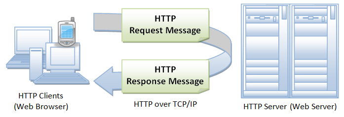
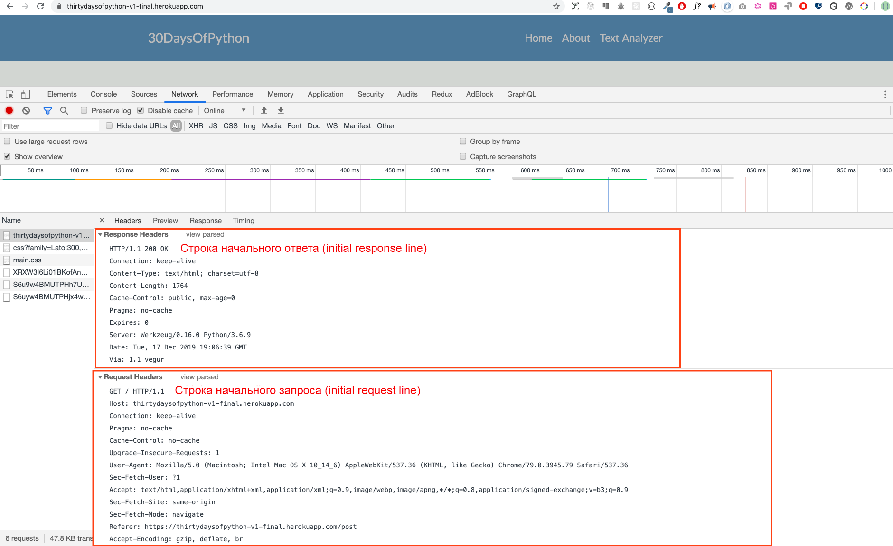

<div align="center">
  <h1> 30 Days Of Python: День 28 - API </h1>
  <a class="header-badge" target="_blank" href="https://www.linkedin.com/in/asabeneh/">
  
  </a>
  <a class="header-badge" target="_blank" href="https://twitter.com/Asabeneh">
  
  </a>

<sub>Автор:
<a href="https://www.linkedin.com/in/asabeneh/" target="_blank">Asabeneh Yetayeh</a><br>
<small>Второе издание: июль 2021</small>
</sub>

</div>
</div>

[<< День 27](./27_python_with_mongodb_ru.md) | [День 29 >>](./29_building_API_ru.md)


- [📘 День 28](#-день-28)
- [Интерфейс программирования приложений (API)](#интерфейс-программирования-приложений-api)
  - [API](#api)
  - [Создание API](#создание-api)
  - [HTTP (протокол передачи гипертекста)](#http-протокол-передачи-гипертекста)
  - [Структура HTTP](#структура-http)
  - [Начальная строка запроса (строка состояния)](#начальная-строка-запроса-строка-состояния)
    - [Начальная строка ответа (строка состояния)](#начальная-строка-ответа-строка-состояния)
    - [Поля заголовков](#поля-заголовков)
    - [Тело сообщения](#тело-сообщения)
    - [Методы запроса](#методы-запроса)
  - [💻 Упражнения: День 28](#-упражнения-день-28)

# 📘 День 28

# Интерфейс программирования приложений (API)

## API

API расшифровывается как Application Programming Interface — интерфейс программирования приложений. Тип API, который мы рассмотрим в этом разделе, — это веб-API.
Веб-API — это определённые интерфейсы, через которые происходит взаимодействие между предприятием и приложениями, использующими его ресурсы; это также соглашение об уровне обслуживания (SLA), которое определяет функционального поставщика и предоставляет путь к сервису или URL для пользователей его API.

В контексте веб-разработки API определяется как набор спецификаций, например сообщений-запросов протокола передачи гипертекста (HTTP), вместе с определением структуры сообщений-ответов, обычно в формате XML или JavaScript Object Notation (JSON).

Веб-API уходят от веб-сервисов на основе Simple Object Access Protocol (SOAP) и сервис-ориентированной архитектуры (SOA) к более прямым веб-ресурсам в стиле передачи репрезентативного состояния (REST).

Сервисы социальных сетей и веб-API позволили веб-сообществам обмениваться контентом и данными между сообществами и разными платформами. 

Используя API, контент, созданный в одном месте, можно динамически публиковать и обновлять в нескольких местах в интернете.

Например, REST API Twitter позволяет разработчикам получать доступ к основным данным Twitter, а Search API предоставляет методы для взаимодействия разработчиков с данными поиска и трендов Twitter.

Многие приложения предоставляют эндпоинты API. Некоторые примеры API — это [API](https://restcountries.eu/rest/v2/all) стран и [API пород кошек](https://api.thecatapi.com/v1/breeds).

В этом разделе мы рассмотрим RESTful API, который использует HTTP-методы запросов для GET, PUT, POST и DELETE данных.

## Создание API

RESTful API — это интерфейс программирования приложений (API), который использует HTTP-запросы для GET, PUT, POST и DELETE данных. В предыдущих разделах мы изучили Python, Flask и MongoDB. Мы используем полученные знания, чтобы разработать RESTful API с помощью Python Flask и базы данных MongoDB. Каждое приложение, в котором есть операция CRUD (Create, Read, Update, Delete), имеет API для создания данных, получения данных, обновления данных или удаления данных из базы данных.

Чтобы создать API, полезно понимать протокол HTTP и цикл запроса и ответа HTTP.

## HTTP (протокол передачи гипертекста)

HTTP — это устоявшийся протокол связи между клиентом и сервером. Клиентом в данном случае является браузер, а сервер — место, где вы получаете доступ к данным. HTTP — это сетевой протокол, используемый для доставки ресурсов, которыми могут быть файлы во Всемирной паутине: HTML-файлы, файлы изображений, результаты запросов, скрипты или другие типы файлов.

Браузер является HTTP-клиентом, потому что он отправляет запросы HTTP-серверу (веб-серверу), который затем отправляет ответы обратно клиенту.

## Структура HTTP

HTTP использует модель клиент-сервер. HTTP-клиент открывает соединение и отправляет сообщение-запрос HTTP-серверу, а HTTP-сервер возвращает сообщение-ответ, которое является запрошенным ресурсом. Когда цикл запроса-ответа завершается, сервер закрывает соединение.



Формат сообщений-запросов и сообщений-ответов похож. Оба вида сообщений имеют

- начальную строку,
- ноль или более строк заголовков,
- пустую строку (то есть отдельный CRLF) и
- необязательное тело сообщения (например, файл, данные запроса или результат запроса).

Давайте рассмотрим пример сообщений-запросов и сообщений-ответов, перейдя на этот сайт: https://thirtydaysofpython-v1-final.herokuapp.com/. Этот сайт развёрнут на бесплатном dyno Heroku и через несколько месяцев может не работать из-за большого количества запросов. Поддержите эту работу, чтобы сервер работал всё время. 



## Начальная строка запроса (строка состояния)

Начальная строка запроса отличается от начальной строки ответа.
Строка запроса состоит из трёх частей, разделённых пробелами:

- имя метода (GET, POST, HEAD)
- путь к запрошенному ресурсу,
- версия используемого HTTP. Например, GET / HTTP/1.1

GET — самый распространённый HTTP-метод, который помогает получить или прочитать ресурс, а POST — распространённый метод запроса для создания ресурса.

### Начальная строка ответа (строка состояния)

Начальная строка ответа, называемая строкой состояния, также состоит из трёх частей, разделённых пробелами:

- версия HTTP
- код состояния ответа, который показывает результат запроса, и причина, описывающая код состояния. Примеры строк состояния:
  HTTP/1.0 200 OK
  или
  HTTP/1.0 404 Not Found
  Примечания:

Самые распространённые коды состояния:
200 OK: запрос успешно выполнен, а результирующий ресурс (например, файл или вывод скрипта) возвращается в теле сообщения.
500 Server Error
Полный список кодов состояния HTTP можно найти [здесь](https://httpstatuses.com/). Его также можно найти [здесь](https://httpstatusdogs.com/).

### Поля заголовков

Как вы видели на скриншоте выше, строки заголовков предоставляют информацию о запросе или ответе либо об объекте, отправленном в теле сообщения.

```sh
GET / HTTP/1.1
Host: thirtydaysofpython-v1-final.herokuapp.com
Connection: keep-alive
Pragma: no-cache
Cache-Control: no-cache
Upgrade-Insecure-Requests: 1
User-Agent: Mozilla/5.0 (Macintosh; Intel Mac OS X 10_14_6) AppleWebKit/537.36 (KHTML, like Gecko) Chrome/79.0.3945.79 Safari/537.36
Sec-Fetch-User: ?1
Accept: text/html,application/xhtml+xml,application/xml;q=0.9,image/webp,image/apng,*/*;q=0.8,application/signed-exchange;v=b3;q=0.9
Sec-Fetch-Site: same-origin
Sec-Fetch-Mode: navigate
Referer: https://thirtydaysofpython-v1-final.herokuapp.com/post
Accept-Encoding: gzip, deflate, br
Accept-Language: en-GB,en;q=0.9,fi-FI;q=0.8,fi;q=0.7,en-CA;q=0.6,en-US;q=0.5,fr;q=0.4
```

### Тело сообщения

Сообщение HTTP может иметь тело с данными, отправленными после строк заголовков. В ответе именно здесь запрошенный ресурс возвращается клиенту (самое распространённое использование тела сообщения) или, возможно, пояснительный текст, если произошла ошибка. В запросе именно здесь данные, введённые пользователем, или загруженные файлы отправляются на сервер.

Если сообщение HTTP включает тело, в сообщении обычно есть строки заголовков, которые описывают тело. В частности,

Заголовок Content-Type: задаёт MIME-тип данных в теле (text/html, application/json, text/plain, text/css, image/gif).
Заголовок Content-Length: задаёт количество байтов в теле.

### Методы запроса

GET, POST, PUT и DELETE — это HTTP-методы запросов, которые мы будем реализовывать в API или приложении с операциями CRUD.

1. GET: метод GET используется для получения информации с заданного сервера по заданному URI. Запросы с использованием GET должны только получать данные и не должны оказывать никакого другого влияния на данные.

2. POST: запрос POST используется для создания данных и отправки данных на сервер, например для создания нового поста, загрузки файла и т. д. с использованием HTML-форм.

3. PUT: заменяет все текущие представления целевого ресурса загруженным содержимым, и мы используем его для изменения или обновления данных.

4. DELETE: удаляет данные

## 💻 Упражнения: День 28

1. Прочитайте об API и HTTP

🎉 ПОЗДРАВЛЯЕМ ! 🎉

[<< День 27](./27_python_with_mongodb_ru.md) | [День 29 >>](./29_building_API_ru.md)
