# 🐍 30 дней Python

|# День | Темы                                                    |
|------|:---------------------------------------------------------:|
| 01  |  [Введение](./readme.md)|
| 02  |  [Переменные, встроенные функции](./02_variables_builtin_functions_ru.md)|
| 03  |  [Операторы](./03_operators_ru.md)|
| 04  |  [Строки](./04_strings_ru.md)|
| 05  |  [Списки](./05_lists_ru.md)|
| 06  |  [Кортежи](./06_tuples_ru.md)|
| 07  |  [Множества](./07_sets_ru.md)|
| 08  |  [Словари](./08_dictionaries_ru.md)|
| 09  |  [Условные операторы](./09_conditionals_ru.md)|
| 10  |  [Циклы](./10_loops_ru.md)|
| 11  |  [Функции](./11_functions_ru.md)|
| 12  |  [Модули](./12_modules_ru.md)|
| 13  |  [List Comprehension](./13_list_comprehension_ru.md)|
| 14  |  [Функции высшего порядка](./14_higher_order_functions_ru.md)|
| 15  |  [Ошибки типов в Python](./15_python_type_errors_ru.md)|
| 16 |  [Дата и время в Python](./16_python_datetime_ru.md) |
| 17 |  [Обработка исключений](./17_exception_handling_ru.md)|
| 18 |  [Регулярные выражения](./18_regular_expressions_ru.md)|
| 19 |  [Работа с файлами](./19_file_handling_ru.md)|
| 20 |  [Менеджер пакетов Python](./20_python_package_manager_ru.md)|
| 21 |  [Классы и объекты](./21_classes_and_objects_ru.md)|
| 22 |  [Веб-скрапинг](./22_web_scraping_ru.md)|
| 23 |  [Виртуальное окружение](./23_virtual_environment_ru.md)|
| 24 |  [Статистика](./24_statistics_ru.md)|
| 25 |  [Pandas](./25_pandas_ru.md)|
| 26 |  [Python в вебе](./26_python_web_ru.md)|
| 27 |  [Python и MongoDB](./27_python_with_mongodb_ru.md)|
| 28 |  [API](./28_API_ru.md)|
| 29 |  [Создание API](./29_building_API_ru.md)|
| 30 |  [Заключение](./30_conclusions_ru.md)|


<small>🧡🧡🧡 УДАЧНОГО КОДИРОВАНИЯ 🧡🧡🧡</small>

---

### 🙌 Станьте спонсором

Вы можете поддержать этот проект, став спонсором на **[GitHub Sponsors](https://github.com/sponsors/asabeneh)** или через [PayPal](https://www.paypal.me/asabeneh).

Каждый вклад, большой или маленький, имеет огромное значение. Спасибо за вашу поддержку! 🌟

---

<div align="center">
  <h1> 30 дней Python: День 1 — Введение</h1>
  <a class="header-badge" target="_blank" href="https://www.linkedin.com/in/asabeneh/">
  
  </a>
  <a class="header-badge" target="_blank" href="https://twitter.com/Asabeneh">
  
  </a>

  <sub>Автор:
  <a href="https://www.linkedin.com/in/asabeneh/" target="_blank">Asabeneh Yetayeh</a><br>
  <small> Второе издание: июль 2021</small>
  </sub>
</div>

🇫🇷 [Французский](../French/README_fr.md)
SP [Испанский](../Spanish/readme.md)
DE [Немецкий](../German/readme.md)
🇧🇷 [Португальский](../Portuguese/README.md)
🇨🇳 [Китайский](../Chinese/README.md)
🇬🇷 [Греческий](../Greek/readme.md)
SA [Арабский](../Arabic/readme.md)
KO [Корейский](../Korean/readme_ko.md)
UK [Украинский](../Ukrainian/readme.md)
UZ [Узбекский](../Uzbek)
FA [Персидский](../Persain/readme.md)
RU [Русский](./readme.md)


[День 2 >>](./02_variables_builtin_functions_ru.md)


- [🐍 30 дней Python](#-30-дней-python)
    - [🙌 Станьте спонсором](#-станьте-спонсором)
- [📘 День 1](#-день-1)
  - [Добро пожаловать](#добро-пожаловать)
  - [Введение](#введение)
  - [Почему Python?](#почему-python-)
  - [Настройка среды](#настройка-среды)
    - [Установка Python](#установка-python)
    - [Оболочка Python](#оболочка-python)
    - [Установка Visual Studio Code](#установка-visual-studio-code)
      - [Как использовать Visual Studio Code](#как-использовать-visual-studio-code)
  - [Основы Python](#основы-python)
    - [Синтаксис Python](#синтаксис-python)
    - [Отступы в Python](#отступы-в-python)
    - [Комментарии](#комментарии)
    - [Типы данных](#типы-данных)
      - [Число](#число)
      - [Строка](#строка)
      - [Логические значения](#логические-значения)
      - [Список](#список)
      - [Словарь](#словарь)
      - [Кортеж](#кортеж)
      - [Множество](#множество)
    - [Проверка типов данных](#проверка-типов-данных)
    - [Файл Python](#файл-python)
  - [💻 Упражнения - День 1](#-упражнения---день-1)
    - [Упражнение: Уровень 1](#упражнение-уровень-1)
    - [Упражнение: Уровень 2](#упражнение-уровень-2)
    - [Упражнение: Уровень 3](#упражнение-уровень-3)

# 📘 День 1

## Добро пожаловать

**Поздравляем** с решением участвовать в программистском испытании _30 дней Python_. В этом испытании вы изучите всё, что нужно, чтобы стать Python-программистом, и все концепции программирования. В конце испытания вы получите сертификат о прохождении программистского испытания _30DaysOfPython_.

Если вы хотите активно участвовать в испытании, можете присоединиться к telegram-группе [испытания 30DaysOfPython](https://t.me/ThirtyDaysOfPython).

## Введение

Python — это высокоуровневый язык программирования общего назначения. Это открытый, интерпретируемый, объектно-ориентированный язык программирования. Python создал голландский программист Гвидо ван Россум. Название языка программирования Python произошло от британского скетч-шоу *«Летающий цирк Монти Пайтона»*. Первая версия была выпущена 20 февраля 1991 года. Это испытание «30 дней Python» поможет вам шаг за шагом изучить новейшую версию Python — Python 3. Темы разбиты на 30 дней, каждый день содержит несколько тем с простыми объяснениями, примерами из реальной жизни и множеством практических упражнений и проектов.

Это испытание предназначено для новичков и профессионалов, которые хотят изучить язык программирования Python. На его прохождение может уйти от 30 до 100 дней. Люди, которые активно участвуют в telegram-группе, имеют высокую вероятность завершить испытание.

Это испытание легко читается, написано живым английским языком, увлекает, мотивирует и в то же время предъявляет высокие требования. Вам нужно выделить много времени, чтобы его закончить. Если вы лучше воспринимаете визуальную информацию, можете посмотреть видеоурок на YouTube-канале <a href="https://www.youtube.com/channel/UC7PNRuno1rzYPb1xLa4yktw"> Washera</a>. Можно начать с [видео «Python для абсолютных новичков»](https://youtu.be/OCCWZheOesI). Подпишитесь на канал, комментируйте, задавайте вопросы под видео на YouTube и проявляйте инициативу — автор рано или поздно вас заметит.

Автор любит слышать ваше мнение об испытании, поэтому поделитесь своими мыслями о 30DaysOfPython. Вы можете оставить отзыв по [этой ссылке](https://www.asabeneh.com/testimonials).

## Почему Python ?

Это язык программирования, который очень близок к человеческому языку, и поэтому его легко изучать и использовать.
Python используется в различных отраслях и компаниях (включая Google). На нём разрабатывают веб-приложения, десктопные приложения, системы администрирования и библиотеки машинного обучения. Python очень популярен в сообществе специалистов по данным и машинному обучению. Надеюсь, этого достаточно, чтобы убедить вас начать изучать Python. Python пожирает мир, а вы его одолеваете, прежде чем он съест вас.

## Настройка среды

### Установка Python

Чтобы запустить скрипт Python, нужно установить Python. Давайте [скачаем](https://www.python.org/) Python.
Если вы пользователь Windows, нажмите кнопку, обведённую красным.

[](https://www.python.org/)

Если вы пользователь macOS, нажмите кнопку, обведённую красным.

[](https://www.python.org/)

Чтобы проверить, установлен ли Python, введите следующую команду в терминале вашего устройства.

```shell
python3 --version
```


Как видно из терминала, в данный момент я использую версию _Python 3.7.5_. Ваша версия Python может отличаться от моей, но она должна быть 3.6 или выше. Если вы смогли увидеть версию Python — отлично. Python установлен на вашей машине. Переходите к следующему разделу.

### Оболочка Python

Python — это интерпретируемый скриптовый язык, поэтому его не нужно компилировать. Это значит, что он выполняет код строка за строкой. Вместе с Python поставляется _оболочка Python (интерактивная оболочка Python)_. Она используется для выполнения одной команды Python и получения результата.

Оболочка Python ждёт от пользователя код на Python. Когда вы вводите код, она интерпретирует его и показывает результат на следующей строке.
Откройте терминал или командную строку (cmd) и введите:

```shell
python
```

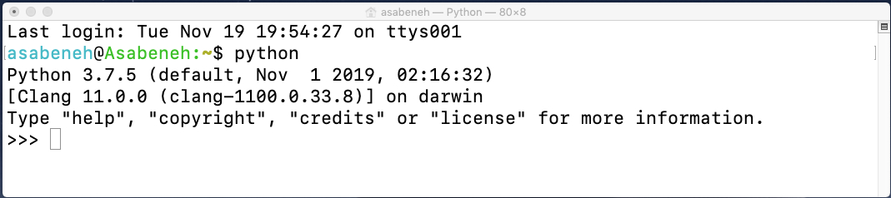

Откроется интерактивная оболочка Python и будет ждать, пока вы напишете код Python (скрипт Python). Вы будете писать свой скрипт рядом с этим символом >>> и затем нажимать Enter.
Давайте напишем наш самый первый скрипт в оболочке Python.

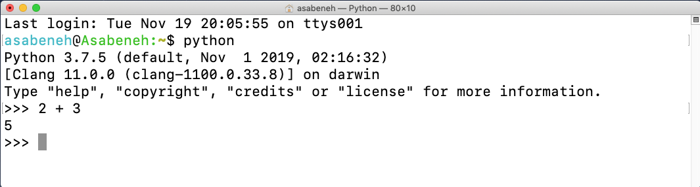

Отлично, вы написали свой первый скрипт Python в интерактивной оболочке Python. Как закрыть интерактивную оболочку Python?
Чтобы закрыть оболочку, рядом с этим символом >>> введите команду **exit()** и нажмите Enter.

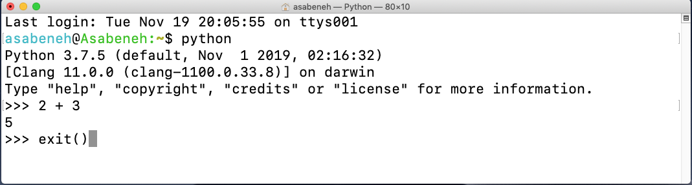

Теперь вы знаете, как открыть интерактивную оболочку Python и как из неё выйти.

Python выдаст результаты, если вы напишете скрипты, которые он понимает, иначе он вернёт ошибки. Давайте намеренно сделаем ошибку и посмотрим, что вернёт Python.

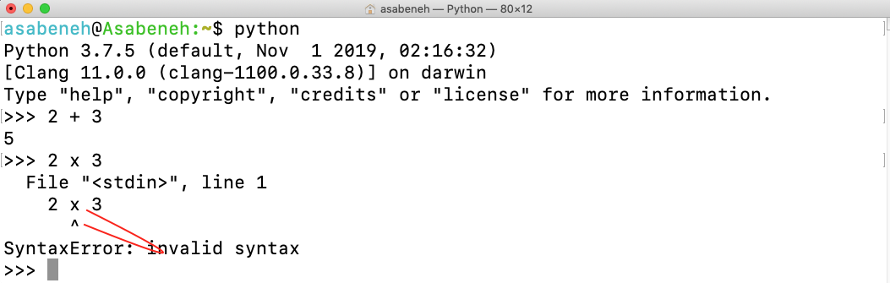

Как видно из возвращённой ошибки, Python настолько умён, что знает, какую ошибку мы допустили: _Syntax Error: invalid syntax_. Использование x для умножения в Python является синтаксической ошибкой, потому что (x) не является допустимым синтаксисом в Python. Вместо (**x**) мы используем звёздочку (*) для умножения. Возвращённая ошибка ясно показывает, что нужно исправить.

Процесс выявления и устранения ошибок в программе называется _отладкой_. Давайте отладим её, поставив * вместо **x**.

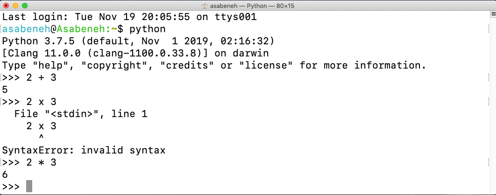

Наша ошибка была исправлена, код запустился, и мы получили ожидаемый результат. Как программист, вы будете сталкиваться с такими ошибками ежедневно. Полезно уметь отлаживать. Чтобы хорошо отлаживать, вы должны понимать, с какими ошибками имеете дело. Некоторые ошибки Python, с которыми вы можете столкнуться: _SyntaxError_, _IndexError_, _NameError_, _ModuleNotFoundError_, _KeyError_, _ImportError_, _AttributeError_, _TypeError_, _ValueError_, _ZeroDivisionError_ и т.д. Подробнее о различных **_типах ошибок_** Python мы поговорим в следующих разделах.

Давайте ещё немного попрактикуемся в использовании интерактивной оболочки Python. Перейдите в терминал или командную строку и введите слово **python**.


Интерактивная оболочка Python открыта. Давайте выполним некоторые базовые математические операции (сложение, вычитание, умножение, деление, остаток, возведение в степень).

Давайте сначала немного посчитаем, прежде чем писать код Python:

- 2 + 3 = 5
- 3 - 2 = 1
- 3 \* 2 = 6
- 3 / 2 = 1.5
- 3 \*\* 2 = 3 x 3 = 9

В Python у нас есть следующие дополнительные операции:

- 3 % 2 = 1 => нахождение остатка
- 3 // 2 = 1 => отбрасывание остатка

Давайте преобразуем приведённые выше математические выражения в код Python. Интерактивная оболочка Python открыта, и давайте напишем комментарий в самом начале оболочки.

_Комментарий_ — это часть кода, которая не выполняется Python. Поэтому мы можем оставлять в коде текст, чтобы сделать его более читаемым. Python не выполняет часть с комментарием. Комментарий в Python начинается с символа решётки (#).
Вот как пишется комментарий в Python:

```shell
 # комментарий начинается с решётки
 # это комментарий Python, потому что он начинается с символа (#)
```

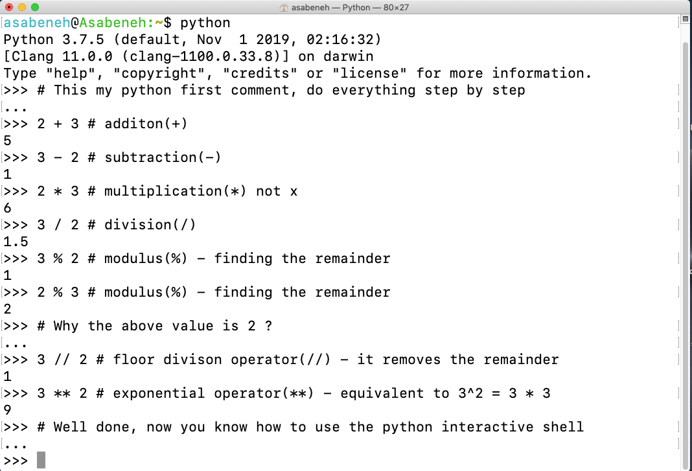

Прежде чем перейти к следующему разделу, давайте ещё немного попрактикуемся в интерактивной оболочке Python. Закройте открытую оболочку, введя _exit()_, откройте её снова и давайте попрактикуемся в написании текста в оболочке Python.

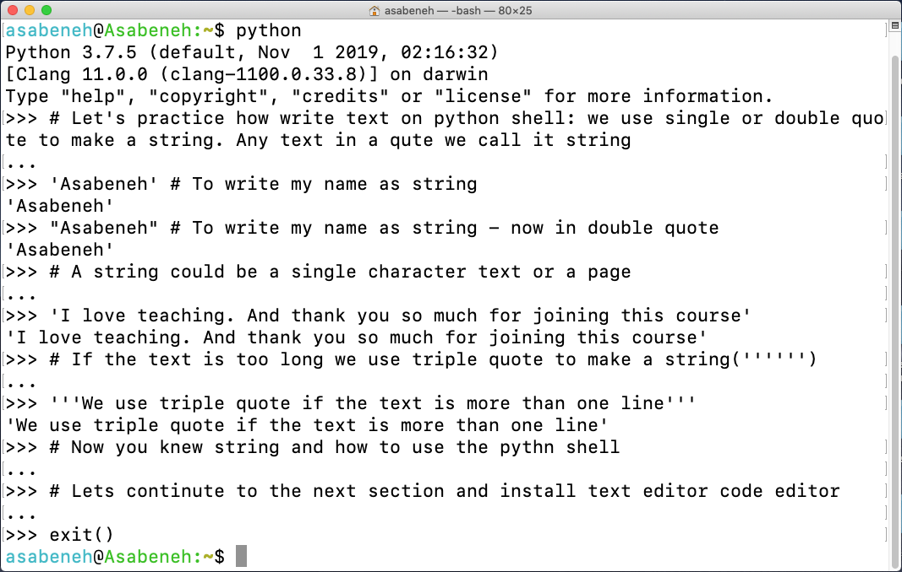

### Установка Visual Studio Code

Интерактивная оболочка Python хороша для проверки и тестирования небольших скриптов, но она не подойдёт для большого проекта. В реальной рабочей среде разработчики используют разные редакторы кода для написания кода. В этом программистском испытании «30 дней Python» мы будем использовать Visual Studio Code. Visual Studio Code — очень популярный текстовый редактор с открытым исходным кодом. Я фанат vscode и рекомендую [скачать](https://code.visualstudio.com/) Visual Studio Code, но если вам больше нравятся другие редакторы, не стесняйтесь использовать то, что у вас есть.

[](https://code.visualstudio.com/)

Если вы установили Visual Studio Code, давайте посмотрим, как им пользоваться.
Если вы предпочитаете видео, можете посмотреть [видеоурок](https://www.youtube.com/watch?v=bn7Cx4z-vSo) по Visual Studio Code для Python.

#### Как использовать Visual Studio Code

Откройте Visual Studio Code, дважды щёлкнув по значку Visual Studio. Когда вы его откроете, вы увидите такой интерфейс. Попробуйте взаимодействовать с подписанными значками.


Создайте на рабочем столе папку с названием 30DaysOfPython. Затем откройте её с помощью Visual Studio Code.


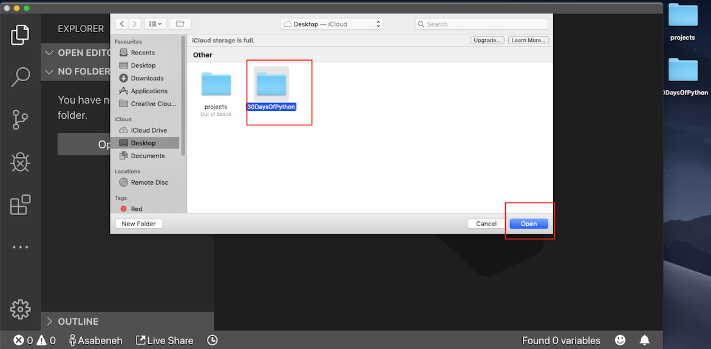

После открытия вы увидите ярлыки для создания файлов и папок внутри каталога проекта 30DaysOfPython. Как видите ниже, я создал самый первый файл, `helloworld.py`. Вы можете сделать то же самое.

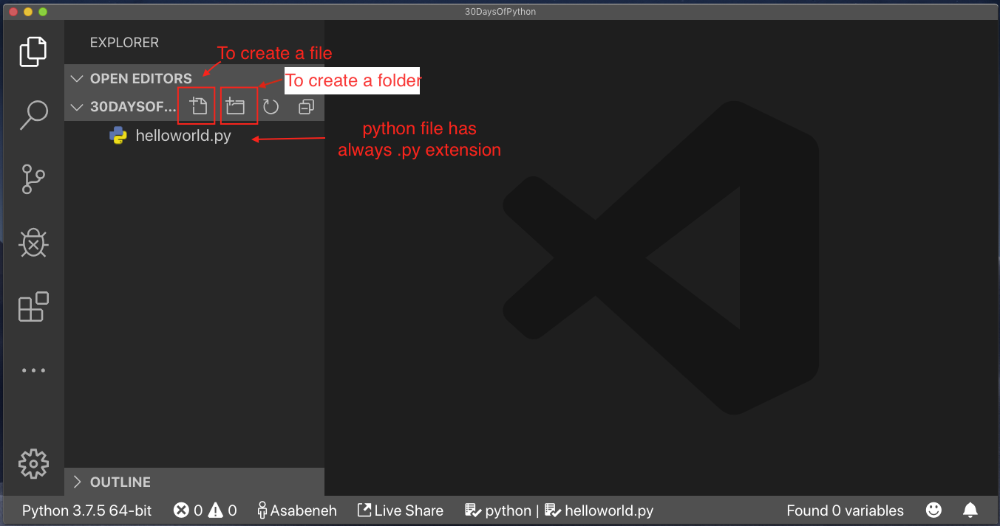

После долгого дня программирования вы хотите закрыть редактор кода, верно? Вот так вы закроете открытый проект.


Поздравляем, вы закончили настройку среды разработки. Давайте начнём программировать.

## Основы Python

### Синтаксис Python

Скрипт Python можно написать в интерактивной оболочке Python или в редакторе кода. Файл Python имеет расширение .py.

### Отступы в Python

Отступ — это пробел в тексте. Во многих языках отступы используются для повышения читаемости кода; однако Python использует отступы для создания блоков кода. В других языках программирования для создания блоков кода вместо отступов используются фигурные скобки. Одна из распространённых ошибок при написании кода на Python — неправильный отступ.

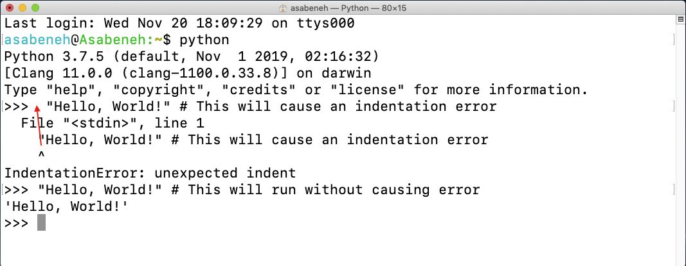

### Комментарии

Комментарии играют решающую роль в повышении читаемости кода и позволяют разработчикам оставлять заметки в коде. В Python любой текст, перед которым стоит символ решётки (#), считается комментарием и не выполняется при запуске кода.

**Пример: однострочный комментарий**

```shell
    # Это первый комментарий
    # Это второй комментарий
    # Python пожирает мир
```

**Пример: многострочный комментарий**

Тройные кавычки можно использовать для многострочного комментария, если он не присвоен переменной.

```shell
"""Это многострочный комментарий
многострочный комментарий занимает несколько строк.
python пожирает мир
"""
```

### Типы данных

В Python есть несколько типов данных. Давайте начнём с самых распространённых. Разные типы данных будут подробно рассмотрены в других разделах. Пока давайте просто пройдёмся по разным типам данных и познакомимся с ними. Вам не нужно сейчас ясно их понимать.

#### Число

- Целое число (Integer): целые числа (отрицательные, ноль и положительные)
    Пример:
    ... -3, -2, -1, 0, 1, 2, 3 ...
- Число с плавающей точкой (Float): десятичное число
    Пример
    ... -3.5, -2.25, -1.0, 0.0, 1.1, 2.2, 3.5 ...
- Комплексное число (Complex)
    Пример
    1 + j, 2 + 4j

#### Строка

Набор из одного или нескольких символов в одинарных или двойных кавычках. Если строка состоит более чем из одного предложения, мы используем тройные кавычки.

**Пример:**

```py
'Asabeneh'
'Finland'
'Python'
'I love teaching'
'I hope you are enjoying the first day of 30DaysOfPython Challenge'
```

#### Логические значения

Логический тип данных — это значение True или False. T и F всегда должны быть заглавными.

**Пример:**

```python
    True  #  Свет включён? Если включён, значение True
    False # Свет включён? Если выключен, значение False
```

#### Список

Список Python — это упорядоченная коллекция, которая позволяет хранить элементы разных типов данных. Список похож на массив в JavaScript.

**Пример:**

```py
[0, 1, 2, 3, 4, 5]  # все одного типа данных — список чисел
['Banana', 'Orange', 'Mango', 'Avocado'] # все одного типа данных — список строк (фрукты)
['Finland','Estonia', 'Sweden','Norway'] # все одного типа данных — список строк (страны)
['Banana', 10, False, 9.81] # разные типы данных в списке — строка, целое число, логическое значение и число с плавающей точкой
```

#### Словарь

Объект словаря Python — это неупорядоченная коллекция данных в формате пар «ключ — значение».

**Пример:**

```py
{
'first_name':'Asabeneh',
'last_name':'Yetayeh',
'country':'Finland',
'age':250,
'is_married':True,
'skills':['JS', 'React', 'Node', 'Python']
}
```

#### Кортеж

Кортеж — это упорядоченная коллекция данных разных типов, как список, но кортежи нельзя изменить после их создания. Они неизменяемы.

**Пример:**

```py
('Asabeneh', 'Pawel', 'Brook', 'Abraham', 'Lidiya') # Имена
```

```py
('Earth', 'Jupiter', 'Neptune', 'Mars', 'Venus', 'Saturn', 'Uranus', 'Mercury') # планеты
```

#### Множество

Множество — это коллекция типов данных, похожая на список и кортеж. В отличие от списка и кортежа, множество не является упорядоченной коллекцией элементов. Как и в математике, множество в Python хранит только уникальные элементы.

В последующих разделах мы подробно рассмотрим каждый тип данных Python.

**Пример:**

```py
{2, 4, 3, 5}
{3.14, 9.81, 2.7} # порядок во множестве не важен
```

### Проверка типов данных

Чтобы проверить тип данных определённых данных/переменной, мы используем функцию **type**. В следующем терминале вы увидите разные типы данных Python:


### Файл Python

Сначала откройте папку проекта 30DaysOfPython. Если у вас нет этой папки, создайте папку с названием 30DaysOfPython. Внутри этой папки создайте файл с названием helloworld.py. Теперь давайте сделаем то же, что мы делали в интерактивной оболочке Python, но с помощью Visual Studio Code.

Интерактивная оболочка Python выводила результат без использования **print**, но в Visual Studio Code, чтобы увидеть результат, мы должны использовать встроенную функцию _print()_. Встроенная функция _print()_ принимает один или несколько аргументов следующим образом: _print('arument1', 'argument2', 'argument3')_. Смотрите примеры ниже.

**Пример:**

Имя файла — `helloworld.py`

```py
# День 1 — испытание 30DaysOfPython

print(2 + 3)             # сложение(+)
print(3 - 1)             # вычитание(-)
print(2 * 3)             # умножение(*)
print(3 / 2)             # деление(/)
print(3 ** 2)            # возведение в степень(**)
print(3 % 2)             # остаток(%)
print(3 // 2)            # оператор целочисленного деления(//)

# Проверка типов данных
print(type(10))          # Int
print(type(3.14))        # Float
print(type(1 + 3j))      # Комплексное число
print(type('Asabeneh'))  # Строка
print(type([1, 2, 3]))   # Список
print(type({'name':'Asabeneh'})) # Словарь
print(type({9.8, 3.14, 2.7}))    # Множество
print(type((9.8, 3.14, 2.7)))    # Кортеж
```

Чтобы запустить файл Python, посмотрите изображение ниже. Вы можете запустить файл Python, нажав зелёную кнопку в Visual Studio Code или введя _python helloworld.py_ в терминале.

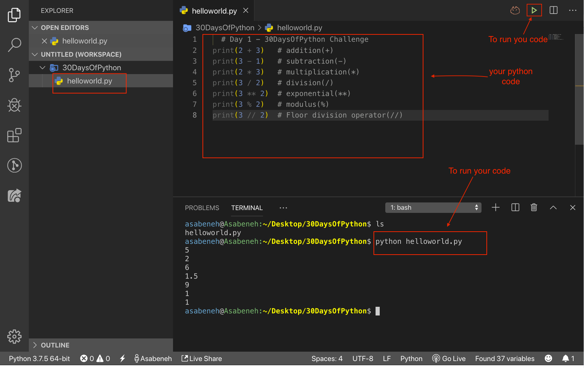

🌕 Вы потрясающие. Вы только что завершили испытание первого дня и находитесь на пути к величию. Теперь сделайте несколько упражнений для мозга и мышц.

## 💻 Упражнения - День 1

### Упражнение: Уровень 1

1. Проверьте, какую версию Python вы используете.
2. Откройте интерактивную оболочку Python и выполните следующие операции. Операнды — 3 и 4.
   - сложение(+)
   - вычитание(-)
   - умножение(\*)
   - остаток(%)
   - деление(/)
   - возведение в степень(\*\*)
   - оператор целочисленного деления(//)
3. Напишите строки в интерактивной оболочке Python. Строки следующие:
   - Ваше имя
   - Ваша фамилия
   - Ваша страна
   - I am enjoying 30 days of python
4. Проверьте типы данных следующих данных:
   - 10
   - 9.8
   - 3.14
   - 4 - 4j
   - ['Asabeneh', 'Python', 'Finland']
   - Ваше имя
   - Ваша фамилия
   - Ваша страна

### Упражнение: Уровень 2

1. Создайте папку с названием day_1 внутри папки 30DaysOfPython. Внутри папки day_1 создайте файл Python helloworld.py и повторите вопросы 1, 2, 3 и 4. Не забывайте использовать _print()_, когда работаете с файлом Python. Перейдите в каталог, где вы сохранили файл, и запустите его.

### Упражнение: Уровень 3

1. Напишите пример для разных типов данных Python, таких как число (целое, с плавающей точкой, комплексное), строка, логическое значение, список, кортеж, множество и словарь.
2. Найдите [евклидово расстояние](https://en.wikipedia.org/wiki/Euclidean_distance#:~:text=In%20mathematics%2C%20the%20Euclidean%20distance,being%20called%20the%20Pythagorean%20distance.) между (2, 3) и (10, 8)

🎉 ПОЗДРАВЛЯЕМ! 🎉

[День 2 >>](./02_variables_builtin_functions_ru.md)
