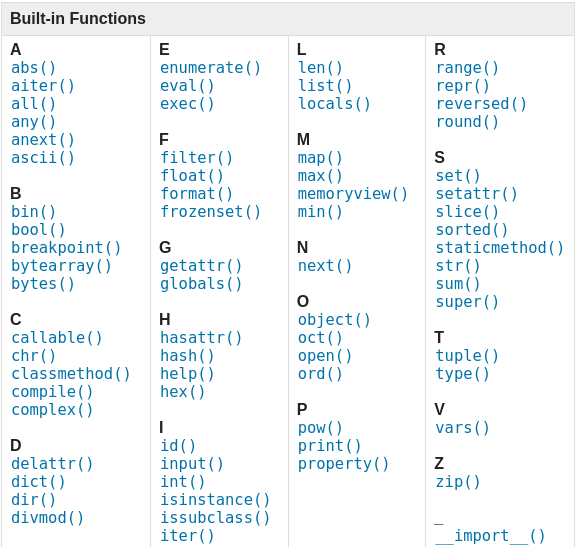
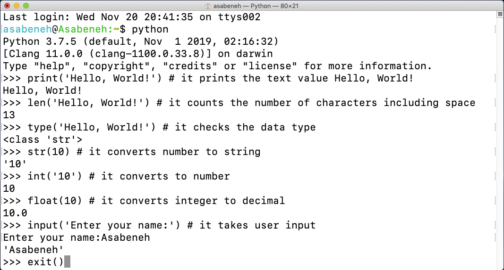
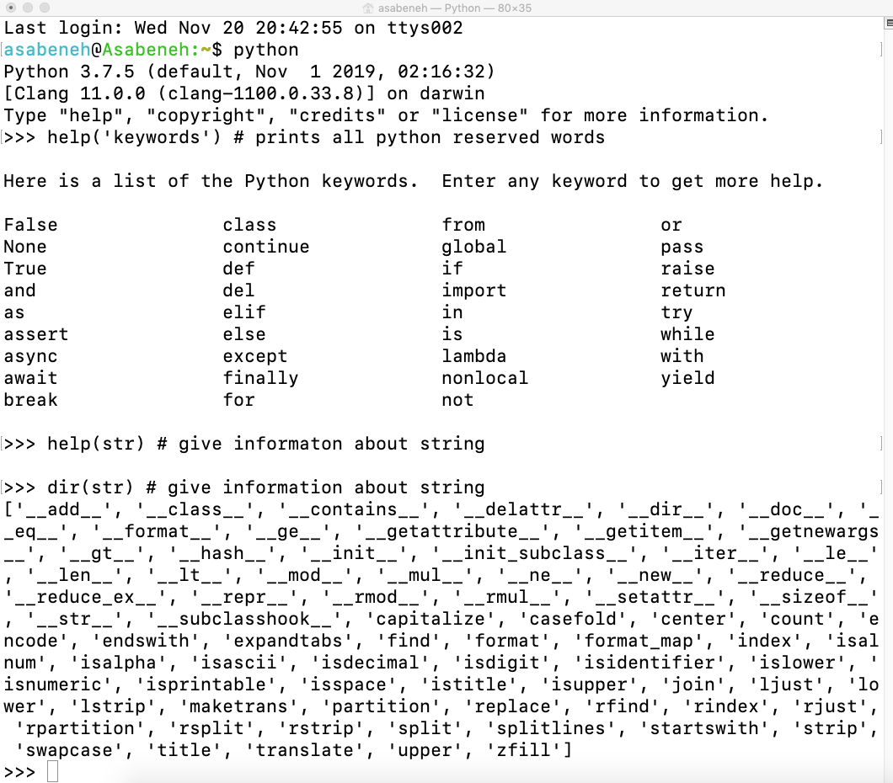
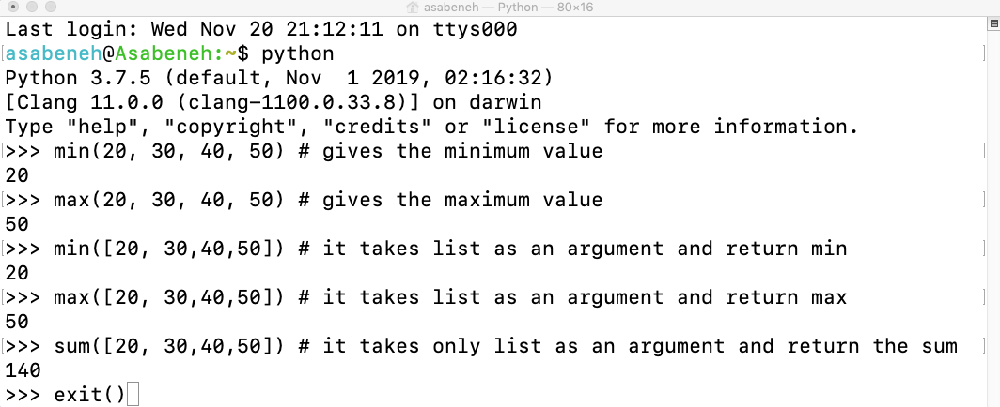

<div dir="rtl" lang="ur">

<div align="center">
  <h1>پائتھن کے 30 دن: دن 2 — متغیرات اور بلٹ اِن فنکشنز</h1>
  <a href="https://www.linkedin.com/in/asabeneh/">
    
  </a>
  <a href="https://twitter.com/Asabeneh">
    
  </a>
  <p>مصنف: <a href="https://www.linkedin.com/in/asabeneh/">Asabeneh Yetayeh</a><br>دوسرا ایڈیشن: جولائی 2021</p>
</div>

[اصل انگریزی سبق](../02_Day_Variables_builtin_functions/02_variables_builtin_functions.md) | [تمام زبانیں](../readme.md)

[پچھلا دن: 1](./readme.md) | [فہرست](./readme.md) | [اگلا دن: 3](./03_operators.md)


**اس سبق کی فہرست**

- [📘 دن 2](#day-2-section-1)
  - [بلٹ اِن فنکشنز](#day-2-section-2)
  - [متغیرات](#day-2-section-3)
    - [ایک سطر میں کئی متغیرات بنانا](#day-2-section-4)
  - [ڈیٹا کی اقسام](#day-2-section-5)
  - [ڈیٹا کی قسم جانچنا اور تبدیل کرنا](#day-2-section-6)
  - [اعداد](#day-2-section-7)
  - [💻 مشقیں — دن 2](#day-2-section-8)
    - [مشقیں: درجہ 1](#day-2-section-9)
    - [مشقیں: درجہ 2](#day-2-section-10)

<a id="day-2-section-1"></a>

# 📘 دن 2

<a id="day-2-section-2"></a>

## بلٹ اِن فنکشنز

پائتھن میں بہت سے بلٹ اِن، یعنی پہلے سے موجود، فنکشنز ہیں۔ انہیں امپورٹ یا الگ ترتیب دیے بغیر استعمال کیا جا سکتا ہے۔ عام مثالیں `print()`، `len()`، `type()`، `int()`، `float()`، `str()`، `input()`، `list()`، `dict()`، `min()`، `max()`، `sum()`، `sorted()`، `open()`، `help()` اور `dir()` ہیں۔ اصل متن میں درج `file()` پائتھن 2 کا فنکشن تھا؛ پائتھن 3 میں فائل کھولنے کے لیے `open()` استعمال کریں۔ نیچے [پائتھن کی دستاویزات](https://docs.python.org/3/library/functions.html) سے بلٹ اِن فنکشنز کی فہرست دی گئی ہے۔



پائتھن شیل کھولیں اور چند عام فنکشنز آزمائیں۔



مختلف فنکشنز کے ساتھ مزید مشق کریں۔



اوپر کے ٹرمینل میں پائتھن کے مخصوص الفاظ (*reserved words*) نظر آتے ہیں۔ انہیں متغیرات یا فنکشنز کے نام کے طور پر استعمال نہیں کرتے۔ اگلے حصے میں متغیرات پڑھیں گے۔

اب آپ بلٹ اِن فنکشنز سے واقف ہو چکے ہیں۔ ایک اور مشق کے بعد آگے بڑھیں۔



<a id="day-2-section-3"></a>

## متغیرات

متغیر (*variable*) کمپیوٹر کی میموری میں موجود ڈیٹا کا حوالہ ہوتا ہے۔ ایسے نام چنیں جو یاد رکھنے میں آسان ہوں اور بتائیں کہ ڈیٹا کس چیز کا ہے۔ نام کے شروع میں عدد، یا نام میں ہائفن اور مخصوص علامتیں استعمال نہیں کی جا سکتیں۔ `x`، `y`، `z` جیسے مختصر نام جائز ہیں، مگر `firstname`، `lastname`، `age` اور `country` جیسے واضح نام بہتر ہیں۔

پائتھن میں متغیر کے نام کے قواعد:

- نام حرف یا انڈر اسکور `_` سے شروع ہونا چاہیے۔
- نام عدد سے شروع نہیں ہو سکتا۔
- بنیادی مثالوں میں حروف، اعداد اور انڈر اسکور استعمال کریں، مثلاً `A-z`، `0-9` اور `_`۔ پائتھن بہت سے یونیکوڈ حروف بھی قبول کرتا ہے۔
- چھوٹے اور بڑے حروف میں فرق ہوتا ہے؛ `firstname`، `Firstname`، `FirstName` اور `FIRSTNAME` الگ نام ہیں۔

درست ناموں کی مثالیں:

<div dir="ltr">

```shell
firstname
lastname
age
country
city
first_name
last_name
capital_city
_if # if we want to use reserved word as a variable
year_2021
year2021
current_year_2021
birth_year
num1
num2
```

</div>

غلط ناموں کی مثالیں:

<div dir="ltr">

```shell
first-name
first@name
first$name
num-1
1num
```

</div>

ہم پائتھن کا عام انداز `snake_case` استعمال کریں گے۔ کئی الفاظ والے نام میں الفاظ کے درمیان انڈر اسکور لگتا ہے، مثلاً `first_name`، `last_name` اور `engine_rotation_speed`۔ یہ نام پڑھنے میں آسان بناتا ہے۔

کسی متغیر کو قدر دینے کو اسائنمنٹ کہتے ہیں۔ مثال میں نام کو `first_name` میں رکھا گیا ہے۔ یہاں مساوی کا نشان `=` اسائنمنٹ آپریٹر ہے؛ اس کا مطلب ریاضی کی مساوات جانچنا نہیں بلکہ قدر دینا ہے۔

**مثال:**

<div dir="ltr">

```py
# Variables in Python
first_name = 'Asabeneh'
last_name = 'Yetayeh'
country = 'Finland'
city = 'Helsinki'
age = 250
is_married = True
skills = ['HTML', 'CSS', 'JS', 'React', 'Python']
person_info = {
   'firstname':'Asabeneh',
   'lastname':'Yetayeh',
   'country':'Finland',
   'city':'Helsinki'
   }
```

</div>

اب `print()` اور `len()` استعمال کریں۔ `print()` کئی آرگیومنٹ لے سکتا ہے۔ آرگیومنٹ وہ قدر ہے جو فنکشن کی قوسین کے اندر دی جاتی ہے۔

**مثال:**

<div dir="ltr">

```py
print('Hello, World!') # The text Hello, World! is an argument
print('Hello',',', 'World','!') # it can take multiple arguments, four arguments have been passed
print(len('Hello, World!')) # it takes only one argument
```

</div>

اوپر بنائے گئے متغیرات دکھائیں اور ان کی لمبائی معلوم کریں۔

**مثال:**

<div dir="ltr">

```py
# Printing the values stored in the variables

print('First name:', first_name)
print('First name length:', len(first_name))
print('Last name: ', last_name)
print('Last name length: ', len(last_name))
print('Country: ', country)
print('City: ', city)
print('Age: ', age)
print('Married: ', is_married)
print('Skills: ', skills)
print('Person information: ', person_info)
```

</div>

<a id="day-2-section-4"></a>

### ایک سطر میں کئی متغیرات بنانا

ایک ہی سطر میں کئی متغیرات کو قدریں دی جا سکتی ہیں۔

**مثال:**

<div dir="ltr">

```py
first_name, last_name, country, age, is_married = 'Asabeneh', 'Yetayeh', 'Helsink', 250, True

print(first_name, last_name, country, age, is_married)
print('First name:', first_name)
print('Last name: ', last_name)
print('Country: ', country)
print('Age: ', age)
print('Married: ', is_married)
```

</div>

`input()` سے صارف کی دی ہوئی معلومات حاصل کریں اور انہیں `first_name` اور `age` میں رکھیں۔

**مثال:**

<div dir="ltr">

```py
first_name = input('What is your name: ')
age = input('How old are you? ')

print(first_name)
print(age)
```

</div>

<a id="day-2-section-5"></a>

## ڈیٹا کی اقسام

پائتھن میں ڈیٹا کی کئی اقسام ہیں۔ ان کی پہچان کے لیے `type()` استعمال ہوتا ہے۔ ان اقسام کو اچھی طرح سمجھیں، کیونکہ پروگرامنگ کے تقریباً ہر موضوع کا ان سے تعلق ہے۔ پہلے تعارف ہو چکا ہے؛ متعلقہ حصوں میں ہر قسم کی مزید تفصیل پڑھیں گے۔

<a id="day-2-section-6"></a>

## ڈیٹا کی قسم جانچنا اور تبدیل کرنا

- قسم جانچنا: کسی قدر یا متغیر کی قسم معلوم کرنے کے لیے `type()` استعمال کریں۔

**مثالیں:**

<div dir="ltr">

```py
# Different python data types
# Let's declare variables with various data types

first_name = 'Asabeneh'     # str
last_name = 'Yetayeh'       # str
country = 'Finland'         # str
city= 'Helsinki'            # str
age = 250                   # int, it is not my real age, don't worry about it

# Printing out types
print(type('Asabeneh'))          # str
print(type(first_name))          # str
print(type(10))                  # int
print(type(3.14))                # float
print(type(1 + 1j))              # complex
print(type(True))                # bool
print(type([1, 2, 3, 4]))        # list
print(type({'name':'Asabeneh'})) # dict
print(type((1,2)))               # tuple
print(type(zip([1,2],[3,4])))    # zip
```

</div>

- قسم تبدیل کرنا (*casting*): ایک قسم کے ڈیٹا کو دوسری قسم میں تبدیل کرنا۔ اس کے لیے `int()`، `float()`، `str()`، `list()` اور `set()` جیسے فنکشنز استعمال ہوتے ہیں۔ حساب سے پہلے عدد والی سٹرنگ کو `int` یا `float` بنائیں، ورنہ خرابی آ سکتی ہے۔ عدد کو سٹرنگ کے ساتھ جوڑنے سے پہلے اسے سٹرنگ بنائیں۔ سٹرنگز کے حصے میں جوڑنے کا عمل تفصیل سے پڑھیں گے۔

**مثالیں:**

<div dir="ltr">

```py
# int to float
num_int = 10
print('num_int',num_int)         # 10
num_float = float(num_int)
print('num_float:', num_float)   # 10.0

# float to int
gravity = 9.81
print(int(gravity))             # 9

# int to str
num_int = 10
print(num_int)                  # 10
num_str = str(num_int)
print(num_str)                  # '10'

# str to int or float
num_str = '10.6'
num_float = float(num_str)  # Convert the string to a float first
num_int = int(num_float)    # Then convert the float to an integer
print('num_int', int(num_str))      # 10
print('num_float', float(num_str))  # 10.6
num_int = int(num_float)
print('num_int', int(num_int))      # 10

# str to list
first_name = 'Asabeneh'
print(first_name)               # 'Asabeneh'
first_name_to_list = list(first_name)
print(first_name_to_list)            # ['A', 's', 'a', 'b', 'e', 'n', 'e', 'h']
```

</div>

<a id="day-2-section-7"></a>

## اعداد

پائتھن میں عددی اقسام:

1. صحیح اعداد (*Integers*): منفی، صفر اور مثبت صحیح اعداد، مثلاً `-3, -2, -1, 0, 1, 2, 3`۔
2. اعشاری اعداد (*Floating Point*): مثلاً `-3.5, -2.25, -1.0, 0.0, 1.1, 2.2, 3.5`۔
3. مختلط اعداد (*Complex*): مثلاً `1 + 1j`، `2 + 4j` اور `1 - 1j`۔

🌕 آپ نے دوسرے دن کا چیلنج مکمل کر لیا! اب مشق کریں۔

<a id="day-2-section-8"></a>

## 💻 مشقیں — دن 2

<a id="day-2-section-9"></a>

### مشقیں: درجہ 1

1. `30DaysOfPython` میں `day_2` فولڈر بنائیں اور اس کے اندر `variables.py` فائل بنائیں۔
2. پائتھن تبصرے میں `Day 2: 30 Days of python programming` لکھیں۔
3. پہلے نام کا متغیر بنائیں اور اسے قدر دیں۔
4. خاندانی نام کا متغیر بنائیں اور اسے قدر دیں۔
5. پورے نام کا متغیر بنائیں اور اسے قدر دیں۔
6. ملک کا متغیر بنائیں اور اسے قدر دیں۔
7. شہر کا متغیر بنائیں اور اسے قدر دیں۔
8. عمر کا متغیر بنائیں اور اسے قدر دیں۔
9. سال کا متغیر بنائیں اور اسے قدر دیں۔
10. `is_married` بنائیں اور اسے قدر دیں۔
11. `is_true` بنائیں اور اسے قدر دیں۔
12. `is_light_on` بنائیں اور اسے قدر دیں۔
13. ایک سطر میں کئی متغیرات بنائیں۔

<a id="day-2-section-10"></a>

### مشقیں: درجہ 2

1. `type()` سے تمام متغیرات کی اقسام جانچیں۔
2. `len()` سے اپنے پہلے نام کی لمبائی معلوم کریں۔
3. اپنے پہلے اور خاندانی نام کی لمبائیوں کا موازنہ کریں۔
4. `num_one` کو `5` اور `num_two` کو `4` دیں۔
5. دونوں اعداد جمع کر کے نتیجہ `total` میں رکھیں۔
6. `num_one` میں سے `num_two` منفی کر کے نتیجہ `diff` میں رکھیں۔
7. دونوں کو ضرب دے کر نتیجہ `product` میں رکھیں۔
8. `num_one` کو `num_two` سے تقسیم کر کے نتیجہ `division` میں رکھیں۔
9. `num_two` کو `num_one` سے تقسیم کرنے کا باقی `%` سے معلوم کریں اور `remainder` میں رکھیں۔
10. `num_one` کی قوت `num_two` معلوم کر کے `exp` میں رکھیں۔
11. `num_one` کی `num_two` سے فلور ڈویژن کر کے نتیجہ `floor_division` میں رکھیں۔
12. ایک دائرے کا رداس 30 میٹر ہے۔
    1. رقبہ معلوم کر کے `area_of_circle` میں رکھیں۔
    2. محیط معلوم کر کے `circum_of_circle` میں رکھیں۔
    3. صارف سے رداس لے کر رقبہ نکالیں۔
13. `input()` سے صارف کا پہلا نام، خاندانی نام، ملک اور عمر لیں اور متعلقہ متغیرات میں رکھیں۔
14. شیل یا فائل میں `help('keywords')` چلا کر پائتھن کے مخصوص الفاظ دیکھیں۔

🎉 مبارک ہو! 🎉

---

[پچھلا دن: 1](./readme.md) | [فہرست](./readme.md) | [اگلا دن: 3](./03_operators.md)

</div>
