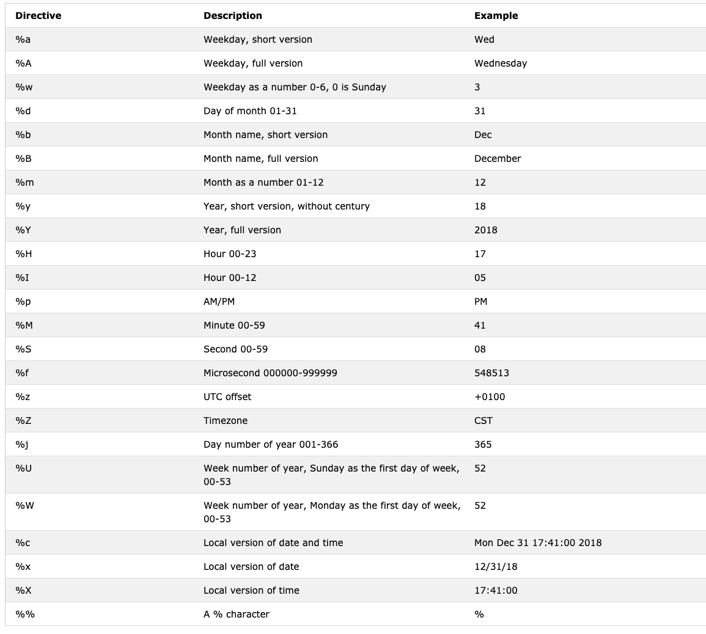

<div dir="rtl" lang="ur">

<div align="center">
  <h1>پائتھن کے 30 دن: دن 16 — تاریخ اور وقت</h1>
  <a href="https://www.linkedin.com/in/asabeneh/">
    
  </a>
  <a href="https://twitter.com/Asabeneh">
    
  </a>
  <p>مصنف: <a href="https://www.linkedin.com/in/asabeneh/">Asabeneh Yetayeh</a><br>دوسرا ایڈیشن: جولائی 2021</p>
</div>

[اصل انگریزی سبق](../16_Day_Python_date_time/16_python_datetime.md) | [تمام زبانیں](../readme.md)

[پچھلا دن: 15](./15_python_type_errors.md) | [فہرست](./readme.md) | [اگلا دن: 17](./17_exception_handling.md)


**اس سبق کی فہرست**

- [📘 دن 16](#day-16-section-1)
  - [پائتھن کا datetime ماڈیول](#day-16-section-2)
    - [تاریخ اور وقت کی معلومات حاصل کرنا](#day-16-section-3)
    - [strftime سے تاریخ کی صورت بنانا](#day-16-section-4)
    - [strptime سے متن کو وقت میں بدلنا](#day-16-section-5)
    - [datetime سے date استعمال کرنا](#day-16-section-6)
    - [وقت ظاہر کرنے والے آبجیکٹس](#day-16-section-7)
    - [دو تاریخوں یا اوقات کا فرق](#day-16-section-8)
    - [timedelta سے دورانیوں کا فرق](#day-16-section-9)
  - [💻 مشقیں — دن 16](#day-16-section-10)

<a id="day-16-section-1"></a>

# 📘 دن 16

<a id="day-16-section-2"></a>

## پائتھن کا datetime ماڈیول

تاریخ اور وقت کے لیے `datetime` ماڈیول موجود ہے۔

<div dir="ltr">

```py
import datetime
print(dir(datetime))
['MAXYEAR', 'MINYEAR', '__builtins__', '__cached__', '__doc__', '__file__', '__loader__', '__name__', '__package__', '__spec__', 'date', 'datetime', 'datetime_CAPI', 'sys', 'time', 'timedelta', 'timezone', 'tzinfo']
```

</div>

`dir()` اور `help()` سے ماڈیول کے دستیاب نام دیکھ سکتے ہیں۔ یہاں `date`، `datetime`، `time` اور `timedelta` پر توجہ دیں گے۔

<a id="day-16-section-3"></a>

### تاریخ اور وقت کی معلومات حاصل کرنا

<div dir="ltr">

```py
from datetime import datetime
now = datetime.now()
print(now)                      # 2021-07-08 07:34:46.549883
day = now.day                   # 8
month = now.month               # 7
year = now.year                 # 2021
hour = now.hour                 # 7
minute = now.minute             # 38
second = now.second
timestamp = now.timestamp()
print(day, month, year, hour, minute)
print('timestamp', timestamp)
print(f'{day}/{month}/{year}, {hour}:{minute}')  # 8/7/2021, 7:38
```

</div>

یونکس ٹائم اسٹیمپ، یکم جنوری 1970، UTC سے گزرنے والے سیکنڈز کی تعداد ہے۔

<a id="day-16-section-4"></a>

### strftime سے تاریخ کی صورت بنانا

<div dir="ltr">

```py
from datetime import datetime
new_year = datetime(2020, 1, 1)
print(new_year)      # 2020-01-01 00:00:00
day = new_year.day
month = new_year.month
year = new_year.year
hour = new_year.hour
minute = new_year.minute
second = new_year.second
print(day, month, year, hour, minute) #1 1 2020 0 0
print(f'{day}/{month}/{year}, {hour}:{minute}')  # 1/1/2020, 0:0

```

</div>

`strftime()` سے تاریخ اور وقت کو متن میں فارمیٹ کریں۔ علامات کی تفصیل [یہاں](https://strftime.org/) ہے۔

<div dir="ltr">

```py
from datetime import datetime
# current date and time
now = datetime.now()
t = now.strftime("%H:%M:%S")
print("time:", t)           # time: 18:21:40
time_one = now.strftime("%m/%d/%Y, %H:%M:%S")
# mm/dd/YY H:M:S format
print("time one:", time_one)        # time one: 06/28/2022, 18:21:40
time_two = now.strftime("%d/%m/%Y, %H:%M:%S")
# dd/mm/YY H:M:S format
print("time two:", time_two)        # time two: 28/06/2022, 18:21:40
```

</div>

<div dir="ltr">

```sh
time: 01:05:01
time one: 12/05/2019, 01:05:01
time two: 05/12/2019, 01:05:01
```

</div>

وقت کی فارمیٹنگ کی علامات اور مثالیں:



<a id="day-16-section-5"></a>

### strptime سے متن کو وقت میں بدلنا

فارمیٹ سمجھنے کے لیے یہ [دستاویز](https://www.programiz.com/python-programming/datetime/strptime) دیکھیں۔

<div dir="ltr">

```py
from datetime import datetime
date_string = "5 December, 2019"
print("date_string =", date_string)     # date_string = 5 December, 2019
date_object = datetime.strptime(date_string, "%d %B, %Y")
print("date_object =", date_object)     # date_object = 2019-12-05 00:00:00
```

</div>

<div dir="ltr">

```sh
date_string = 5 December, 2019
date_object = 2019-12-05 00:00:00
```

</div>

<a id="day-16-section-6"></a>

### datetime سے date استعمال کرنا

<div dir="ltr">

```py
from datetime import date
d = date(2020, 1, 1)
print(d)        # 2020-01-01
print('Current date:', d.today())    # 2019-12-05
# date object of today's date
today = date.today()
print("Current year:", today.year)   # 2019
print("Current month:", today.month) # 12
print("Current day:", today.day)     # 5
```

</div>

<a id="day-16-section-7"></a>

### وقت ظاہر کرنے والے آبجیکٹس

<div dir="ltr">

```py
from datetime import time
# time(hour = 0, minute = 0, second = 0)
a = time()
print("a =", a)     # a = 00:00:00
# time(hour, minute and second)
b = time(10, 30, 50)
print("b =", b)     # b = 10:30:50
# time(hour, minute and second)
c = time(hour=10, minute=30, second=50)
print("c =", c)     # c = 10:30:50
# time(hour, minute, second, microsecond)
d = time(10, 30, 50, 200555)
print("d =", d)     # d = 10:30:50.200555
```

</div>

نتیجہ:

- `a = 00:00:00`
- `b = 10:30:50`
- `c = 10:30:50`
- `d = 10:30:50.200555`

<a id="day-16-section-8"></a>

### دو تاریخوں یا اوقات کا فرق

<div dir="ltr">

```py
from datetime import date, datetime
today = date(year=2019, month=12, day=5)
new_year = date(year=2020, month=1, day=1)
time_left_for_newyear = new_year - today
# Time left for new year:  27 days, 0:00:00
print('Time left for new year: ', time_left_for_newyear)  # Time left for new year:  27 days, 0:00:00

t1 = datetime(year = 2019, month = 12, day = 5, hour = 0, minute = 59, second = 0)
t2 = datetime(year = 2020, month = 1, day = 1, hour = 0, minute = 0, second = 0)
diff = t2 - t1
print('Time left for new year:', diff) # Time left for new year: 26 days, 23: 01: 00
```

</div>

<a id="day-16-section-9"></a>

### timedelta سے دورانیوں کا فرق

<div dir="ltr">

```py
from datetime import timedelta
t1 = timedelta(weeks=12, days=10, hours=4, seconds=20)
t2 = timedelta(days=7, hours=5, minutes=3, seconds=30)
t3 = t1 - t2
print("t3 =", t3)
```

</div>

<div dir="ltr">

```sh
    date_string = 5 December, 2019
    date_object = 2019-12-05 00:00:00
    t3 = 86 days, 22:56:50
```

</div>

🌕 آپ نے سولہویں دن کا چیلنج مکمل کر لیا! اب مشق کریں۔

<a id="day-16-section-10"></a>

## 💻 مشقیں — دن 16

1. `datetime` سے موجودہ دن، مہینہ، سال، گھنٹہ، منٹ اور ٹائم اسٹیمپ حاصل کریں۔
2. موجودہ تاریخ کو `"%m/%d/%Y, %H:%M:%S"` میں فارمیٹ کریں۔
3. فرض کریں تاریخ 5 دسمبر 2019 ہے۔ اس تاریخ کی سٹرنگ کو تاریخ/وقت میں بدلیں۔
4. ابھی سے نئے سال تک کا فرق معلوم کریں۔
5. یکم جنوری 1970 سے اب تک کا فرق معلوم کریں۔
6. `datetime` کے استعمال سوچیں، مثلاً:
   - وقت کے ساتھ بدلتے ڈیٹا کا تجزیہ۔
   - ایپلی کیشن میں سرگرمیوں کے ٹائم اسٹیمپ۔
   - بلاگ پوسٹ کی تاریخ محفوظ کرنا۔

🎉 مبارک ہو! 🎉

---

[پچھلا دن: 15](./15_python_type_errors.md) | [فہرست](./readme.md) | [اگلا دن: 17](./17_exception_handling.md)

</div>
