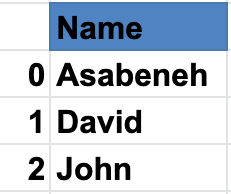
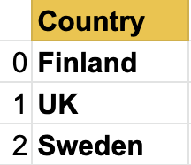
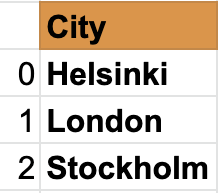
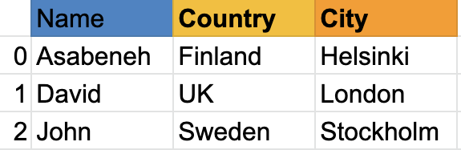
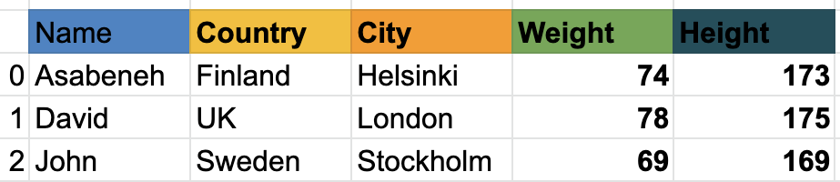

<div dir="rtl" lang="ur">

<div align="center">
  <h1>پائتھن کے 30 دن: دن 25 — Pandas</h1>
  <a href="https://www.linkedin.com/in/asabeneh/">
    
  </a>
  <a href="https://twitter.com/Asabeneh">
    
  </a>
  <p>مصنف: <a href="https://www.linkedin.com/in/asabeneh/">Asabeneh Yetayeh</a><br>دوسرا ایڈیشن: جولائی 2021</p>
</div>

[اصل انگریزی سبق](../25_Day_Pandas/25_pandas.md) | [تمام زبانیں](../readme.md)

[پچھلا دن: 24](./24_statistics.md) | [فہرست](./readme.md) | [اگلا دن: 26](./26_python_web.md)


**اس سبق کی فہرست**

- [📘 دن 25](#day-25-section-1)
  - [Pandas](#day-25-section-2)
    - [Pandas انسٹال کرنا](#day-25-section-3)
    - [Pandas امپورٹ کرنا](#day-25-section-4)
    - [طے شدہ انڈیکس کے ساتھ Series](#day-25-section-5)
    - [اپنی پسند کے انڈیکس کے ساتھ Series](#day-25-section-6)
    - [ڈکشنری سے Series بنانا](#day-25-section-7)
    - [مستقل قدر والی Series](#day-25-section-8)
    - [linspace سے Series بنانا](#day-25-section-9)
  - [DataFrames](#day-25-section-10)
    - [لسٹوں کی لسٹ سے DataFrame](#day-25-section-11)
    - [ڈکشنری سے DataFrame](#day-25-section-12)
    - [ڈکشنریز کی لسٹ سے DataFrame](#day-25-section-13)
  - [Pandas سے CSV پڑھنا](#day-25-section-14)
    - [ڈیٹا کا ابتدائی جائزہ](#day-25-section-15)
  - [DataFrame میں تبدیلی](#day-25-section-16)
    - [DataFrame بنانا](#day-25-section-17)
    - [نیا کالم شامل کرنا](#day-25-section-18)
    - [کالم کی قدریں بدلنا](#day-25-section-19)
    - [کالموں کی فارمیٹنگ](#day-25-section-20)
  - [کالموں کی ڈیٹا اقسام جانچنا](#day-25-section-21)
    - [بولین انڈیکسنگ](#day-25-section-22)
  - [مشقیں — دن 25](#day-25-section-23)

<a id="day-25-section-1"></a>

# 📘 دن 25

<a id="day-25-section-2"></a>

## Pandas

Pandas پائتھن کی اوپن سورس لائبریری ہے جو تیز اور آسان ڈیٹا ساختیں اور تجزیے کے اوزار دیتی ہے۔ جدول جیسے ڈیٹا کے لیے اس کی بنیادی ساختیں *Series* اور *DataFrame* ہیں۔ اس سے یہ کام کیے جا سکتے ہیں:

- ساخت بدلنا۔
- ڈیٹا ملانا۔
- ترتیب دینا۔
- حصے نکالنا۔
- مجموعی اعداد نکالنا۔
- غائب قدریں پُر کرنا۔

Anaconda کی مکمل تقسیم میں Pandas عموماً پہلے سے شامل ہوتا ہے۔

<a id="day-25-section-3"></a>

### Pandas انسٹال کرنا

Mac کے لیے:

<div dir="ltr">

```py
pip install conda
conda install pandas
```

</div>

ونڈوز کے لیے:

<div dir="ltr">

```py
pip install conda
pip install pandas
```

</div>

Pandas کی بنیاد Series اور DataFrames پر ہے۔ Series ایک جہت کا، لیبل والا ڈیٹا ہے جسے کالم کی طرح سمجھ سکتے ہیں۔ DataFrame کئی Series سے بنی دو جہتی جدول ہے۔ Series بنانے کے لیے ایک جہت کا NumPy array یا پائتھن لسٹ استعمال کر سکتے ہیں۔

ناموں کی Series:



ملکوں کی Series:



شہروں کی Series:



Series ایک کالم ظاہر کرتی ہے۔ کئی کالموں کے لیے DataFrame استعمال کریں۔ مثال:



DataFrame قطاروں اور کالموں کا مجموعہ ہے۔ اگلی مثال میں مزید کالم ہیں۔



اب Pandas امپورٹ کرنا اور Series اور DataFrames بنانا دیکھیں گے۔

<a id="day-25-section-4"></a>

### Pandas امپورٹ کرنا

<div dir="ltr">

```python
import pandas as pd # importing pandas as pd
import numpy  as np # importing numpy as np
```

</div>

<a id="day-25-section-5"></a>

### طے شدہ انڈیکس کے ساتھ Series

<div dir="ltr">

```python
nums = [1, 2, 3, 4,5]
s = pd.Series(nums)
print(s)
```

</div>

<div dir="ltr">

```sh
    0    1
    1    2
    2    3
    3    4
    4    5
    dtype: int64
```

</div>

<a id="day-25-section-6"></a>

### اپنی پسند کے انڈیکس کے ساتھ Series

<div dir="ltr">

```python
nums = [1, 2, 3, 4, 5]
s = pd.Series(nums, index=[1, 2, 3, 4, 5])
print(s)
```

</div>

<div dir="ltr">

```sh
    1    1
    2    2
    3    3
    4    4
    5    5
    dtype: int64
```

</div>

<div dir="ltr">

```python
fruits = ['Orange','Banana','Mango']
fruits = pd.Series(fruits, index=[1, 2, 3])
print(fruits)
```

</div>

<div dir="ltr">

```sh
    1    Orange
    2    Banana
    3    Mango
    dtype: object
```

</div>

<a id="day-25-section-7"></a>

### ڈکشنری سے Series بنانا

<div dir="ltr">

```python
dct = {'name':'Asabeneh','country':'Finland','city':'Helsinki'}
```

</div>

<div dir="ltr">

```python
s = pd.Series(dct)
print(s)
```

</div>

<div dir="ltr">

```sh
    name       Asabeneh
    country     Finland
    city       Helsinki
    dtype: object
```

</div>

<a id="day-25-section-8"></a>

### مستقل قدر والی Series

<div dir="ltr">

```python
s = pd.Series(10, index = [1, 2, 3])
print(s)
```

</div>

<div dir="ltr">

```sh
    1    10
    2    10
    3    10
    dtype: int64
```

</div>

<a id="day-25-section-9"></a>

### linspace سے Series بنانا

<div dir="ltr">

```python
s = pd.Series(np.linspace(5, 20, 10)) # linspace(starting, end, items)
print(s)
```

</div>

<div dir="ltr">

```sh
    0     5.000000
    1     6.666667
    2     8.333333
    3    10.000000
    4    11.666667
    5    13.333333
    6    15.000000
    7    16.666667
    8    18.333333
    9    20.000000
    dtype: float64
```

</div>

<a id="day-25-section-10"></a>

## DataFrames

DataFrame کئی طریقوں سے بنایا جا سکتا ہے۔

<a id="day-25-section-11"></a>

### لسٹوں کی لسٹ سے DataFrame

<div dir="ltr">

```python
data = [
    ['Asabeneh', 'Finland', 'Helsink'],
    ['David', 'UK', 'London'],
    ['John', 'Sweden', 'Stockholm']
]
df = pd.DataFrame(data, columns=['Names','Country','City'])
print(df)
```

</div>

<div dir="ltr">

<table border="1" class="dataframe">
  <thead>
    <tr style="text-align: right;">
      <th></th>
      <th>Names</th>
      <th>Country</th>
      <th>City</th>
    </tr>
  </thead>
  <tbody>
    <tr>
      <td>0</td>
      <td>Asabeneh</td>
      <td>Finland</td>
      <td>Helsink</td>
    </tr>
    <tr>
      <td>1</td>
      <td>David</td>
      <td>UK</td>
      <td>London</td>
    </tr>
    <tr>
      <td>2</td>
      <td>John</td>
      <td>Sweden</td>
      <td>Stockholm</td>
    </tr>
  </tbody>
</table>

</div>

<a id="day-25-section-12"></a>

### ڈکشنری سے DataFrame

<div dir="ltr">

```python
data = {'Name': ['Asabeneh', 'David', 'John'], 'Country':[
    'Finland', 'UK', 'Sweden'], 'City': ['Helsiki', 'London', 'Stockholm']}
df = pd.DataFrame(data)
print(df)
```

</div>

<div dir="ltr">

<table border="1" class="dataframe">
  <thead>
    <tr style="text-align: right;">
      <th></th>
      <th>Name</th>
      <th>Country</th>
      <th>City</th>
    </tr>
  </thead>
  <tbody>
    <tr>
      <td>0</td>
      <td>Asabeneh</td>
      <td>Finland</td>
      <td>Helsiki</td>
    </tr>
    <tr>
      <td>1</td>
      <td>David</td>
      <td>UK</td>
      <td>London</td>
    </tr>
    <tr>
      <td>2</td>
      <td>John</td>
      <td>Sweden</td>
      <td>Stockholm</td>
    </tr>
  </tbody>
</table>

</div>

<a id="day-25-section-13"></a>

### ڈکشنریز کی لسٹ سے DataFrame

<div dir="ltr">

```python
data = [
    {'Name': 'Asabeneh', 'Country': 'Finland', 'City': 'Helsinki'},
    {'Name': 'David', 'Country': 'UK', 'City': 'London'},
    {'Name': 'John', 'Country': 'Sweden', 'City': 'Stockholm'}]
df = pd.DataFrame(data)
print(df)
```

</div>

<div dir="ltr">

<table border="1" class="dataframe">
  <thead>
    <tr style="text-align: right;">
      <th></th>
      <th>Name</th>
      <th>Country</th>
      <th>City</th>
    </tr>
  </thead>
  <tbody>
    <tr>
      <td>0</td>
      <td>Asabeneh</td>
      <td>Finland</td>
      <td>Helsinki</td>
    </tr>
    <tr>
      <td>1</td>
      <td>David</td>
      <td>UK</td>
      <td>London</td>
    </tr>
    <tr>
      <td>2</td>
      <td>John</td>
      <td>Sweden</td>
      <td>Stockholm</td>
    </tr>
  </tbody>
</table>

</div>

<a id="day-25-section-14"></a>

## Pandas سے CSV پڑھنا

مثال کی CSV فائل کمانڈ لائن سے ڈاؤن لوڈ کی جا سکتی ہے۔

<div dir="ltr">

```sh
curl -O https://raw.githubusercontent.com/Asabeneh/30-Days-Of-Python/master/data/weight-height.csv
```

</div>

فائل موجودہ کام والے فولڈر میں رکھیں۔

<div dir="ltr">

```python
import pandas as pd

df = pd.read_csv('weight-height.csv')
print(df)
```

</div>

<a id="day-25-section-15"></a>

### ڈیٹا کا ابتدائی جائزہ

`head()` سے پہلی پانچ قطاریں دیکھیں۔

<div dir="ltr">

```python
print(df.head()) # give five rows we can increase the number of rows by passing argument to the head() method
```

</div>

<div dir="ltr">

<table border="1" class="dataframe">
  <thead>
    <tr style="text-align: right;">
      <th></th>
      <th>Gender</th>
      <th>Height</th>
      <th>Weight</th>
    </tr>
  </thead>
  <tbody>
    <tr>
      <td>0</td>
      <td>Male</td>
      <td>73.847017</td>
      <td>241.893563</td>
    </tr>
    <tr>
      <td>1</td>
      <td>Male</td>
      <td>68.781904</td>
      <td>162.310473</td>
    </tr>
    <tr>
      <td>2</td>
      <td>Male</td>
      <td>74.110105</td>
      <td>212.740856</td>
    </tr>
    <tr>
      <td>3</td>
      <td>Male</td>
      <td>71.730978</td>
      <td>220.042470</td>
    </tr>
    <tr>
      <td>4</td>
      <td>Male</td>
      <td>69.881796</td>
      <td>206.349801</td>
    </tr>
  </tbody>
</table>

</div>

`tail()` سے آخری قطاریں دیکھیں۔

<div dir="ltr">

```python
print(df.tail()) # tails give the last five rows, we can increase the rows by passing argument to tail method
```

</div>

<div dir="ltr">

<table border="1" class="dataframe">
  <thead>
    <tr style="text-align: right;">
      <th></th>
      <th>Gender</th>
      <th>Height</th>
      <th>Weight</th>
    </tr>
  </thead>
  <tbody>
    <tr>
      <td>9995</td>
      <td>Female</td>
      <td>66.172652</td>
      <td>136.777454</td>
    </tr>
    <tr>
      <td>9996</td>
      <td>Female</td>
      <td>67.067155</td>
      <td>170.867906</td>
    </tr>
    <tr>
      <td>9997</td>
      <td>Female</td>
      <td>63.867992</td>
      <td>128.475319</td>
    </tr>
    <tr>
      <td>9998</td>
      <td>Female</td>
      <td>69.034243</td>
      <td>163.852461</td>
    </tr>
    <tr>
      <td>9999</td>
      <td>Female</td>
      <td>61.944246</td>
      <td>113.649103</td>
    </tr>
  </tbody>
</table>

</div>

فائل میں تین کالم ہیں: `Gender`، `Height` اور `Weight`۔ بڑی جدول میں تمام کالم اور قطاروں کی تعداد ایک نظر میں معلوم نہیں ہوتی۔ `shape` استعمال کریں۔

<div dir="ltr">

```python
print(df.shape) # as you can see 10000 rows and three columns
```

</div>

<div dir="ltr">

```text
(10000, 3)
```

</div>

`columns` سے تمام کالموں کے نام لیں۔

<div dir="ltr">

```python
print(df.columns)
```

</div>

<div dir="ltr">

```text
Index(['Gender', 'Height', 'Weight'], dtype='object')
```

</div>

کالم کے نام سے مخصوص کالم حاصل کریں۔

<div dir="ltr">

```python
heights = df['Height'] # this is now a series
```

</div>

<div dir="ltr">

```python
print(heights)
```

</div>

<div dir="ltr">

```sh
    0       73.847017
    1       68.781904
    2       74.110105
    3       71.730978
    4       69.881796
              ...
    9995    66.172652
    9996    67.067155
    9997    63.867992
    9998    69.034243
    9999    61.944246
    Name: Height, Length: 10000, dtype: float64
```

</div>

<div dir="ltr">

```python
weights = df['Weight'] # this is now a series
```

</div>

<div dir="ltr">

```python
print(weights)
```

</div>

<div dir="ltr">

```sh
    0       241.893563
    1       162.310473
    2       212.740856
    3       220.042470
    4       206.349801
               ...
    9995    136.777454
    9996    170.867906
    9997    128.475319
    9998    163.852461
    9999    113.649103
    Name: Weight, Length: 10000, dtype: float64
```

</div>

<div dir="ltr">

```python
print(len(heights) == len(weights))
```

</div>

<div dir="ltr">

```text
True
```

</div>

`describe()` ڈیٹا کے خلاصہ شماریاتی اعداد دیتا ہے۔

<div dir="ltr">

```python
print(heights.describe()) # give statistical information about height data
```

</div>

<div dir="ltr">

```sh
    count    10000.000000
    mean        66.367560
    std          3.847528
    min         54.263133
    25%         63.505620
    50%         66.318070
    75%         69.174262
    max         78.998742
    Name: Height, dtype: float64
```

</div>

<div dir="ltr">

```python
print(weights.describe())
```

</div>

<div dir="ltr">

```sh
    count    10000.000000
    mean       161.440357
    std         32.108439
    min         64.700127
    25%        135.818051
    50%        161.212928
    75%        187.169525
    max        269.989699
    Name: Weight, dtype: float64
```

</div>

<div dir="ltr">

```python
print(df.describe())  # describe can also give statistical information from a dataFrame
```

</div>

<div dir="ltr">

<table border="1" class="dataframe">
  <thead>
    <tr style="text-align: right;">
      <th></th>
      <th>Height</th>
      <th>Weight</th>
    </tr>
  </thead>
  <tbody>
    <tr>
      <td>count</td>
      <td>10000.000000</td>
      <td>10000.000000</td>
    </tr>
    <tr>
      <td>mean</td>
      <td>66.367560</td>
      <td>161.440357</td>
    </tr>
    <tr>
      <td>std</td>
      <td>3.847528</td>
      <td>32.108439</td>
    </tr>
    <tr>
      <td>min</td>
      <td>54.263133</td>
      <td>64.700127</td>
    </tr>
    <tr>
      <td>25%</td>
      <td>63.505620</td>
      <td>135.818051</td>
    </tr>
    <tr>
      <td>50%</td>
      <td>66.318070</td>
      <td>161.212928</td>
    </tr>
    <tr>
      <td>75%</td>
      <td>69.174262</td>
      <td>187.169525</td>
    </tr>
    <tr>
      <td>max</td>
      <td>78.998742</td>
      <td>269.989699</td>
    </tr>
  </tbody>
</table>

</div>

`info()` بھی ڈیٹا سیٹ کی ساخت کے بارے میں معلومات دیتا ہے۔

<a id="day-25-section-16"></a>

## DataFrame میں تبدیلی

ہم یہ کام کر سکتے ہیں:

- نیا DataFrame بنانا۔
- نیا کالم شامل کرنا۔
- موجودہ کالم ہٹانا۔
- کالم کی قدریں بدلنا۔
- کالم کی ڈیٹا قسم بدلنا۔

<a id="day-25-section-17"></a>

### DataFrame بنانا

پہلے ضروری پیکیجز، Pandas اور NumPy، امپورٹ کریں۔

<div dir="ltr">

```python
import pandas as pd
import numpy as np
data = [
    {"Name": "Asabeneh", "Country":"Finland","City":"Helsinki"},
    {"Name": "David", "Country":"UK","City":"London"},
    {"Name": "John", "Country":"Sweden","City":"Stockholm"}]
df = pd.DataFrame(data)
print(df)
```

</div>

<div dir="ltr">

<table border="1" class="dataframe">
  <thead>
    <tr style="text-align: right;">
      <th></th>
      <th>Name</th>
      <th>Country</th>
      <th>City</th>
    </tr>
  </thead>
  <tbody>
    <tr>
      <td>0</td>
      <td>Asabeneh</td>
      <td>Finland</td>
      <td>Helsinki</td>
    </tr>
    <tr>
      <td>1</td>
      <td>David</td>
      <td>UK</td>
      <td>London</td>
    </tr>
    <tr>
      <td>2</td>
      <td>John</td>
      <td>Sweden</td>
      <td>Stockholm</td>
    </tr>
  </tbody>
</table>

</div>

کالم شامل کرنا ڈکشنری میں کلید شامل کرنے جیسا ہے۔ پچھلی مثال سے DataFrame بنائیں، پھر کالم اور قدریں بدلیں۔

<a id="day-25-section-18"></a>

### نیا کالم شامل کرنا

وزن کا کالم شامل کریں۔

<div dir="ltr">

```python
weights = [74, 78, 69]
df['Weight'] = weights
df
```

</div>

<div dir="ltr">

<table border="1" class="dataframe">
  <thead>
    <tr style="text-align: right;">
      <th></th>
      <th>Name</th>
      <th>Country</th>
      <th>City</th>
      <th>Weight</th>
    </tr>
  </thead>
  <tbody>
    <tr>
      <td>0</td>
      <td>Asabeneh</td>
      <td>Finland</td>
      <td>Helsinki</td>
      <td>74</td>
    </tr>
    <tr>
      <td>1</td>
      <td>David</td>
      <td>UK</td>
      <td>London</td>
      <td>78</td>
    </tr>
    <tr>
      <td>2</td>
      <td>John</td>
      <td>Sweden</td>
      <td>Stockholm</td>
      <td>69</td>
    </tr>
  </tbody>
</table>

</div>

اب قد کا کالم شامل کریں۔

<div dir="ltr">

```python
heights = [173, 175, 169]
df['Height'] = heights
print(df)
```

</div>

<div dir="ltr">

<table border="1" class="dataframe">
  <thead>
    <tr style="text-align: right;">
      <th></th>
      <th>Name</th>
      <th>Country</th>
      <th>City</th>
      <th>Weight</th>
      <th>Height</th>
    </tr>
  </thead>
  <tbody>
    <tr>
      <td>0</td>
      <td>Asabeneh</td>
      <td>Finland</td>
      <td>Helsinki</td>
      <td>74</td>
      <td>173</td>
    </tr>
    <tr>
      <td>1</td>
      <td>David</td>
      <td>UK</td>
      <td>London</td>
      <td>78</td>
      <td>175</td>
    </tr>
    <tr>
      <td>2</td>
      <td>John</td>
      <td>Sweden</td>
      <td>Stockholm</td>
      <td>69</td>
      <td>169</td>
    </tr>
  </tbody>
</table>

</div>

`Weight` اور `Height` شامل ہو گئے۔ اب ان سے BMI کا کالم بنائیں۔ حساب `Weight / (Height * Height)` ہے، جہاں وزن کلوگرام اور قد میٹر میں ہو۔ یہ یہاں ڈیٹا پر حساب کی مثال ہے۔

قد سینٹی میٹر میں ہے؛ پہلے میٹر میں بدلیں۔

<a id="day-25-section-19"></a>

### کالم کی قدریں بدلنا

<div dir="ltr">

```python
df['Height'] = df['Height'] * 0.01
df
```

</div>

<div dir="ltr">

<table border="1" class="dataframe">
  <thead>
    <tr style="text-align: right;">
      <th></th>
      <th>Name</th>
      <th>Country</th>
      <th>City</th>
      <th>Weight</th>
      <th>Height</th>
    </tr>
  </thead>
  <tbody>
    <tr>
      <td>0</td>
      <td>Asabeneh</td>
      <td>Finland</td>
      <td>Helsinki</td>
      <td>74</td>
      <td>1.73</td>
    </tr>
    <tr>
      <td>1</td>
      <td>David</td>
      <td>UK</td>
      <td>London</td>
      <td>78</td>
      <td>1.75</td>
    </tr>
    <tr>
      <td>2</td>
      <td>John</td>
      <td>Sweden</td>
      <td>Stockholm</td>
      <td>69</td>
      <td>1.69</td>
    </tr>
  </tbody>
</table>

</div>

<div dir="ltr">

```python
# Using functions makes our code clean, but you can calculate the bmi without one
def calculate_bmi ():
    weights = df['Weight']
    heights = df['Height']
    bmi = []
    for w,h in zip(weights, heights):
        b = w/(h*h)
        bmi.append(b)
    return bmi

bmi = calculate_bmi()

```

</div>

<div dir="ltr">

```python
df['BMI'] = bmi
df
```

</div>

<div dir="ltr">

<table border="1" class="dataframe">
  <thead>
    <tr style="text-align: right;">
      <th></th>
      <th>Name</th>
      <th>Country</th>
      <th>City</th>
      <th>Weight</th>
      <th>Height</th>
      <th>BMI</th>
    </tr>
  </thead>
  <tbody>
    <tr>
      <td>0</td>
      <td>Asabeneh</td>
      <td>Finland</td>
      <td>Helsinki</td>
      <td>74</td>
      <td>1.73</td>
      <td>24.725183</td>
    </tr>
    <tr>
      <td>1</td>
      <td>David</td>
      <td>UK</td>
      <td>London</td>
      <td>78</td>
      <td>1.75</td>
      <td>25.469388</td>
    </tr>
    <tr>
      <td>2</td>
      <td>John</td>
      <td>Sweden</td>
      <td>Stockholm</td>
      <td>69</td>
      <td>1.69</td>
      <td>24.158818</td>
    </tr>
  </tbody>
</table>

</div>

<a id="day-25-section-20"></a>

### کالموں کی فارمیٹنگ

BMI کی قدروں میں اعشاری نقطے کے بعد کئی ہندسے ہیں۔ انہیں ایک ہندسے تک محدود کریں۔

<div dir="ltr">

```python
df['BMI'] = round(df['BMI'], 1)
print(df)
```

</div>

<div dir="ltr">

<table border="1" class="dataframe">
  <thead>
    <tr style="text-align: right;">
      <th></th>
      <th>Name</th>
      <th>Country</th>
      <th>City</th>
      <th>Weight</th>
      <th>Height</th>
      <th>BMI</th>
    </tr>
  </thead>
  <tbody>
    <tr>
      <td>0</td>
      <td>Asabeneh</td>
      <td>Finland</td>
      <td>Helsinki</td>
      <td>74</td>
      <td>1.73</td>
      <td>24.7</td>
    </tr>
    <tr>
      <td>1</td>
      <td>David</td>
      <td>UK</td>
      <td>London</td>
      <td>78</td>
      <td>1.75</td>
      <td>25.5</td>
    </tr>
    <tr>
      <td>2</td>
      <td>John</td>
      <td>Sweden</td>
      <td>Stockholm</td>
      <td>69</td>
      <td>1.69</td>
      <td>24.2</td>
    </tr>
  </tbody>
</table>

</div>

سالِ پیدائش اور موجودہ سال کے کالم بھی شامل کریں۔ مثال کے اصل سال برقرار رکھے گئے ہیں۔

<div dir="ltr">

```python
birth_year = ['1769', '1985', '1990']
current_year = pd.Series(2020, index=[0, 1,2])
df['Birth Year'] = birth_year
df['Current Year'] = current_year
df
```

</div>

<div dir="ltr">

<table border="1" class="dataframe">
  <thead>
    <tr style="text-align: right;">
      <th></th>
      <th>Name</th>
      <th>Country</th>
      <th>City</th>
      <th>Weight</th>
      <th>Height</th>
      <th>BMI</th>
      <th>Birth Year</th>
      <th>Current Year</th>
    </tr>
  </thead>
  <tbody>
    <tr>
      <td>0</td>
      <td>Asabeneh</td>
      <td>Finland</td>
      <td>Helsinki</td>
      <td>74</td>
      <td>1.73</td>
      <td>24.7</td>
      <td>1769</td>
      <td>2020</td>
    </tr>
    <tr>
      <td>1</td>
      <td>David</td>
      <td>UK</td>
      <td>London</td>
      <td>78</td>
      <td>1.75</td>
      <td>25.5</td>
      <td>1985</td>
      <td>2020</td>
    </tr>
    <tr>
      <td>2</td>
      <td>John</td>
      <td>Sweden</td>
      <td>Stockholm</td>
      <td>69</td>
      <td>1.69</td>
      <td>24.2</td>
      <td>1990</td>
      <td>2020</td>
    </tr>
  </tbody>
</table>

</div>

<a id="day-25-section-21"></a>

## کالموں کی ڈیٹا اقسام جانچنا

<div dir="ltr">

```python
print(df.Weight.dtype)
```

</div>

<div dir="ltr">

```sh
    dtype('int64')
```

</div>

<div dir="ltr">

```python
df['Birth Year'].dtype # it gives string object , we should change this to number

```

</div>

<div dir="ltr">

```python
df['Birth Year'] = df['Birth Year'].astype('int')
print(df['Birth Year'].dtype) # let's check the data type now
```

</div>

<div dir="ltr">

```sh
    dtype('int32')
```

</div>

موجودہ سال کے لیے بھی یہی کریں۔

<div dir="ltr">

```python
df['Current Year'] = df['Current Year'].astype('int')
df['Current Year'].dtype
```

</div>

<div dir="ltr">

```sh
    dtype('int32')
```

</div>

دونوں سال صحیح اعداد ہیں؛ اب عمر نکال سکتے ہیں۔

<div dir="ltr">

```python
ages = df['Current Year'] - df['Birth Year']
ages
```

</div>

<div dir="ltr">

```text
0    251
1     35
2     30
dtype: int32
```

</div>

<div dir="ltr">

```python
df['Ages'] = ages
print(df)
```

</div>

<div dir="ltr">

<table border="1" class="dataframe">
  <thead>
    <tr style="text-align: right;">
      <th></th>
      <th>Name</th>
      <th>Country</th>
      <th>City</th>
      <th>Weight</th>
      <th>Height</th>
      <th>BMI</th>
      <th>Birth Year</th>
      <th>Current Year</th>
      <th>Ages</th>
    </tr>
  </thead>
  <tbody>
    <tr>
      <td>0</td>
      <td>Asabeneh</td>
      <td>Finland</td>
      <td>Helsinki</td>
      <td>74</td>
      <td>1.73</td>
      <td>24.7</td>
      <td>1769</td>
      <td>2019</td>
      <td>250</td>
    </tr>
    <tr>
      <td>1</td>
      <td>David</td>
      <td>UK</td>
      <td>London</td>
      <td>78</td>
      <td>1.75</td>
      <td>25.5</td>
      <td>1985</td>
      <td>2019</td>
      <td>34</td>
    </tr>
    <tr>
      <td>2</td>
      <td>John</td>
      <td>Sweden</td>
      <td>Stockholm</td>
      <td>69</td>
      <td>1.69</td>
      <td>24.2</td>
      <td>1990</td>
      <td>2019</td>
      <td>29</td>
    </tr>
  </tbody>
</table>

</div>

پہلی قطار میں عمر 251 سال آ رہی ہے، جو نامعقول معلوم ہوتی ہے۔ ڈیٹا میں غلطی یا فرضی قدر ہو سکتی ہے۔ اس مثال میں غیر معمولی قدر کو باقی عمروں کے اوسط سے بدل کر دکھایا گیا ہے: `mean = (35 + 30) / 2`۔ اصل محفوظ جدولوں میں 2019 اور 2020 دونوں سال ہیں؛ اسی لیے بعض دکھائی گئی عمریں ایک سال مختلف ہیں۔

<div dir="ltr">

```python
mean = (35 + 30)/ 2
print('Mean: ',mean)	#it is good to add some description to the output, so we know what is what
```

</div>

<div dir="ltr">

```sh
   Mean:  32.5
```

</div>

<a id="day-25-section-22"></a>

### بولین انڈیکسنگ

<div dir="ltr">

```python
print(df[df['Ages'] > 120])
```

</div>

<div dir="ltr">

<table border="1" class="dataframe">
  <thead>
    <tr style="text-align: right;">
      <th></th>
      <th>Name</th>
      <th>Country</th>
      <th>City</th>
      <th>Weight</th>
      <th>Height</th>
      <th>BMI</th>
      <th>Birth Year</th>
      <th>Current Year</th>
      <th>Ages</th>
    </tr>
  </thead>
  <tbody>
    <tr>
      <td>0</td>
      <td>Asabeneh</td>
      <td>Finland</td>
      <td>Helsinki</td>
      <td>74</td>
      <td>1.73</td>
      <td>24.7</td>
      <td>1769</td>
      <td>2020</td>
      <td>251</td>
    </tr>
  </tbody>
</table>

</div>

<div dir="ltr">

```python
print(df[df['Ages'] < 120])
```

</div>

<div dir="ltr">

<table border="1" class="dataframe">
  <thead>
    <tr style="text-align: right;">
      <th></th>
      <th>Name</th>
      <th>Country</th>
      <th>City</th>
      <th>Weight</th>
      <th>Height</th>
      <th>BMI</th>
      <th>Birth Year</th>
      <th>Current Year</th>
      <th>Ages</th>
    </tr>
  </thead>
  <tbody>
    <tr>
      <td>1</td>
      <td>David</td>
      <td>UK</td>
      <td>London</td>
      <td>78</td>
      <td>1.75</td>
      <td>25.5</td>
      <td>1985</td>
      <td>2020</td>
      <td>35</td>
    </tr>
    <tr>
      <td>2</td>
      <td>John</td>
      <td>Sweden</td>
      <td>Stockholm</td>
      <td>69</td>
      <td>1.69</td>
      <td>24.2</td>
      <td>1990</td>
      <td>2020</td>
      <td>30</td>
    </tr>
  </tbody>
</table>

</div>

<a id="day-25-section-23"></a>

## مشقیں — دن 25

1. ڈیٹا فولڈر سے `hacker_news.csv` پڑھیں۔
2. پہلی پانچ قطاریں حاصل کریں۔
3. آخری پانچ قطاریں حاصل کریں۔
4. عنوان والا کالم Pandas Series کی صورت میں لیں۔
5. قطاروں اور کالموں کی تعداد گنیں۔
   - `python` والے عنوان چھانٹیں۔
   - `JavaScript` والے عنوان چھانٹیں۔
   - ڈیٹا کا جائزہ لے کر اسے سمجھیں۔

🎉 مبارک ہو! 🎉

---

[پچھلا دن: 24](./24_statistics.md) | [فہرست](./readme.md) | [اگلا دن: 26](./26_python_web.md)

</div>
